<!-- 原PDF 1 / 47 ページ -->

# 第1章 はじめに

## 1.1 研究背景

リアルタイム 3D コンテンツにおける髪は、キャラクタの外観だけでなく、運動時の印象、接触表現、編集自由度を左右する重要な要素である。本研究の対象システムでは、正式評価用アセットとして表示ストランド数 100,000 本、Guide 4,000 本、Follower 96,000 本、Guide当たり 128 粒子を使用している。表示上の本数を増やすだけでなく、Guide 上の粒子状態、Follower 再構成、衝突、編集、描画までを毎フレーム整合させる必要があるため、髪処理は単一の物理計算ではなく、複数段階からなる実行時処理問題として扱う必要がある。本研究では、Guide/Follower 構成を前提として、物理計算の対象を必要な範囲に限定し、静的な部分の再利用、局所的な修復処理、GPU 側での処理継続、内部状態表現の縮小を組み合わせることで、リアルタイム髪処理の負荷を抑えることを目標とした。正式実験では、1920×1080、垂直同期無効、固定時間刻み 1/60 秒、ソルバ反復回数 6 回という条件で100,000 本を描画し、フレーム時間、GPU 髪処理時間、プロセスメモリ使用量、DXGI ローカルメモリ使用量、正解データに対する誤判定、NaN/Inf/致命的な障害などを記録している。

## 1.2 髪シミュレーションにおける問題

髪シミュレーションの難しさの一つは、画面上に表示されるストランド数と、物理シミュレーションにおける自由度が必ずしも一致しない点にある。本研究で使用する正式アセットでは、4,000 本の Guide に対して各 24 本の Follower を割り当てることで、Guide を含めて合計 100,000 本の表示ストランドを構成している。各 Guide は 128 個の Particle によって構成されるため、Guide のみでも総 Particle 数は512,000 個となる。また、1 本の Guide におけるセグメントは隣接する 2 個の Particle 間に形成されるため、Particle 数が (𝑵𝐩𝐚𝐫𝐭𝐢𝐜𝐥𝐞 ) 個の場合、1 本の Guide に含まれるセグメント数は (𝑵𝐩𝐚𝐫𝐭𝐢𝐜𝐥𝐞 − 𝟏) 個となる。したがって、Guide 全体に含まれるセグメントグループの総数(𝑵𝐬𝐞𝐠 )は、Guide 数を(𝑵𝐠𝐮𝐢𝐝𝐞 )、1 本の Guide を構成する Particle 数を(𝑵𝐩𝐚𝐫𝐭𝐢𝐜𝐥𝐞 ) とすると、次式で表される。𝑵𝐠𝐮𝐢𝐝𝐞 (𝑵𝐩𝐚𝐫𝐭𝐢𝐜𝐥𝐞 − 𝟏)本研究で使用する正式アセットでは、𝑵𝐠𝐮𝐢𝐝𝐞 = 𝟒𝟎𝟎𝟎、𝑵𝐩𝐚𝐫𝐭𝐢𝐜𝐥𝐞 = 𝟏𝟐𝟖であるため、𝑵𝐬𝐞𝐠 = 𝑵𝐠𝐮𝐢𝐝𝐞 (𝑵𝐩𝐚𝐫𝐭𝐢𝐜𝐥𝐞 − 𝟏) = 𝟒𝟎𝟎𝟎 × (𝟏𝟐𝟖 − 𝟏) = 𝟒𝟎𝟎𝟎 × 𝟏𝟐𝟕 = 𝟓𝟎𝟖𝟎𝟎𝟎となる。この値は、正式評価用 Telemetry に記録された 508,000 セグメントグループと一致する。したがって、508,000 個すべてのセグメントグループを毎フレーム一律に高負荷な処理経路で更新した場合、状態分類や計算結果の再利用を導入することによる性能上の利点が失われる。一方で、単純に処理を省略すると、実際には動いている髪を静的状態状態として扱う静的誤判定、衝突判定の見逃し、編集結果の反映遅延、位置誤差などの品質上の問題が生じ

<!-- 原PDF 2 / 47 ページ -->

る可能性がある。このため、本研究における性能最適化は、単純に処理量を削減する問題ではなく、どのセグメントグループについて、どの処理を安全に省略または再利用できるかを判定する問題として扱う必要がある。さらに、髪の状態はルートの移動および回転、瞬間移動、コライダーとの相互作用、風、局所編集、Repair 要求、静的／動的状態の切り替え、カメラとの距離など、複数の要因によって変化する。特に、これらの入力によって状態遷移が発生した場合には、それまで再利用可能であった計算結果を無効化し、必要な処理を再実行する必要がある。本研究の正式評価では、これらの状態変化を 18 種類のシナリオとして定義し、通常状態だけでなく、状態遷移が頻発する条件や Repair 処理が発生する条件についても評価対象とする。これにより、定常状態における性能だけでなく、状態変化が発生した場合にも計算の省略や再利用が安全に機能することを検証する。

## 1.3 本研究の目的

本研究の目的は、100,000 表示ストランドを対象とする Guide/Follower 型髪実行時処理に対し、縮小状態表現、処理モード割当て、局所物理領域、ロッド局所修復、GPU 常駐実行時系の 5 要素を統合した処理方式を設計・実装し、その性能と限界を正式な B0/P ペア実験によって検証することである。縮小状態表現は内部状態表現の縮小、処理モード割当ては状態に応じた処理経路の選択、局所物理領域は動的領域の局所化、ロッド局所修復は拘束違反や局所破綻の修復、GPU 常駐実行系は CPU/GPU 間同期と転送の削減をそれぞれ担う。本研究では、これらの要素が期待通りに動作しなかった場合も含めて評価する。すなわち、「提案方式が高速であること」を結論として先に置くのではなく、実装した方式がどの実行経路を通り、その結果どの指標が改善または悪化したかを測定することを目的とする。

# 第2章 関連研究

## 2.1 髪シミュレーションの概要

コンピュータグラフィックスにおける髪の表現では、一本の髪を複数の点およびそれらを結ぶ線分によって表現し、重力、慣性、曲げ、伸び、衝突などを考慮して時間方向に更新する方法が広く用いられている。髪は細長い形状を持つだけでなく、頭部には多数の毛髪が存在するため、高い表現品質と実時間性を両立するには、物理計算量だけでなく、保持する状態量、GPU メモリへの読み書き、衝突判定、表示用データの生成などを含めて考える必要がある。髪シミュレーションに関する研究は、大きく分けると、髪一本の物理的挙動を高精度に表現する研究、多数の髪を効率的に扱う研究、GPU を用いて処理を並列化する研究、代表的な髪から多数の表示用髪を生成する研究、学習モデルによって髪の形状や運動を近似する研究などに分類できる。本研究は、新しい髪の力学モデルそのものを提案するものではない。そのため本章では、髪の物理表現に加えて、高密度な髪を実時間で扱うための計算量削減、Guide/Follower 方式、

<!-- 原PDF 3 / 47 ページ -->

GPU 処理、部分更新、状態再利用など、本研究の問題設定に関係する先行研究を中心に整理する。

## 2.2 髪の物理表現

### 2.2.1 点列および制約を用いた表現

髪を複数の点によって離散化し、隣接点の距離や曲げなどに制約を与える方法は、リアルタイム髪シミュレーションの基本的な表現の一つである。Müller らは Position Based Dynamics を提案し、物理量を直接積分するだけでなく、粒子位置を制約条件に従って補正することで、柔軟物体を安定してシミュレーションする方法を示した[1]。Position Based Dynamics は、布、ロープ、軟体、髪など、リアルタイム性が必要な用途で広く利用されている。さらに Macklin らは Extended Position Based Dynamics を提案し、Compliance を導入することで、時間刻みや反復回数への依存を抑えた制約計算を可能にした[2]。このような制約ベースの手法では、髪の長さ、曲げ、衝突などを粒子間の条件として扱えるため、ゲームを含む実時間 CG との親和性が高い。一方、表示する髪の本数や一本当たりの点数が増加すると、位置だけでなく、速度、前フレームの状態、制約計算に必要な一時情報など、保持および更新するデータも増加する。そのため、高密度な髪を扱う場合には、物理モデルだけでなくデータ量と更新範囲も重要となる。

### 2.2.2 弾性ロッドによる表現

Bergou らは Discrete Elastic Rods を提案し、細長い物体を頂点と辺によって離散化しながら、曲げおよびねじれを表現する方法を示した[3]。この研究は髪、糸、ロープなどの細長い構造を扱うための代表的な基礎研究である。また、Stable Cosserat Rods では、Cosserat Rod に基づいて、曲げ、ねじれ、伸び、せん断を安定して計算する方法が研究されている[4]。これらの研究は、一本の髪または細長い物体をどのように高品質に計算するかという問題に対する重要な知見を与えている。一方で、高精度な物理表現を多数のストランドへ適用するほど、必要となる計算量と状態量も増加する。したがって、高密度なリアルタイム髪シミュレーションでは、動的状態をどのように計算するかに加えて、どの範囲にその計算を適用する必要があるかも重要な問題となる。

## 2.3 Guide/Follower 方式と実時間髪システム

高密度な髪を表示する場合、表示対象となるすべてのストランドに対して独立した物理シミュレーションを行うと、計算量が非常に大きくなる。この問題に対して実時間用途では、少数の代表的な髪を Guide として物理計算し、その結果から多数の Follower を生成する Guide/Follower 方式が用いられている。GPU Gems 2 の Nalu Demo では、GPU を利用した髪のアニメーションおよび描画が示さ

<!-- 原PDF 4 / 47 ページ -->

れている[5]。また AMD の TressFX では、髪の物理計算、衝突、Guide を利用した髪生成、描画などを GPU 上で処理する実用的な髪システムが構築されている[6]。Unreal Engine の Groom システムにおいても、Guide、表示用ストランド、LOD、シミュレーション、描画などを統合した髪処理が用いられている[7]。Guide/Follower 方式では、表示する髪の本数と実際に物理計算する髪の本数を分離できるため、大量の髪を表示する場合に有効である。一方、Guide の一部分しか変化していない場合であっても、それに対応する Follower を広い範囲で再生成すれば、Guide 側の計算量を削減しても、Follower 生成や描画用データ更新の処理量が残る。したがって、高密度な Guide/Follower 型髪システムでは、物理計算する Guide 数だけでなく、Guide の変更が Follower や描画処理へどのように伝播するかも実行時間に影響する。

## 2.4 高密度な髪の物理シミュレーション

高密度な髪を直接扱うため、物理モデルおよび GPU 計算を高速化する研究も進められている。「Interactive Hair Simulation on the GPU using ADMM 」では、Alternating Direction Method of Multipliers を用いて髪の制約問題を GPU 上で並列に計算する手法が示されている[8]。多数のストランドを GPU に適した形で処理することにより、高密度な髪のインタラクティブなシミュレーションを実現することを目的としている。また、「Augmented Mass-Spring Model for Real-Time Dense Hair Simulation」では、高密度な髪を実時間でシミュレーションするための Mass-Spring ベースの方法が提案されている[9]。これらの研究は、多数の髪をどのように効率的に物理計算するかという問題を対象としている。しかし、髪の全領域が常に同じ程度に動いているとは限らない。頭部の運動、外力、衝突、ユーザー編集などの影響は、時間および場所によって変化する。このため、高密度な髪をリアルタイムで扱う場合には、個々の動的計算を高速化するだけでなく、現在の状態に応じて必要な計算量を変化させることも重要となる。

## 2.5 接触を考慮した変形体シミュレーション

髪のシミュレーションでは、頭部や身体との衝突だけでなく、髪同士の接触も考慮する必要がある。Li らは Incremental Potential Contact を提案し、変形体同士の接触について、交差や反転を防ぎながら計算する方法を示した[10]。さらに Codimensional Incremental Potential Contact では、面だけでなく線や点など異なる次元の要素を含む接触へ拡張されており、糸やロッドなどの細長い構造にも適用可能な枠

<!-- 原PDF 5 / 47 ページ -->

組みとなっている[11]。このような研究は、接触を含む物理シミュレーションを高い安全性で計算することを目的としている。一方、リアルタイム用途では、すべての領域について常に高コストな接触処理を行うことは難しい。そのため、どの領域が Collider や他の物体の影響を受ける可能性があるかを判定し、必要な場所に計算を集中させることが重要になる。これは、後述する適応的な物理計算とも関係する。

## 2.6 ニューラルネットワークを用いた髪表現

近年では、従来の物理シミュレーションとは異なる方向として、ニューラルネットワークを利用した髪の生成、復元、アニメーションに関する研究も進んでいる。Neural Strands では、複数視点の画像から髪の形状と外観を学習し、髪を明示的なストランドとして復元する方法が提案された[12]。NeuWigs では、動的な髪をニューラルモデルによって表現し、髪の変形を再現する方法が示されている[13]。Quaffure では、ニューラルネットワークによって髪の準静的な状態を高速に推定することで、リアルタイムな髪シミュレーションを実現することが試みられている[14]。さらに Neuralocks[15]や HairFormer[16]では、時間方向の髪の変形をニューラルモデルによって推定し、動的な髪の挙動を効率的に生成する研究が行われている。ニューラル方式では、学習済みモデルによって物理シミュレーションの一部または全部を近似できる可能性がある。一方で、学習時に想定していない形状、衝突、外力、ユーザー編集などへの対応は、従来の物理シミュレーションとは異なる問題となる。本研究では物理シミュレーションをニューラルモデルへ置き換えることは対象とせず、既存の物理計算を使用するリアルタイムランタイムを対象とする。

## 2.7 適応的な GPU 物理計算

高密度な物理シミュレーションでは、すべての領域に同じ計算量を割り当てるのではなく、必要性に応じて計算量を変化させる研究が行われている。AGIPC では、GPU 上で Incremental Potential Contact を計算する際に、問題の状態に応じて代数系を適応的に粗視化する方法が提案されている[17]。これにより、高精度な接触計算を維持しながら、GPU で処理する問題規模を削減する。Heterogeneous Subspace Corrections for GPU Deformable Multibody Dynamics では、変形体シミュレーションにおいて、領域ごとに異なる計算空間を利用することにより、GPU 上の計算を効率化する方法が示されている[18]。また、Progressing Level-of-Detail Animation for Volumetric Elastodynamics では、変形体

<!-- 原PDF 6 / 47 ページ -->

の状態に応じてシミュレーションの詳細度を段階的に変更する方法が研究されている[19]。これらの研究に共通するのは、「すべての領域へ常に同じ計算量を割り当てる必要はない」という考え方である。ただし、それぞれが変更する対象は異なる。AGIPC では主としてソルバ内部の代数系、Heterogeneous Subspace Corrections では計算に用いる Subspace、Progressing Level-of-Detail Animation では物理計算の詳細度が適応対象となる。このような研究は、リアルタイム物理シミュレーションにおいて、処理対象の状態を観測し、それに応じて計算資源を配分することの有効性を示している。

## 2.8 部分更新と計算結果の再利用

物理シミュレーションでは、現在変化していない対象に対する計算を省略する方法も広く利用されている。代表的な方法として Sleeping がある。Sleeping では、位置や速度の変化が十分に小さくなった物体について物理計算を停止し、外力や衝突などが発生した場合に再び計算を開始する。また、多数の要素から現在処理が必要なものだけを抽出する Active Set や、GPU 上でその一覧を生成する Compaction も、並列計算を効率化するために利用されている。さらに、前フレームまでに計算した結果を保持し、入力条件に変化がなければ再利用する Cache 方式も、レンダリングや物理計算を含むさまざまな分野で利用されている。これらの方式は、不要な計算を省略するという点で共通している。一方、高密度な髪シミュレーションでは、一つのストランド全体が完全に静止しているとは限らない。例えば、根元付近は頭部とともに移動し、中間部分はほとんど変化せず、毛先だけが衝突や外力によって動いている場合が考えられる。そのため、ストランド全体より細かな単位で状態を判断し、どの範囲まで過去の結果を利用できるかを管理することが重要となる。また、計算を停止するだけではなく、計算を停止している領域についてどのような状態情報を GPU 上に保持する必要があるかという点も、高密度なシミュレーションではメモリ使用量やメモリ帯域に関係する。

## 2.9 髪の局所編集

リアルタイムな髪を扱うシステムでは、物理シミュレーションだけでなく、髪型の編集も重要な要素である。Curvature Space Editing of Highly-Coiled Hair では、強くカールした髪を曲率空間で表現し、局所的に髪形状を編集する方法が示されている[20]。

<!-- 原PDF 7 / 47 ページ -->

また、HairGPT や HairLRM など、高密度なストランド形式の髪を生成または復元する研究も進められている[21][22]。これらの研究によって、高密度なストランド形式の髪を生成・編集することが容易になる一方、その一部が変更された場合に、シミュレーションおよび描画側でどこまで再計算する必要があるかという問題が生じる。特に Guide/Follower 方式では、一つの Guide に加えられた局所的な変更が、多数の Followerへ影響する可能性がある。そのため、髪の局所編集とリアルタイムシミュレーションを組み合わせる場合には、変更された範囲とその依存範囲を適切に管理する必要がある。

## 2.10 既存研究の整理と本研究の位置づけ

これまでの研究によって、髪シミュレーションに必要となる多くの技術が発展してきた。Position Based Dynamics や Elastic Rod に関する研究では、髪や細長い物体を安定して物理計算する方法が研究されている。Guide/Follower 方式や TressFX、Unreal Engine Groom などでは、物理計算するストランド数を減らしながら大量の髪を表示するための実時間システムが構築されている。高密度髪シミュレーションに関する研究では、多数のストランドそのものを効率的に GPUで処理する方法が研究されている。ニューラル方式では、髪の形状や動きを学習によって表現し、従来とは異なる方法で計算量を削減する研究が進んでいる。また、AGIPC や Heterogeneous Subspace Corrections などの研究では、局所的な状態に応じて計算内容を変更することで、GPU 上の計算資源を必要な領域へ配分する方向が示されている。一方、Guide/Follower 型の高密度髪シミュレーションを考えた場合、Guide のすべての部分が毎フレーム同じ状態にあるとは限らない。さらに、計算を省略できる領域が存在したとしても、動的計算時と同じ状態情報を常に保持し続ける場合、物理計算を省略した効果が GPU メモリ使用量やメモリへの読み書き量には十分反映されない可能性がある。また、Guide の局所的な変化について物理計算だけを部分更新しても、Follower 生成や描画用データを広い範囲で再計算すれば、システム全体としての処理量削減につながらない可能性がある。既存研究では、物理ソルバ、Guide/Follower、LOD、Sleeping、Active Set、Cache、GPU並列化、適応計算など、それぞれの技術について多くの研究が行われている。しかし、本研究が対象とする高密度な Guide/Follower 型髪システムにおいて、

- ストランド内部のどの範囲まで動的計算が必要であるか
- 計算を省略している範囲にどの状態情報を保持する必要があるか

<!-- 原PDF 8 / 47 ページ -->

- 過去の計算結果をどの条件まで安全に再利用できるか
- Guide の局所的な変更を Follower および描画処理までどのように伝えるか
- 部分的な処理が不利な状態に変化した場合にどのように通常処理へ戻すか

を一つの実時間ランタイム上で扱う必要がある。

# 第3章 問題設定と研究仮説

## 3.1 本章の目的

前章では、髪の物理表現、Guide/Follower 方式、高密度髪シミュレーション、GPU 並列処理、部分更新、計算結果の再利用、適応的な物理計算などに関する先行研究を整理した。これらの研究により、多数の髪をリアルタイムに計算するための技術は発展している。一方、高密度な Guide/Follower 型髪システムでは、物理計算そのものを高速化するだけでは、システム全体の処理量を十分に削減できない場合がある。特に、髪の一部分のみが変化している場合でも、髪全体に対して動的計算用の状態を保持し、Follower の再構築や描画用データの更新まで広い範囲で実行すると、局所的な変化に対して過剰な処理が発生する。そこで本章では、本研究が対象とするシステムと前提条件を定義したうえで、解決すべき問題を整理する。さらに、本研究で満たすべき要求条件を定め、それらに基づいて検証する研究仮説を設定する。具体的な解決手法については本章では扱わず、第 4 章で述べる。

## 3.2 対象とする髪システム

本研究では、Guide/Follower 方式を用いたリアルタイム髪システムを対象とする。Guide は物理シミュレーションの対象となる代表ストランドであり、Follower は Guide の変形を参照して生成される表示用ストランドである。Guide 本 数 を (N_{\mathrm{guide}}) 、 Guide 一 本 当 た り の Follower 本 数 を(N_{\mathrm{follower}}) とすると、表示ストランド総数 (N_{\mathrm{strand}}) は、𝑁guide (1 + 𝑁follower )と表せる。本研究の正式評価条件では、[𝑁guide = 4000][𝑁follower = 24]であり、100000となる。このうち 96,000 本は Follower である。また、一本の Guide は 128 個の点によって構成される。この場合、隣接する点の間に存在

<!-- 原PDF 9 / 47 ページ -->

するセグメント数は 127 であるため、Guide 全体では、508000個のセグメントが存在する。本研究では、このように多数のセグメントを含む髪システムについて、すべての部分を毎フレーム同一の方法で処理する必要があるかを問題として扱う。

## 3.3 高密度髪シミュレーションにおける問題

### 3.3.1 局所的な変化に対する全体更新

リアルタイム髪シミュレーションでは、すべての髪が常に同じ程度に運動するとは限らない。例えば、頭部の移動によって根元付近が変化している一方、中間部分はほとんど変化していない場合や、毛先の一部だけが Collider と接触している場合が考えられる。また、ユーザーが髪の一部分だけを編集した場合も、変化は局所的である。それにもかかわらず、更新単位をストランド全体または髪全体として扱う場合、実際には変化していない部分まで物理計算の対象となる。Guide (g) が持つセグメント集合を𝑠0 , 𝑠1 , … , 𝑠126 とし、あるフレームで実際に状態変化が必要なセグメント集合を[𝐴𝑔𝑡 ⊆ 𝑆𝑔 ]とする。局所的な変化の場合、[|𝐴𝑔𝑡 | ≪ |𝑆𝑔 |]となる可能性がある。しかし、ストランド全体を更新する方式では、実際の変化範囲にかかわらず、[|𝑆𝑔 |]個すべてを処理することになる。この差が多数の Guide について発生すると、不必要な計算量が増加する。

### 3.3.2 動的計算用データの常時保持

髪の物理計算では、現在位置だけでなく、

- 速度
- 前フレーム位置
- 制約計算に使用する値
- 衝突に関する情報
- 一時的なソルバ状態

などが必要になる。これらの情報は髪が動的に計算されている場合には必要である。一方、長時間ほとんど変化していない領域でも同じ情報を常時保持する場合、実際には利用していない動的計算用データが GPU メモリ上に残る。全要素数を (N)、各要素が常時保持する動的状態量を (M_d) とすると、その状態量だけで、𝑁𝑀𝑑 の記憶領域が必要となる。しかし、あるフレームにおいて実際に動的計算を必要とする要素数を (N_d^t) とし、[𝑁𝑑𝑡 < 𝑁]である場合には、すべての要素が同量の動的状態を必要としているとは限らない。また GPU では、メモリ容量だけでなく、毎フレームそのデータを読み書きする量も性能に

<!-- 原PDF 10 / 47 ページ -->

影響する。したがって、計算を停止するだけではなく、現在使用していない動的状態を常時保持する必要があるかという問題も考える必要がある。

### 3.3.3 Guide 側の局所化だけでは不十分である問題

Guide/Follower 方式では、Guide の物理計算量を削減できたとしても、その後に Follower全体を再構築すると、システム全体としての処理量削減につながらない場合がある。本研究の条件では Follower は 96,000 本であり、一本当たり 128 点を持つため、Follower 側には、12288000個の点が存在する。Guide の一部だけが変更されたにもかかわらず、これらを広い範囲で再構築する場合、Guide側で削減した処理量より Follower 側の処理量が大きくなる可能性がある。さらに、その後の描画用頂点や位置情報についても全体更新を行えば、物理計算を局所化した効果が描画段階で失われる。したがって、高密度な Guide/Follower 型髪システムでは、[𝐺𝑢𝑖𝑑𝑒 → 𝐹𝑜𝑙𝑙𝑜𝑤𝑒𝑟 → 𝑅𝑒𝑛𝑑𝑒𝑟𝑖𝑛𝑔]という処理全体を対象として更新範囲を考える必要がある。

### 3.3.4 再利用判定自体が処理負荷となる問題

変化していない領域を検出し、物理計算を省略する方法を導入したとしても、すべての要素について毎フレーム詳細な判定を行えば、その判定処理自体が大きな負荷になる可能性がある。例えば、約 50 万個のセグメントについて、

- 位置変化
- 速度
- Collider までの距離
- 制約誤差
- 外力
- 編集状態

などを毎フレーム調べる場合、その分類処理も無視できない。したがって、「計算を省略できる領域を発見するために、大量の計算を行う」という逆転が発生してはならない。過去に確認した状態をどの条件まで再利用できるかという観点も必要となる。

### 3.3.5 部分更新が不利になる場合

局所更新や状態判定には、通常の全体処理には存在しない管理処理が必要となる。例えば、

- 更新対象の判定

<!-- 原PDF 11 / 47 ページ -->

- 処理対象一覧の生成
- 状態遷移
- メモリ管理
- 更新範囲の生成
- 再利用可能性の検証

などである。動いている範囲が十分に小さい場合、これらの追加処理を行っても全体として処理量を削減できる可能性がある。しかし、激しい頭部運動、広範囲な Collider 接触、強い外力などによって髪の大部分が動的になった場合には、管理処理を追加した方式の方が単純な全体処理より遅くなる可能性がある。したがって、部分更新方式が常に有利であるという前提を置くことはできない。

### 3.3.6 誤った再利用による品質低下

過去の計算結果を再利用する場合、実際には再計算すべき領域を誤って静的と判断すると、髪が Collider を貫通したり、長さ制約が破れたり、不連続な形状が発生したりする可能性がある。性能を優先するために誤った状態を継続して利用することは、本研究の目的ではない。したがって、再利用可能かどうかが不明な場合には、処理量の削減よりも再計算を優先する必要がある。

## 3.4 要求条件

前節で整理した問題から、本研究で提案する方式は以下の要求条件を満たす必要がある。

### 3.4.1 局所性

髪の一部分のみが変化している場合、その影響範囲を必要以上に広げず、局所的な単位で処理対象を決定できる必要がある。ストランド単位より細かな状態管理が可能であることを要求する。

### 3.4.2 物理計算との独立性

本研究の高速化によって物理ソルバそのものを簡略化してはならない。動的計算が必要と判断された領域では、比較対象と同じ物理ソルバおよび同じ計算条件を使用できる必要がある。これにより、性能差が物理品質の低下によるものではなく、処理対象と状態管理の違いによるものとして評価できる。

### 3.4.3 動的状態量の削減

<!-- 原PDF 12 / 47 ページ -->

静的な領域について、動的計算時にしか必要としない情報を常時保持することを避けられる構造が望ましい。動的な領域数を (N_d^t)、全領域数を (N) とした場合、[𝑁𝑑𝑡 ≪ 𝑁]となる状況では、それに応じて動的状態量も減少することが望まれる。

### 3.4.4 End-to-End での局所更新

Guide 側だけでなく、Follower 再構築および描画用データ更新まで、変更範囲を伝達できる必要がある。Guide の局所更新が Follower や描画側の全体更新によって打ち消されない構造が必要である。

### 3.4.5 安全な再利用

過去に計算した状態を再利用する場合には、その結果が現在も利用可能であることを確認できなければならない。Root Transform、Collider、外力、Topology、編集、依存関係など、結果へ影響する条件が変更された場合には再利用を停止する必要がある。

### 3.4.6 安全側への復帰

局所更新の条件を満たさない場合や、状態を安全に判定できない場合には、通常の動的計算へ戻せる必要がある。部分更新の継続よりも計算結果の正しさを優先する。

### 3.4.7 管理負荷への対応

局所処理を行うための管理負荷が、削減できる処理量を上回る場合には、局所処理を継続しないことが望ましい。髪全体が動的になった場合でも、提案方式の管理処理によって著しい性能低下が発生しない構造が必要である。

## 3.5 研究仮説

前節までの問題設定および要求条件に基づき、本研究では以下の仮説を設定する。

### 3.5.1 仮説 1：髪内部の動的状態には局所性が存在する

高密度な髪シミュレーションにおいて、すべてのセグメントが毎フレーム同じ程度に動的であるとは限らない。したがって、ストランド内部をより細かな単位で管理し、動的計算が必要な領域のみを抽出できれば、全領域を常時処理する場合より処理量を削減できると仮定する。これを仮説 (H_1) とする。[𝐻1 : 𝑁𝑑𝑡 < 𝑁]となる状況において、動的領域のみを処理する方

<!-- 原PDF 13 / 47 ページ -->

式は全領域を処理する方式より計算量を削減できる。

### 3.5.2 仮説 2：動的計算用状態の分離によりメモリ使用と読み書きを削減できる

動的計算でのみ必要となる状態情報を、すべての領域へ常時割り当てる必要はないと考える。全領域が常時動的状態を持つ場合の記憶量を𝑁(𝐶 + 𝐷)とする。ここで、(C) は常時必要な情報量、(D) は動的計算時に必要な情報量である。動的領域だけが (D) を持つ場合、𝑁𝐶 + 𝑁𝑑𝑡 𝐷となる。𝑡したがって、[𝑁𝑑𝑡 < 𝑁]であれば、[𝑀adaptive < 𝑀base ]となる。これを仮説 (H_2) とする。

### 3.5.3 仮説 3：更新範囲を Follower と描画まで伝播することでシステム全体の処理量を削

減できる Guide 側の物理計算だけを局所化しても、Follower および描画側を全体更新すれば、システム全体としての効果は限定的である。そこで Guide の変更範囲を Follower および描画処理へ伝播できれば、End-to-End で更新対象を削減できると仮定する。これを仮説 (H_3) とする。

### 3.5.4 仮説 4：再利用可能性を階層的に判定することで判定コストを削減できる

すべての局所領域について毎フレーム詳細判定を行うのではなく、複数領域をまとめた上位単位で過去の判定結果が有効であることを確認できれば、内部の詳細判定を省略できると仮定する。これを仮説 (H_4) とする。

### 3.5.5 仮説 5：全体が動的な場合に通常処理へ戻すことで適応処理の性能悪化を抑制でき

る局所的な状態管理は、動的領域が小さい場合に有効である一方、大部分が動的になった場合には管理処理が追加負荷となる。したがって、局所処理が不利な状態を検出して通常の全動的処理へ戻すことで、適応処理による性能悪化を抑制できると仮定する。これを仮説 (H_5) とする。

## 3.6 評価すべき観点

前節の仮説を検証するためには、単純な平均フレーム時間だけでは不十分である。本研究では少なくとも次の観点を評価する必要がある。

<!-- 原PDF 14 / 47 ページ -->

第一に、性能である。平均値だけでなく、p95 および p99 フレーム時間などを用いて、安定したリアルタイム処理が可能かを確認する。第二に、更新範囲である。実際に動的処理された領域数、再利用された領域数、Follower および描画側で更新された範囲を確認する。第三に、記憶量およびデータ転送量である。動的状態として保持されるデータ量が、動的領域の割合に応じて変化するかを確認する。第四に、品質である。誤って静的と判定された領域、位置誤差、NaN、Inf、異常終了などを確認する。第五に、Fallback である。局所更新が安全でない場合または不利な場合に、通常処理へ正しく戻れているかを確認する。これらの評価方法および具体的な条件については、第 6 章で述べる。

# 第4章 提案手法

## 4.1 提案手法の概要

第 3 章では、高密度な Guide/Follower 型髪シミュレーションにおいて、髪の局所的な変化に対して広い範囲を更新すること、動的計算用データを全領域で常時保持すること、Follower および描画側まで全体更新されることなどを問題として設定した。また、これらの問題に対し、

- 髪内部の動的状態には局所性が存在する
- 動的計算用状態を分離することで記憶量および読み書きを削減できる
- 更新範囲を Follower と描画まで伝播することで End-to-End の処理量を削減できる
- 再利用可能性を階層的に判断することで判定処理を削減できる
- 全体が動的な場合には通常処理へ戻すことで管理負荷を抑制できる

という仮説を設定した。本研究では、これらの仮説を検証するため、GPU 常駐型セグメントグループ適応ペイロード表現（GPU-Resident Segment-Group Adaptive Payload Type、以下 SG-APT）を提案する。SG-APT では、Guide を複数の Segment Group として管理し、各 Segment Group について、「常に保持する情報」と、「動的計算を行う場合にのみ必要となる情報」を分離する。さらに、各 Segment Group について現在の状態を管理し、過去に検証した状態を再利用可能な場合には物理計算を省略する。Guide 側で発生した変更範囲は Follower および描画側へ伝播し、物理計算だけでなく後続処理も局所化する。一方、局所処理が不利な場合または安全性を保証できない場合には、通常の全動的処理へ戻す。SG-APT の目的は、すべてのフレームで必ず部分更新を行うことではない。

<!-- 原PDF 15 / 47 ページ -->

現在更新する必要のない領域を安全に除外し、局所処理が有効な場合だけ利用することを基本方針とする。

## 4.2 Segment Group による局所管理

SG-APT では、Guide 一本全体を一つの状態として管理するのではなく、隣接する点によって構成される局所領域を Segment Group として管理する。Guide (g) に属する Segment Group を、[𝐺𝑔,𝑖 ]と表す。各 Segment Group は、髪全体またはストランド全体とは独立して状態を持つ。これにより、例えば一本の Guide のうち、

- 根元付近は Root 変換だけを受ける
- 中間部は前フレームの形状を再利用する
- 毛先のみ Collider との接触によって動的に計算する

という異なる状態を同時に扱うことができる。本研究では、Topology が変化しない限り、各 Segment Group の GPU 上の識別位置を固定する。したがって、Segment Group が静的状態から動的状態へ変化した場合でも、Segment Group本体を別の配列位置へ移動させない。この固定された識別位置を基準として、後述する状態、動的付加データ、Cache、Follower依存関係などを管理する。

## 4.3 固定コアと動的付加データ

### 4.3.1 固定コア

各 Segment Group は、常に存在する固定コア（Fixed Core）を持つ。固定コアには、少なくとも次のような情報を保持する。

- Segment Group の識別情報
- 所属する Guide
- セグメント範囲
- 局所的な基準形状
- 現在の状態
- 状態の Version
- 依存関係
- 再利用に必要な識別情報

固定コアは、Segment Group が静的か動的かにかかわらず保持する。また、Topology が変化しない限り、固定コアの GPU 上の Index は変更しない。

### 4.3.2 動的付加データ

<!-- 原PDF 16 / 47 ページ -->

物理計算を行う場合には、固定コアだけでは不十分である。動的計算では、

- 速度
- 前フレーム位置
- 制約計算用の一時値
- 衝突残差
- 修復処理に必要な状態

などが必要になる。SG-APT では、これらを動的付加データ（Dynamic Payload）として固定コアから分離する。Segment Group (G_i) が時刻 (t) に動的付加データを持つかどうかを、[𝑃𝑖𝑡 ∈ 0,1]で表す。静的な Segment Group では、[𝑃𝑖𝑡 = 0]とし、動的計算を必要とする Segment Group では、[𝑃𝑖𝑡 = 1]とする。全 Segment Group 数を (N)、動的な Segment Group 数を (N_d^t)、固定コアの記憶量を(C)、動的付加データの記憶量を (D) とすると、SG-APT で必要となる概念上の状態量は、𝑁𝐶 + 𝑁𝑑𝑡 𝐷となる。全 Segment Group が常に動的情報を持つ場合は、𝑁(𝐶 + 𝐷)である。𝑡したがって、[𝑁𝑑𝑡 < 𝑁]である状況では、[𝑀SGAPT < 𝑀all ]となる。これは第 3 章の仮説 (H_2) に対応する。

## 4.4 Segment Group の状態管理

各 Segment Group は、現在どの処理が必要であるかを表す状態を持つ。本研究では概念的に、次の状態を用いる。

| 状態 | 内容 |
| --- | --- |
| StaticReuse | 過去に検証した形状をそのまま利用できる |
| StaticTransform | Root 変換のみを反映して過去の形状を利用できる |
| Dynamic | 通常の動的物理計算を行う |
| Deferred | 動的処理を一時的に保留して管理する |
| Repair | 境界誤差や局所的な不整合を修復する |
| ForcedDynamic | 安全上の理由で強制的に動的計算する |
| Invalid | 正常な再利用ができない |

状態遷移は、単純な速度だけによって決定しない。例えば、Static 状態を維持するには、

- 位置変化が十分小さい
- 速度が十分小さい
- Collider が安全な距離にある

<!-- 原PDF 17 / 47 ページ -->

- Root の変化が許容範囲内である
- 外力条件に変化がない
- 制約誤差が許容範囲内である
- Cache が有効である
- 関係する Version が一致する

などの条件を満たす必要がある。一方、

- Collider の接近
- 大きな外力
- User Edit
- Topology 変更
- Version 不一致
- Cache 無効
- NaN または Inf
- 境界誤差
- 依存関係の不整合

などが検出された場合には、Static 状態を継続せず Dynamic、Repair または ForcedDynamicへ移行する。これにより、処理省略より安全性を優先する。

## 4.5 静的形状の再利用

Static 状態となった Segment Group については、最後に正常な動的計算によって確認された形状を保持する。この形状を Static Cache として扱う。ただし、前フレームの形状が存在するという理由だけで再利用してはならない。Cache には、その形状がどの条件で作成されたかを識別する Version 情報を関連付ける。例えば、

- Root Version
- Collider Version
- Topology Version
- Edit Version
- Follower Mapping Version

などである。現在の Version と Cache 生成時の Version が一致しない場合、その Cache は再利用できない。Cache (C_i) が時刻 (t) に利用可能である条件を簡略化すると、𝑉root ∧ 𝑉collider ∧ 𝑉topology ∧

<!-- 原PDF 18 / 47 ページ -->

𝑉edit ∧ 𝑉dependency ]と表せる。いずれか一つでも不一致である場合には、[𝑉𝑎𝑙𝑖𝑑(𝐶𝑖𝑡 ) = 0]とし、動的計算へ戻す。

## 4.6 ブロック証明情報による階層的判定

約 50 万個の Segment Group すべてについて、毎フレーム詳細な状態判定を実行すると、分類処理そのものが大きな負荷となる。そこで SG-APT では、複数の Segment Group をまとめた Block を利用する。本研究の固定条件では、一つの Block に最大 32 個の Segment Group をまとめる。各 Block について、

- 含まれる Segment Group
- Dirty 状態
- 有効状態
- 空間 Bounds
- 最大変位
- Collider までの距離
- 制約残差
- Version
- 最終確認フレーム

などから、前回の判定結果を利用できるかを管理する。本研究では、この再利用可能性を表す情報をブロック証明情報（Block Certificate）と呼ぶ。Block (B_i) の Certificate が有効であり、新しい変更要因が存在しない場合には、内部の Segment Group すべてについて詳細判定を再実行しない。Block の Dirty 状態を (D_i)、Certificate の有効性を (C_i) とすると、

```latex
\begin{cases}
0 & (C_i=1 \land D_i=0) \
1 & \mathrm{otherwise}
\end{cases}
```

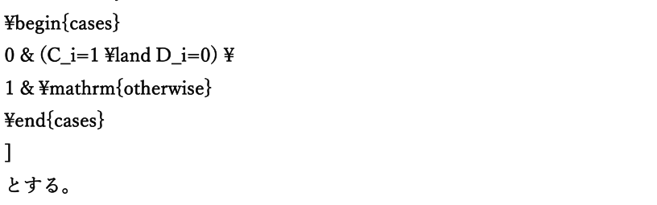

]とする。ここで、[𝐸𝑣𝑎𝑙𝑢𝑎𝑡𝑒(𝐵𝑖 ) = 0]は、Block 内部の詳細判定を省略できることを表す。これによって、第 3 章の仮説 (H_4) を検証する。ただし、Certificate は永久に有効ではない。Collider の移動、編集、Topology 変更、Version 変更、一定期間の経過などによって無効化できるようにする。

<!-- 原PDF 19 / 47 ページ -->

## 4.7 動的付加データの寿命管理

動的付加データを状態に応じて割り当てる場合、不正な再利用を防ぐ必要がある。特に GPU では、ある付加データを CPU 側または別処理から解放した時点でも、GPU の以前の処理がそのデータを参照している可能性がある。そのため SG-APT では、付加データを即座に別の Segment Group へ再利用しない。各動的付加データには、

- Owner
- Version
- Generation

を持たせる。付 加 デ ー タ (p) を Segment Group (g) が 利 用 で き る 条 件 を 、 [𝑜𝑤𝑛𝑒𝑟(𝑝) = 𝑔] 、[𝑣𝑒𝑟𝑠𝑖𝑜𝑛(𝑝) = 𝑣𝑒𝑟𝑠𝑖𝑜𝑛(𝑔)]、[𝑔𝑒𝑛𝑒𝑟𝑎𝑡𝑖𝑜𝑛(𝑝) = 𝑔𝑒𝑛𝑒𝑟𝑎𝑡𝑖𝑜𝑛(𝑔)]とする。いずれかが一致しない場合、その付加データを利用してはならない。また、使用を終了した付加データは、すぐに Free 状態へ戻さず、一度 Retired 状態へ移す。現在の GPU 実行がそのデータを参照しないことを保証できる時点を安全再利用 Epoch(E_s) とした場合、[𝐸current ≥ 𝐸𝑠 ]を満たした後にのみ再利用する。これにより、古い GPU 処理が新しい Owner のデータへ誤ってアクセスすることを防ぐ。

## 4.8 Guide 更新範囲の局所化

Guide が動的計算された場合でも、ストランド全体が更新されたとは限らない。そこで Guide ごとに、変更された最小セグメント区間を Dirty Range として記録する。Guide (g) の Dirty Range を[𝑠𝑔 , 𝑒𝑔 ]とする。ここで、

- (s_g)：更新開始セグメント
- (e_g)：更新終了セグメント

である。この範囲は、Dynamic、Repair、User Edit などによって実際に変更された領域から生成する。これにより、Guide 一本を単純な Dirty / Clean の二値で管理するのではなく、「Guide のどの範囲が変更されたか」を後続処理へ伝達できる。

## 4.9 Follower の局所再構築

Guide の Dirty Range が得られた後、それを Guide に依存する Follower へ伝播する。Follower (f) が Guide (g) に対応している場合、Follower 側の更新範囲を、[max(0, 𝑠𝑔 −

<!-- 原PDF 20 / 47 ページ -->

𝑏) , min(𝑃 − 2, 𝑒𝑔 + 𝑏)]とする。ここで (b) は境界付近の不連続を避けるための Guard Band である。本実装では、基本値として 1 セグメントを使用する。Follower 側では、この範囲に含まれる点についてのみ Guide の変化を反映する。これにより、Guide の一部のみが変更された場合に、Follower 一本の全点を毎回再構築する必要をなくす。ただし、Guide と Follower の対応関係が不正である場合、Mapping Version が一致しない場合、依存関係を確認できない場合には局所更新を利用しない。その場合には該当 Follower の全範囲を Dirty として扱う。つまり、[𝐷𝑒𝑝𝑒𝑛𝑑𝑒𝑛𝑐𝑦𝑉𝑎𝑙𝑖𝑑 = 1]の場合には局所更新を行い、[𝐷𝑒𝑝𝑒𝑛𝑑𝑒𝑛𝑐𝑦𝑉𝑎𝑙𝑖𝑑 = 0]の場合には全範囲更新へ Fallback する。

## 4.10 描画処理への Dirty Range 伝播

Guide および Follower の更新を局所化しても、描画用 Position Buffer を毎フレームすべて再生成すると、End-to-End の処理量削減にはならない。そこで SG-APT では、Follower Dirty Range をさらに描画側へ伝播する。処理関係は、[𝐺𝑢𝑖𝑑𝑒𝐷𝑖𝑟𝑡𝑦 → 𝐹𝑜𝑙𝑙𝑜𝑤𝑒𝑟𝐷𝑖𝑟𝑡𝑦 → 𝑅𝑒𝑛𝑑𝑒𝑟𝐷𝑖𝑟𝑡𝑦]となる。描画側では、前フレームまでの有効な位置情報を保持する Persistent Render Cache を利用する。更新された Guide および Follower の範囲のみ Render Cache を書き換え、変更されていない範囲については以前の値を維持する。一方、

- Render Dirty Range を生成できない
- Follower 依存関係が不正
- Cache が初期化されていない
- 全動的処理を使用している

などの場合には局所更新を使用せず、描画用位置情報を全体更新する。この処理は第 3 章の仮説 (H_3) に対応する。

## 4.11 全動的高速経路

部分更新では、

- Block 判定
- Segment Group 分類
- 動的付加データ管理
- 処理対象の Compaction
- Dirty Range 生成

<!-- 原PDF 21 / 47 ページ -->

などの追加処理が必要である。そのため、髪の大部分が動的になった場合には、これらの管理処理を継続するより、すべての Guide を通常の物理ソルバで処理した方が速い可能性がある。そこで SG-APT では、全動的高速経路（Full Dynamic Fast Path）を用意する。𝑁動的 Segment Group 数を (N_d)、全 Segment Group 数を (N) とすると、動的率を、 𝑑𝑁とする。動的率が高くなった場合には、局所管理を停止して通常の全動的処理へ切り替える。本実装では、経路の頻繁な往復を防ぐため、切替時と復帰時で異なる閾値を用いる。全動的経路へ移行する基準を、[𝑟𝑑 ≥ 0.70]、通常の SG-APT 経路へ戻る基準を、[𝑟𝑑 ≤ 0.55]とする。このように異なる閾値を持たせることで Hysteresis を形成し、境界付近で処理経路が毎フレーム切り替わることを防ぐ。また、動的率だけでなく、

- 動的付加データ Pool の不足
- 修復処理の失敗
- 誤った Static 判定の検出
- 大規模な Topology 変更
- 大規模な User Edit
- Proposal 側の処理時間が全動的経路と同程度以上

などの場合も全動的処理へ移行できる。この処理は第 3 章の仮説 (H_5) に対応する。

## 4.12 安全側への Fallback

SG-APT では、処理量削減より計算結果の正しさを優先する。次のような状態を検出した場合には、Static Cache や局所更新を継続しない。

- NaN
- Inf
- 無効な Position
- 不正な Payload Owner
- Version 不一致
- Generation 不一致
- Payload Pool 不足
- Follower Mapping 不一致
- 依存関係の不整合
- 大きな制約誤差
- 大きな境界誤差

<!-- 原PDF 22 / 47 ページ -->

- Repair 失敗
- Cache 破損

これらの場合、対象 Segment Group を Dynamic または ForcedDynamic へ移行する。必要であれば、局所処理自体を停止して全動的処理へ戻す。したがって、「再利用できることを証明できない場合には再利用しない」ことを基本方針とする。

## 4.13 提案手法の処理手順

SG-APT の一フレームの処理は、概念的には次の順序で行う。まず、Root、Collider、外力、User Edit、Topology などの変更を確認する。次に、それらの変更によって影響を受ける Block を Dirty として記録する。Dirty でない Block については Block Certificate を確認し、前回の判定結果を利用できる場合には内部の詳細判定を省略する。詳細判定が必要な Block では、各 Segment Group を StaticReuse、StaticTransform、Dynamic、Repair などの状態へ分類する。Dynamic、Repair、ForcedDynamic となった Segment Group には必要な動的付加データを割り当てる。Static へ移行した Segment Group については、最後に正常な物理計算で得られた形状を Cache として保持し、不要となった動的付加データを Retired 状態へ移す。その後、動的 Segment Group について通常の物理ソルバを実行する。変更された Guide 範囲から Guide Dirty Range を生成し、Follower Dirty Range および Render Dirty Range へ伝播する。最後に描画処理を実行し、次フレームへ必要な状態を保持する。

## 4.14 研究仮説と提案機構の対応

第 3 章で設定した仮説と、本章で提案した SG-APT の各機構との対応を表 4-1 に示す。

**表 4-1　研究仮説と提案機構の対応**

| 研究仮説 | 対応する提案機構 |
| --- | --- |
| (H_1)：動的状態には局所性が存在する | Segment Group 単位の状態管理 |
| (H_2)：動的状態の分離により状態量を削減できる | 固定コアと動的付加データの分離 |
| (H_3)：Follower・描画まで局所化することで処理量を削減できる | Guide / Follower / Render Dirty Range |
| (H_4)：階層的判定によって分類処理を削減できる | Block Certificate |
| (H_5)：不利な場合に通常処理へ戻すことで性能悪化を抑制できる | Full Dynamic Fast Path |

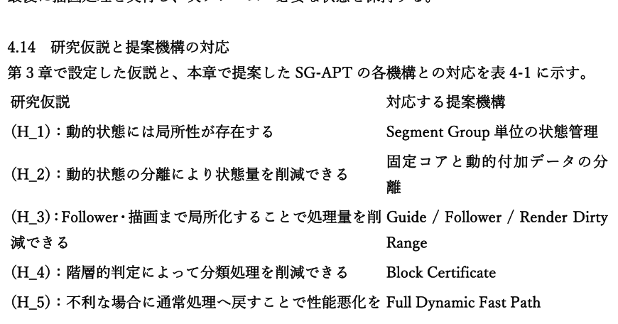

<!-- 原PDF 23 / 47 ページ -->

SG-APT は、これらの機構を個別の最適化として独立に使用するのではなく、一つの髪用 GPU 常駐ランタイムとして組み合わせる。

## 4.15 本研究における提案範囲

本研究では、次の技術そのものを新規提案とはしない。

- Guide/Follower 方式
- Position Based Dynamics 等の物理ソルバ
- GPU Compute Shader
- Sleeping
- Active Set
- Compaction
- Cache
- Dirty Range
- Indirect Dispatch

これらは既存技術として利用する。本研究の提案範囲は、それらを基盤としながら、Guide 内部の Segment Group について、

- 固定コア
- 状態依存の動的付加データ
- 動的付加データの Owner および Lifetime
- Version 付き Static Cache
- Block 単位の再利用判定
- Segment Group 単位の状態遷移
- Follower および描画までの Dirty Range 伝播
- 安全性を優先した Fallback

を統合し、GPU 上で一貫して管理する点にある。

# 第5章 実装

## 5.1 実装環境

実装および正式測定は Windows 11 Home 上で行った。CPU は Intel Core i7-14700、GPUは NVIDIA GeForce RTX 4070 Ti SUPER 16,376 MiB、RAM は 65,303 MiB である。Visual Studio 18.5.2、MSVC 14.50.35717、Windows SDK 10.0.26100.0 を使用し、Release/x64 で実行した。正式 Viewer は同一バイナリ SHA-256 で B0/P を切り替えており、正式セッションには`sameBinary=true`、`sameCommit=true` が記録されている。実行時解像度は 1920×1080、VSync OFF、Present Sync Interval 0、Fixed Timestep 1/60 秒である。

<!-- 原PDF 24 / 47 ページ -->

## 5.2 全体アーキテクチャ

正式 Telemetry のフィールドから、Runtime は少なくとも入力適用、Group 分類、Mode/Active Set 決定、Compaction、Dynamic Solve、Boundary Repair、Wake、Follower Reconstruction、Render Preparation、Hair Draw、Telemetry Reduction の段階を持つ。フレーム𝑡の処理を抽象化すると、𝐒 𝑡+1 = ℛ ∘ ℱ ∘ 𝒫 ∘ 𝒞(𝐒 𝑡 , 𝐮𝑡 )と表せる。$\mathcal{C}$は Classification/Mode 決定、𝒫は Physics/Repair、ℱは Follower 再構成、ℛは Render 準備を表す。

## 5.3 データ構造

正 式 ア セ ッ ト は Display Strand 100,000 本 、 Guide 4,000 本 、 Follower 96,000 本 、Particles/Guide 128 である。Guide 粒子総数は𝑁𝑝𝑎𝑟𝑡𝑖𝑐𝑙𝑒 = 4000 × 128 = 512000である。隣接粒子間の Segment Group 数は 𝑁𝑔𝑟𝑜𝑢𝑝 = 4000 × (128 − 1) = 508000 で あ り 、 正 式 Telemetry の`totalSegmentGroupCount` と一致する。

Frozen Asset Manifest で は `groupsPerBlock=32` 、 正 式 Telemetry で は`totalSegmentGroupBlockCount=16000` であるため、Block 側の収容能力は𝑁𝑐𝑎𝑝𝑎𝑐𝑖𝑡𝑦 =16000 × 32 = 512000となる。実 Group 数との差は 4,000 である。P では State Storage に `IntegratedRecord` が指定され、Segment Group の状態と補助情報を統合 Record として保持する設定になっている。

## 5.4 Microtype Codec の実装

Microtype Codec は、完全位置列を常時保持する代わりに Direction Cache を利用する構成として Telemetry に現れる。𝐱 𝑗+1 −𝐱 𝑗Segment𝑗の方向を𝐝𝑗 = とし、Codec を𝐸𝑛𝑐: 𝐝𝑗 ↦ 𝐪𝑗 , 𝐷𝑒𝑐: 𝐪𝑗 ↦ 𝐝ˆ𝑗 と定義する。‖𝐱 𝑗+1 −𝐱 𝑗 ‖

位置再構成は𝐱ˆ𝑗+1 = 𝐱ˆ𝑗 + ℓ𝑗 𝐝ˆ𝑗 で表す。誤差は𝑒𝑗 = ‖𝐱ˆ𝑗 − 𝐱𝑗 ‖として `meanDecodeErrorMm`に対応させる。正式 Telemetry では Direction Cache Memory が 7.751465 MB、Full Position Memory が

## 15.502930 MB であり、保存量は 50%となった。一方、`microtypeDecodedCount`は正式 P

条件 erformance 評価で非 0 率 0.0%であった。したがって、Codec 用データ構造は存在しても、Performance 経路で Decode が実行されたことは確認できない。

## 5.5 Mode Allocation の実装

<!-- 原PDF 25 / 47 ページ -->

Mode Allocation は Group 単 位 の 状 態 関 数 𝑚𝑔𝑡 = 𝜙(𝐳𝑔𝑡 ) と し て 実 装 を 説 明 す る 。 正 式 Telemetry に は `modeSkipCount` 、 `modeQSOnlyCount` 、 `modeDynamicCount` 、`modeIslandCount`、`modeRepairCount`、`modeFloatFallbackCount` が用意されている。Group の状態更新を𝑞𝑔𝑡+1 = Φ(𝑞𝑔𝑡 , 𝐷𝑔𝑡 , 𝐶𝑔𝑡 , 𝐸𝑔𝑡 , 𝑊𝑔𝑡 , 𝑅𝑔𝑡 )とする。State Hysteresis が有効であるため、Mode は単純な現在入力だけではなく前状態𝑞𝑔𝑡 にも依存する構成として扱う。さらに、`stateTransitionCount`と`stateOscillationCount`を別々に記録することで、Modeの切替量と振動量を観測できる。

## 5.6 Physics Island 生成の実装

Physics Island 生成は、Candidate Group を抽出し、依存関係に基づいて局所集合へ分割する処理として表す。Candidate 指示関数を𝑎𝑔𝑡 = 𝟏[𝑚𝑔𝑡 = Island ∨ localInteraction𝑔𝑡 ]とし、Candidate 集合を𝒜𝑡 ={𝑔 ∣ 𝑎𝑔𝑡 = 1}とする。隣接関係𝐸 を持つグラフ𝐻 = (𝑉, 𝐸)に対し、ℐ 𝑡 = 𝐶𝐶(𝐻[𝒜𝑡 ])で Island 集合を得る。正式 Runtime では Candidate、Member、Commit、Reject、Fallback を個別 Counter として記録する。なお、今回の正式 P 条件設定では `enablePhysicsIslands=false` であるため、この実装構造は存在していても正式性能評価時には有効化されていない。

## 5.7 Rod Repair の実装

Rod Repair は局所的な長さ・衝突・状態破綻を Repair Task へ変換するものとして数式化する。長さ残差𝑟ℓ,𝑗 = ‖𝐱𝑗+1 − 𝐱𝑗 ‖ − ℓ𝑗0 と、衝突残差𝑟𝑐,𝑗 に対し、Repair Predicate 𝑄を用いてℛ 𝑡 ={𝑗 ∣ 𝑄(𝑟ℓ,𝑗 , 𝑟𝑐,𝑗 , 𝐳𝑗𝑡 ) = 1}とする。2局所修正は、Δ𝐱 ∗ = arg min ∑𝑗∈ℛ 𝑡 ‖Δ𝐱𝑗 ‖Δ𝐱

subject to 拘束回復条件として記述できる。正式 Telemetry では Repair Attempt、Success、Failure、Verified、Recurrence を分けているため、Repair の「実行」と「検証済み成功」を区別できる。一方、正式 P 条件では`enableRodRepair=false` であり、動作している Repair Counter は Generic Repair に由来する。

## 5.8 GPU-Resident Runtime の実装

𝑡 𝑡+1 𝑡GPU 側の状態を𝐒𝐺𝑃𝑈 とし、𝐒𝐺𝑃𝑈 = 𝐹𝐺𝑃𝑈 (𝐒𝐺𝑃𝑈 , 𝐔 𝑡 )で更新する。Active Group の Compactionを𝒜𝑡 = {𝑔 ∣ 𝑎𝑐𝑡𝑖𝑣𝑒𝑔𝑡 = 1}とし、Compact Buffer を𝐵𝑡 = 𝐶𝑜𝑚𝑝𝑎𝑐𝑡(𝒜𝑡 )として生成する。

<!-- 原PDF 26 / 47 ページ -->

|𝐵𝑡 |Indirect Dispatch では𝐷𝑡 = ⌈ ⌉を Dispatch Group 数とする。𝑇

正 式 Telemetry に は `dynamicCompactionInputCount` 、`dynamicCompactionOutputCount`、`gpuResidentTaskCount`、`dispatchIndirectCount`、`drawIndirectCount`、`cpuReadbackCount`、`sameFrameReadbackCount` 等が存在する。ただし正式 P 条件 erformance 評価では GPU-Resident Task と Indirect Dispatch の主要 Counter が 0 であったため、実装の存在と実測時の利用を区別する必要がある。

## 5.9 ログ出力・デバッグ・可視化

正式 Case では `case.json`、`settings.json`、`frames.csv`、`frames.jsonl`、`telemetry.jsonl`、P では `novelty01.csv`、さらに Process Memory、Validation、Visual Metrics を保存している。各 Case は Scenario Input SHA-256 と Physical Scenario Input SHA-256 を保持し、B0/P間の入力一致を検証できる。また正式セッションでは同一 Viewer SHA-256、同一 Commit、Frozen Asset Hash を保存する。Final Gate では 90 ランすべての Formal Window Guard が PASS であり、実験データの完全性を検証している。

# 第6章 評価計画

## 6.1 評価目的

本研究では、リアルタイム髪シミュレーションに導入した提案方式が、ベースライン方式と比較してフレーム時間、GPU 処理時間、メモリ使用量、品質および長時間安定性にどのような影響を与えるかを評価する。提案方式を構成する対象は、Microtype、Mode Allocation、Physics Islands、Rod Repair、GPU-Resident Runtime の 5 要素である。評価では平均 FPS のみを用いず、Frame Time の中央値、p95、p99、60 FPS 以内に収まるフレーム割合、Frame Budget Overrun Rate、GPU Hair Time、プロセスメモリ、DXGI Local Usage、品質テレメトリ、および内部実行カウンタを併用する。これにより、性能向上が確認できた場合だけでなく、期待した実行経路が使用されなかった場合や、オーバーヘッドによって性能が悪化した場合も結果として記録する。また、B0 と P の比較では、同一バイナリ、同一コミット、同一シナリオ入力を用いる。正式セッションは Status=FORMAL_COMPLETE_VALID、Final Gate=PASS であり、実験データの完全性と入力一致を確認した上で比較を行う。

## 6.2 評価環境

正式測定は、表 6-1 に示す環境で実施した。GPU は NVIDIA GeForce RTX 4070 Ti SUPER、CPU は Intel(R) Core(TM) i7-14700 であり、表示解像度は 1920x1080 とした。Hair Systemは Release/x64 で実行し、VSync を無効化した。

<!-- 原PDF 27 / 47 ページ -->

評価対象は表示ストランド 100,000 本、Guide Strand 4,000 本、Follower 96,000 本とした。各 Guide には 24 本の Follower を割り当て、Particles / Guide は 128、Solver Iterations は6 とした。固定タイムステップは 1/60 秒である。

## 6.3 評価シナリオ

通常の静止状態だけでなく、Root 移動・回転、Collider、局所編集、Wind、Repair Storm、Dynamic/Static 強制切替、Camera 距離変更などの状態変化を含めるため、S01 から S18 までの 18 シナリオを使用する。各シナリオは Canonical Scenario から生成された Materialized Timeline を用い、B0 と P で Scenario Input SHA-256 および Physical Scenario Input SHA-256 を一致させる。表 6-2 に各シナリオと主要入力を示す。シナリオ名と実際に注入されたイベントの双方を記載することで、名称だけから実験内容を推測しないようにした。

## 6.4 比較対象

比較対象は B0（PRE-NOVELTY BASELINE）と P（POST-NOVELTY SG-APT）の 2 方式 と す る 。 両 方 式 は 別 バ イ ナ リ で は な く 、 同 一 Commit 21e206250d902912fc429c0c024dcc992f522466、同一実行ファイルを用い、機能フラグによって経路を切り替える。正式セッションでは sameBinary=true、sameCommit=true が記録されている。B0 は提案機構を無効化した独立ベースライン経路である。P では Microtype、GPU-Resident、Segment Group State、Static Certificate、Predictive Wake、Generic Repair、GPU Compaction、Static Cache などの機構を有効化している。一方、正式 P 条件条件では enablePhysicsIslandsおよび enableRodRepair は false である。この設定差は後の結果解釈に直接関係するため、表 6-3 に明示する。

## 6.5 評価指標

性 能評 価の主 要指 標には frameMilliseconds を使 用す る。 60 FPS のフ レー ム予算 は

## 16.666667 ms であり、Performance Profile では Average FPS 60 以上、60 FPS 以内のフレ

ーム割合 95%以上、Frame Budget Overrun Rate 5%以下、p95 Frame Time 16.6667 ms 以下、p99 Frame Time 20 ms 以下を判定基準とする。GPU 側 は gpuHairMilliseconds を 使 用 す る 。 メ モ リ に つ い て は 、 フ レ ー ム CSV の vramMegabytes が本正式データでは 0 として記録されているため、Process Private Memory、Working Set、および DXGI Local Usage を主指標として扱う。品質については False Static、False Dynamic、Position RMSE、Position Max Error、NaN State Count、Infinite State Count、Fatal Failure などを確認する。提案要素の実行状況については、Microtype Decode、Mode、Island、Repair、GPU-Resident Task、Indirect Dispatch、

<!-- 原PDF 28 / 47 ページ -->

Dirty Block、Static Reuse などの内部カウンタを使用する。

## 6.6 各提案要素の単体評価

Microtype では microtypeDecodedCount、safeDecodeCount、falseSafeCount、Direction Cache Memory、Full Position Memory、Memory Saving Rate を確認する。Mode Allocationで は modeSkipCount 、 modeQSOnlyCount 、 modeDynamicCount 、 modeIslandCount 、modeRepairCount、staticCachedGroupCount、dynamicGroupCount、stateTransitionCount、stateOscillationCount を確認する。Physics Islands で は islandCandidateCount 、 islandCount 、 islandCommitCount 、islandRejectCount 、 physicsFallbackCount を 使 用 す る 。 Rod Repair で は typedRepairRequestCount、repairTaskCount、repairAttemptCount、repairSuccessCount、repairVerifiedCount 、 repairFailureCount を 使 用 す る 。 GPU-Resident Runtime で は gpuResidentTaskCount 、 dispatchIndirectCount 、 drawIndirectCount 、delayedTelemetryReadCount、cpuReadbackCount および GPU Hair Time を使用する。単体評価では、機能フラグが ON であることだけを動作の証拠とせず、対応する実行カウンタが増加していることを確認条件とする。これにより、実装済みであるが正式シナリオで経路が使用されなかった場合を区別する。

## 6.7 統合システム評価

統合評価では B0 と P を Quality、Performance、Determinism、Soak の各 Profile で比較する。正式セッションは Pilot 10 ラン、Quality 36 ラン、Performance 36 ラン、Determinism 4 ラン、Soak 4 ランの合計 90 ランで構成され、B0 と P を各 45 ラン実行している。Quality、Performance、Determinism では 600 フレームの Warm-up 後に 6,000 フレームを測定し、Soak では 600 フレームの Warm-up 後に 108,000 フレームを測定する。Pilot は300 フレームの Warm-up 後に 1,800 フレームを測定する。Soak の 108,000 measured framesは 60 FPS 換算で 30 分に相当する。

## 6.8 アブレーション評価

5 つの提案要素の独立寄与を評価するためには、統合 P 条件から各要素を 1 つずつ除外した条件を用意し、同一シナリオで比較する必要がある。例えば、P から Microtype のみを無効化した条件と P を比較すれば、その他の条件を固定したまま Microtype の寄与を推定できる。正式テレメトリには topLevelNoveltyMask および Feature Mask が記録されるため、アブレーション条件が実際に異なる構成として実行されたかを検証できる。第 7 章では、正式セッション内に必要な Mask の組合せが存在するかを確認し、アブレーション評価の成立可否そのものも結果として扱う。

<!-- 原PDF 29 / 47 ページ -->

## 6.9 評価結果の記録方法

各 Case では case.json、settings.json、frames.csv、frames.jsonl、telemetry.jsonl、novelty01.csv、process_memory.jsonl、per_second.csv、summary.json、validation.json、visual_metrics.jsonなどを保存する。Profile 単位では novelty01_matrix_summary.json、全実験終了後には thesis_aggregate_table.csv、thesis_paired_b0_p.csv、thesis_statistical_report.json を生成する。実行ファイル、Asset、Settings、Scenario Timeline および入力について SHA-256 を保存し、B0 と P の入力一致を確認する。実行順は Counterbalanced Schedule とする。正式セッションの Final Gate では 90 件の Window Guard 記録すべてが PASS し、Fatal Integrity Issue は0 件であった。ただし Final Gate の PASS は P の性能優位性を意味しない。これは正式測定条件とデータ完全性を満たしていることを示す検証結果であり、性能基準の未達は Quality Outcome としてそのまま記録する。

# 第7章 結果

## 7.1 実験条件

正式評価では合計 90 run を実施し、B0 と P をそれぞれ 45 run 測定した。内訳は Pilot 10 run、Quality 36 run、Performance 36 run、Determinism 4 run、Soak 4 run である。Performance および Quality では S01 から S18 までの 18 シナリオを両方式で実行した。す べ て の 正 式 Profile で Scenario Input Parity Issue は 0 件 で あ り 、thesis_statistical_report.json に 記 録 さ れ た Fatal Integrity Issue も 0 件 で あ っ た 。Determinism Outcome Issue も 0 件である。一方、性能基準やハードウェア変動などを含む Quality Outcome Issue は 139 件記録された。したがって、以下では「データ取得が正式に完了したこと」と「提案方式が性能目標を達成したこと」を分けて示す。

**表 7-1　正式 Profile 別測定数**

| Profile | Runs | Warm-up | Measurement/Run | Total measured |
| --- | --- | --- | --- | --- |
| Pilot | 10 | 300 | 1800 | 18000 |
| Quality | 36 | 600 | 6000 | 216000 |
| Performance | 36 | 600 | 6000 | 216000 |
| Determinism | 4 | 600 | 6000 | 24000 |
| Soak | 4 | 600 | 108000 | 432000 |

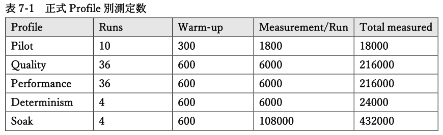

## 7.2 メモリ使用量の結果

Performance Profile の 18 シナリオについて Peak Memory を平均すると、Peak Process Private Memory は B0 が 8171.34 MiB、P が 10626.38 MiB であり、P は 30.0%増加した。

<!-- 原PDF 30 / 47 ページ -->

Peak Working Set は B0 2809.98 MiB、P 4751.31 MiB であり、69.1%増加した。Peak DXGI Local Usage も B0 4468.49 MiB に対して P 4856.46 MiB であり、8.7%増加した。18 シナリオの最大 Peak Process Private Memory は B0 で 8235.96 MiB、P で 11102.36 MiBであった。したがって、本正式 Performance 測定では P によるシステム全体のメモリ削減は確認できなかった。一方、P 内部の Microtype 関連指標では Direction Cache Memory が 7.751465 MB、Full Position Memory が 15.502930 MB、Memory Saving Rate が 0.500 であった。局所データ表現では 50%の削減が記録されているが、この局所削減はプロセス全体の使用量削減には結び付かなかった。

**表 7-2　Performance Profile のメモリ集計**

| 方式 | Peak Private 平均 [MiB] | Peak Working Set 平均 [MiB] | Peak DXGI Local 平均 [MiB] | Peak Private 最大 [MiB] |
| --- | --- | --- | --- | --- |
| B0 | 8171.34 | 2809.98 | 4468.49 | 8235.96 |
| P | 10626.4 | 4751.31 | 4856.46 | 11102.4 |

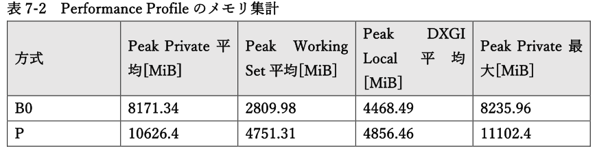

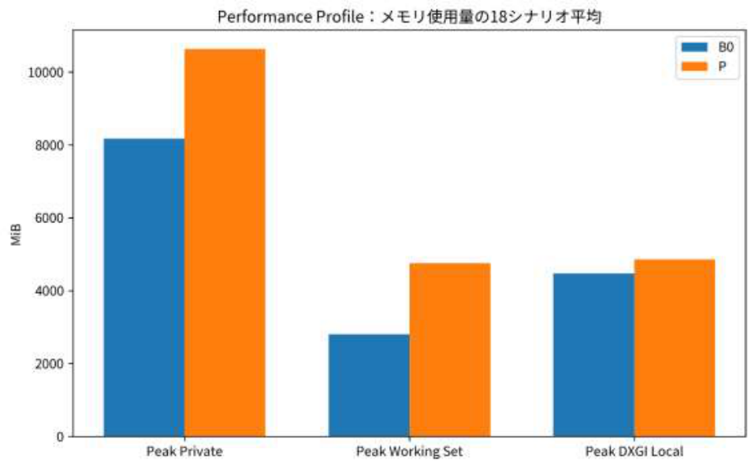

*図 7-1　Performance Profile のメモリ使用量比較。 18 シナリオの Peak 値を方式別に平均した。*

## 7.3 フレーム時間の結果

Performance Profile の 18 シナリオで Median Frame Time を平均すると、B0 は 6.9432 ms、P は 10.0587 ms であった。P は B0 に対して 44.9%増加した。Average Frame Time は B0

<!-- 原PDF 31 / 47 ページ -->

## 6.9958 ms、P 13.2884 ms であり、89.9%増加した。

p95 Frame Time の 18 シナリオ平均は B0 7.3659 ms、P 26.0901 ms であった。P は約 254.2%増加し、16.6667 ms の 60 FPS 予算を全 18 シナリオで上回った。60 FPS 以内に収まったフレーム割合の 18 シナリオ平均は B0 99.959%、P 65.168%であった。Frame Budget Overrun Rate は B0 0.041%、P 34.832%である。P では全 18 シナリオで 60 FPS Ratio、Frame Budget Overrun Rate、p95、p99 の主要 4 基準が未達となった。以上より、Performance Profile では P による高速化は確認できず、すべてのシナリオで Median Frame Time が B0 より長くなった。

**表 7-3　18 シナリオのフレーム時間と 60 FPS 達成率**

| Scenario | B0 Median [ms] | P Median [ms] | B0 p95 [ms] | P p95 [ms] | B0 ≤16.667 ms [%] | P ≤16.667 ms [%] |
| --- | --- | --- | --- | --- | --- | --- |
| S01 | 6.9459 | 10.2064 | 7.4266 | 26.0191 | 99.95 | 63.47 |
| S02 | 6.9446 | 10.2629 | 7.3466 | 26.088 | 99.98 | 61.58 |
| S03 | 6.9467 | 9.8391 | 7.445 | 25.9433 | 99.98 | 69.02 |
| S04 | 6.9407 | 10.0999 | 7.428 | 26.0952 | 99.93 | 64.32 |
| S05 | 6.9443 | 10.2914 | 7.3363 | 26.1502 | 99.93 | 60.73 |
| S06 | 6.9432 | 10.2728 | 7.3302 | 26.1164 | 99.95 | 62.1 |
| S07 | 6.9434 | 9.9215 | 7.2999 | 26.0707 | 99.98 | 68.68 |
| S08 | 6.942 | 10.2723 | 7.357 | 26.1913 | 99.97 | 61.67 |
| S09 | 6.9413 | 9.8455 | 7.3551 | 26.1306 | 99.93 | 68.55 |
| S10 | 6.9436 | 9.8403 | 7.3543 | 26.0775 | 99.95 | 68.18 |
| S11 | 6.9408 | 9.8288 | 7.387 | 26.0869 | 99.98 | 69 |
| S12 | 6.9407 | 9.8462 | 7.3552 | 26.0475 | 99.97 | 68.38 |
| S13 | 6.9431 | 9.799 | 7.3183 | 25.9711 | 99.95 | 69.75 |
| S14 | 6.9437 | 10.2853 | 7.3194 | 26.2342 | 99.98 | 60.8 |
| S15 | 6.9428 | 9.8202 | 7.3723 | 26.0476 | 99.97 | 69.18 |
| S16 | 6.942 | 10.1261 | 7.3476 | 26.0436 | 99.97 | 63.72 |
| S17 | 6.9417 | 10.2289 | 7.3604 | 26.1235 | 99.92 | 62.48 |
| S18 | 6.9462 | 10.2701 | 7.4477 | 26.1849 | 99.97 | 61.4 |

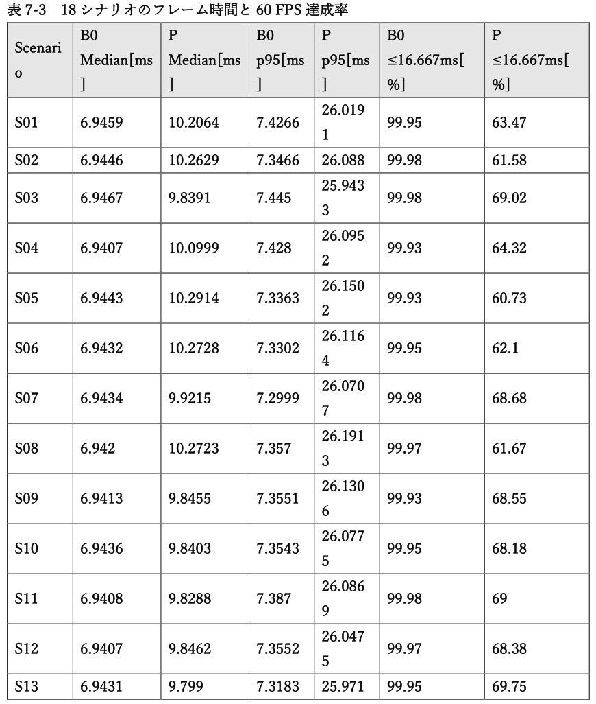

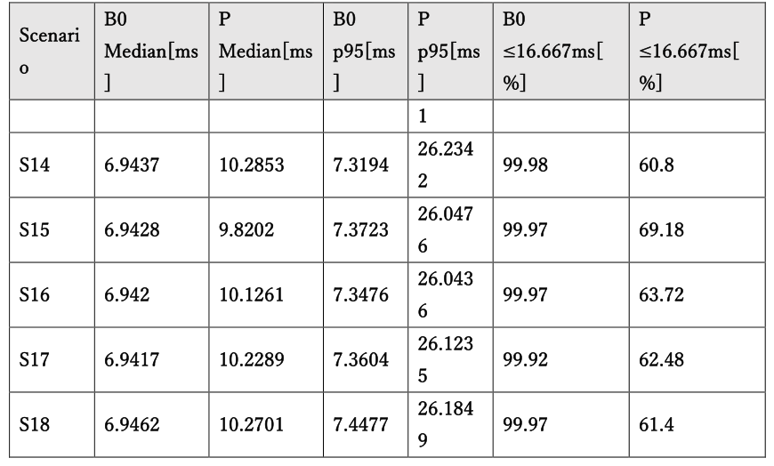

<!-- 原PDF 32 / 47 ページ -->

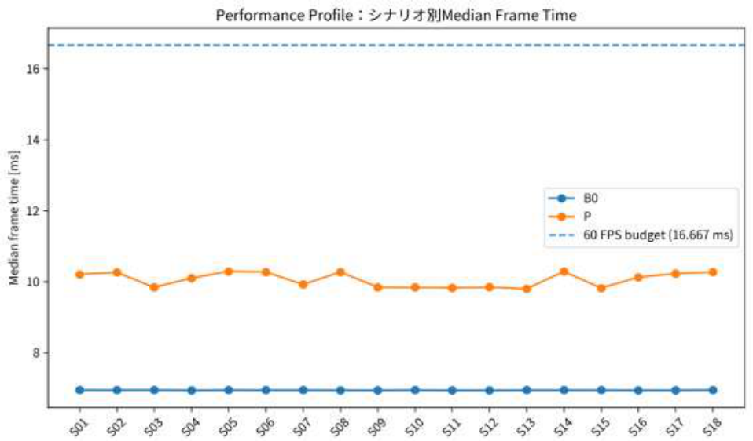

*図 7-2　18 シナリオの Median Frame Time。 破線は 60 FPS の 16.6667 ms 予算である。*

<!-- 原PDF 33 / 47 ページ -->

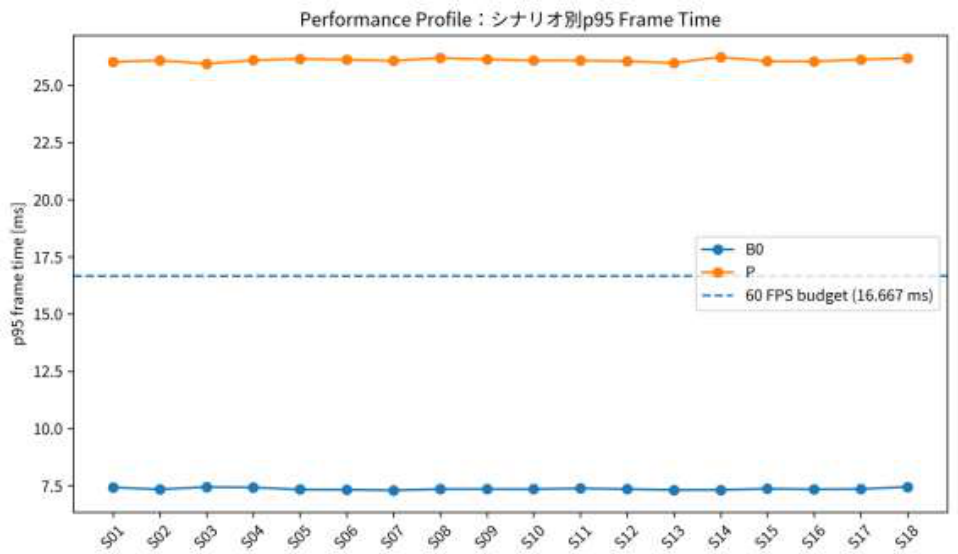

*図 7-3　18 シナリオの p95 Frame Time。 P は全 18 シナリオで 16.6667 ms を超過した。*

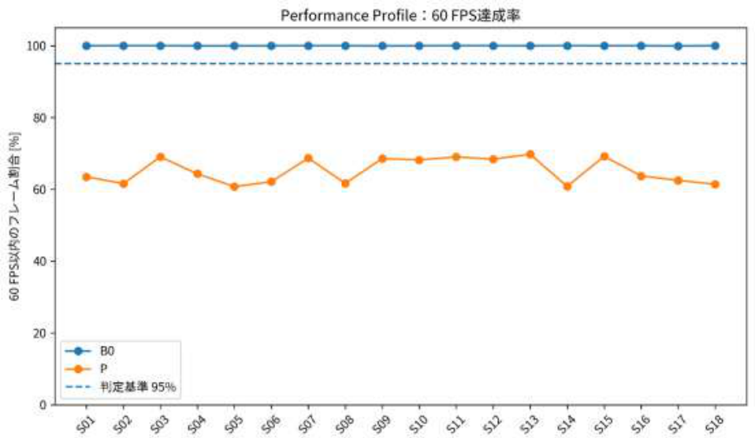

*図 7-4　60 FPS 達成率。 各フレームが 16.6667 ms 以内に収まった割合を示す。*

## 7.4 Microtype の結果

P 条件では enableMicrotype が ON であった。Direction Cache Memory は 7.751465 MB、Full Position Memory は 15.502930 MB であり、directionCacheMemorySavingRate は 0.500であった。したがって、Microtype が対象とする局所保存表現については 50%の削減が記録された。しかし、Performance Profile の P 条件 108,000 フレームにおいて microtypeDecodedCount、

<!-- 原PDF 34 / 47 ページ -->

safeDecodeCount 、 falseSafeCount の 最 大 値 は い ず れ も 0 で あ っ た 。 ま た microtypeBlockHierarchyEnabled は 0 であった。さらに、dirtyBlockCount は毎フレーム16,000 で Total Block 数と一致し、dirtyGroupCount も毎フレーム 508,000 で Total Segment Group 数と一致した。staticReuseAttemptCount は 0 であった。Quality Profile では False Static Count は全 108,000 frame で 0 であった。Novelty telemetry上の Position RMSE の非ゼロ値中央値は 0.008015 mm、最大 RMSE は 0.105774 mm、Position Max Error の最大値は 7.93073 mm であった。ただし、これらは統合 P 条件の品質値であり、Microtype だけを有効にした単体条件ではない。以上から、局所保存量の削減は確認できた一方、正式測定中に Microtype Decode 経路が利用されたことを示すカウンタは得られなかった。

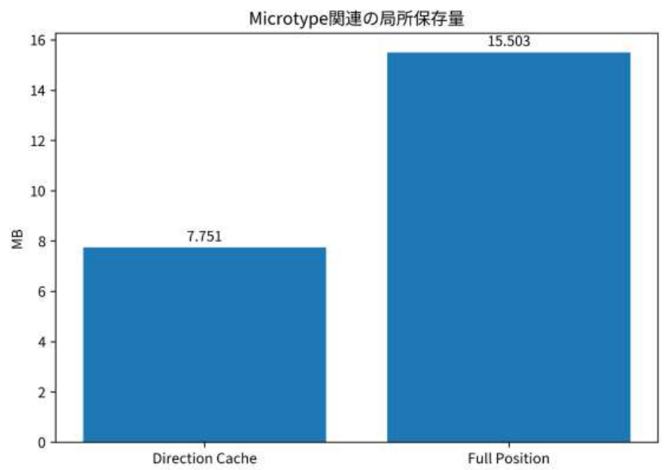

*図 7-5　Microtype の局所保存量。 Direction Cache と Full Position の記録値を比較する。*

## 7.5 Mode Allocation の結果

Performance Profile では modeSkipCount、modeQSOnlyCount、modeDynamicCount、modeIslandCount、modeRepairCount、modeFloatFallbackCount の最大値はいずれも 0 であった。一方、Novelty telemetry の used_full_dynamic は測定対象行で 100.0%であり、Performance 測定では Full Dynamic 経路が継続して使用された。1 フレーム当たりの totalSegmentGroupCount は 508,000 であり、dynamicGroupCount の平均は 507914.44 であった。全 Group の約 99.983%が Dynamic として記録されたことになる。staticCachedGroupCount および staticTransformedGroupCount は全測定フレームで

<!-- 原PDF 35 / 47 ページ -->

0 であり、Static Cache による処理省略は確認できなかった。stateTransitionCount は 1 フレーム当たり平均 507925.83、stateOscillationCount も平均

## 507925.83 であった。S14 AllDynamic の Median Frame Time は B0 6.9437 ms、P 10.2853

ms、S15 AllStatic でも B0 6.9428 ms、P 9.8202 ms であった。したがって、正式 Performance 測定では Mode Allocation によって Static 側へ処理を逃がし計算量を削減する状態を確認できなかった。

## 7.6 Physics Islands の結果

正式 P 条件では enablePhysicsIslands=false であった。Performance Profile の 108,000 フレー ム に お い て islandCount 、 islandMemberCount 、 islandCandidateCount 、islandCommitCount 、 islandRejectCount の 最 大 値 は い ず れ も 0 で あ っ た 。 一 方 、physicsFallbackCount は平均 1.000 であり、各フレームで Fallback が記録された。このため、本データから Physics Islands の性能向上または性能低下を判断することはできない。正確には、正式測定で Physics Islands を有効化した単体条件が存在せず、Physics Islands の評価が成立していない。

## 7.7 Rod Repair の結果

正 式 P 条 件 で は enableRodRepair=false で あ っ た 。 typedRepairRequestCount 、floatFallbackRequestCount、repairCommitCount、repairRejectCount、repairDeferCount の最大値はいずれも 0 である。一方、P 条件では Generic Repair に相当する enableRepair が ON であり、Performance Profile の repairTaskCount は 1 フレーム当たり平均 85.56、最小 83、最大 89 であった。repairAttemptCount と repairSuccessCount も同程度で、repairFailureCount の最大値は 0であった。ただし repairVerifiedCount も 0 であり、Success Count を独立検証済みの物理修復成功件数とは解釈できない。Repair Storm を入力する S13 では、Median Frame Time が B0 6.9431 ms、P 9.7991 ms、p95 が B0 7.3183 ms、P 25.9711 ms であった。しかし Rod Repair 自体が OFF であるため、この差を Rod Repair 固有の性能結果として扱うことはできない。

## 7.8 GPU-Resident Runtime の結果

P 条件では enableGpuResident=true であった。しかし Performance Profile の 108,000 フレ ー ム で gpuResidentTaskCount 、 riskyCompactionCount 、 dispatchIndirectCount 、drawIndirectCount、delayedTelemetryReadCount の最大値はいずれも 0 であった。したがって、設定上 GPU-Resident が有効であることは確認できるが、専用 Task や Indirect Dispatch が実際に使用された証拠は得られなかった。GPU Hair Time の Median を 18 シナリオで平均すると B0 6.8720 ms、P 11.2670 ms であり、P は 64.0%増加した。p95 平均も B0 7.3836 ms、P 22.2815 ms であり、201.8%増加した。また DXGI Local Usage も P で増加したため、本正式測定では GPU-Resident Runtime に

<!-- 原PDF 36 / 47 ページ -->

よる GPU 処理時間および GPU メモリ使用量の削減を確認できなかった。

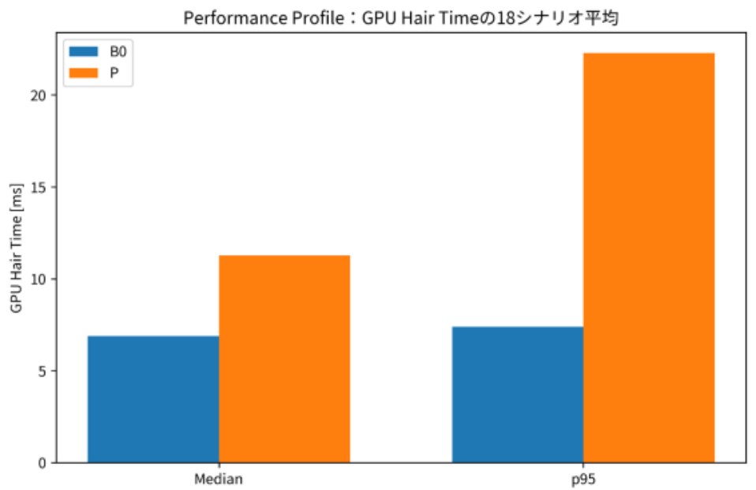

*図 7-6　GPU Hair Time の比較。 Performance 18 シナリオの Median および p95 平均を示す。*

## 7.9 統合システムの結果

P 条件を含む全 90 run で NaN State Count、Infinite State Count、Fatal Failure は 0 であり、Fatal Integrity Issue も 0 件であった。Determinism Profile でも determinismIssues は 0件である。したがって、正式測定の範囲では致命的な数値破綻や異常終了を起こさず実行を完了した。一方、thesis_paired_b0_p.csv に含まれる全 45 ペアの Median Frame Time を比較すると、B0 が高速であったペアが 45、P が高速であったペアが 0、同値が 0 であった。Pilot、Quality、Performance、Determinism、Soak のいずれの Profile でも、P が B0 より高速となった対応ペアは存在しなかった。Soak Test では S01 の Average Frame Time が B0 7.0077 ms、P 9.7996 ms、S13 では B0

## 6.9864 ms、

P 9.9097 ms であった。Peak Process Private Memory も S01 で B0 8251.57 MiB、P 11973.68 MiB、S13 で B0 8237.67 MiB、P 12063.28 MiB となった。Process Private Memory の傾きは B0 が S01 -0.73 MiB/min、S13 -0.63 MiB/min であったのに対し、P は S01 +4.91 MiB/min、S13 +4.65 MiB/min であった。長時間測定でも P の高速化やメモリ削減は確認されなかった。

**表 7-4　Soak Test 結果**

| 方式 | Scenario | Average Frame [ms] | p95 [ms] | Max [ms] | >100 ms Frames | Peak Private [MiB] | Private Slope [MiB/min] | Peak DXGI Local [MiB] |
| --- | --- | --- | --- | --- | --- | --- | --- | --- |
| B0 | S01 | 7.008 | 7.541 | 153.518 | 3 | 8251.57 | -0.73 | 4468.51 |
| P | S01 | 9.8 | 14.124 | 160.379 | 1 | 11973.7 | 4.909 | 5647.16 |
| P | S13 | 9.91 | 14.085 | 104.07 | 1 | 12063.3 | 4.647 | 5647.14 |
| B0 | S13 | 6.986 | 7.555 | 161.319 | 2 | 8237.67 | -0.632 | 4468.5 |

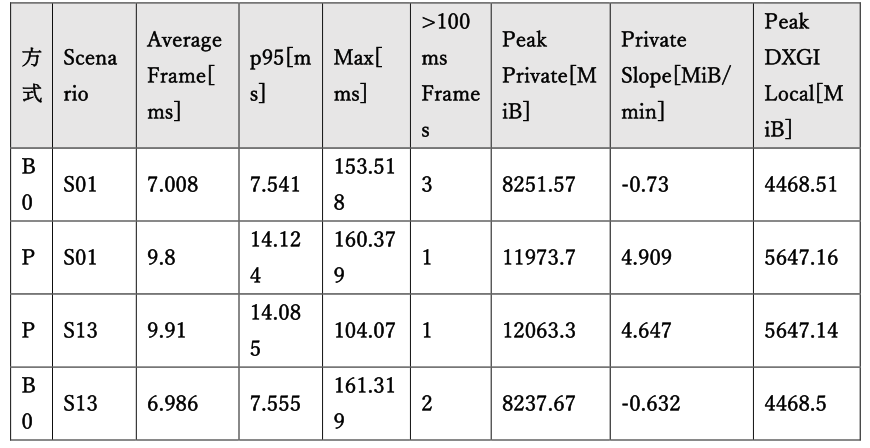

<!-- 原PDF 37 / 47 ページ -->

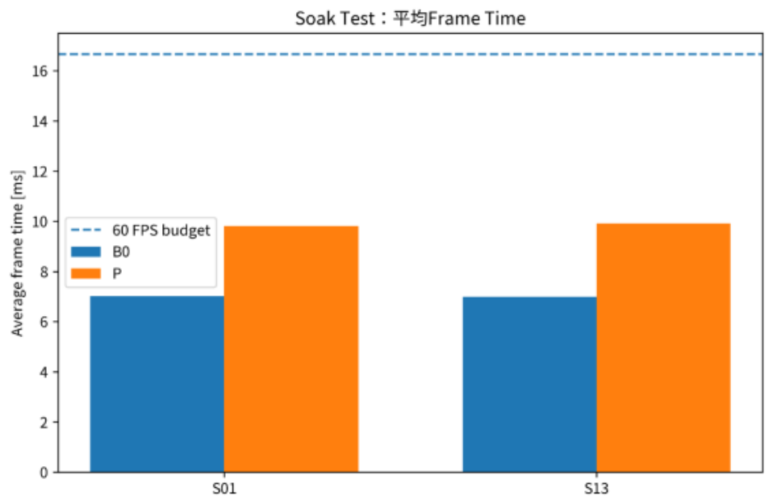

*図 7-7　Soak Test の Average Frame Time。 S01 と S13 の長時間測定を比較する。*

<!-- 原PDF 38 / 47 ページ -->

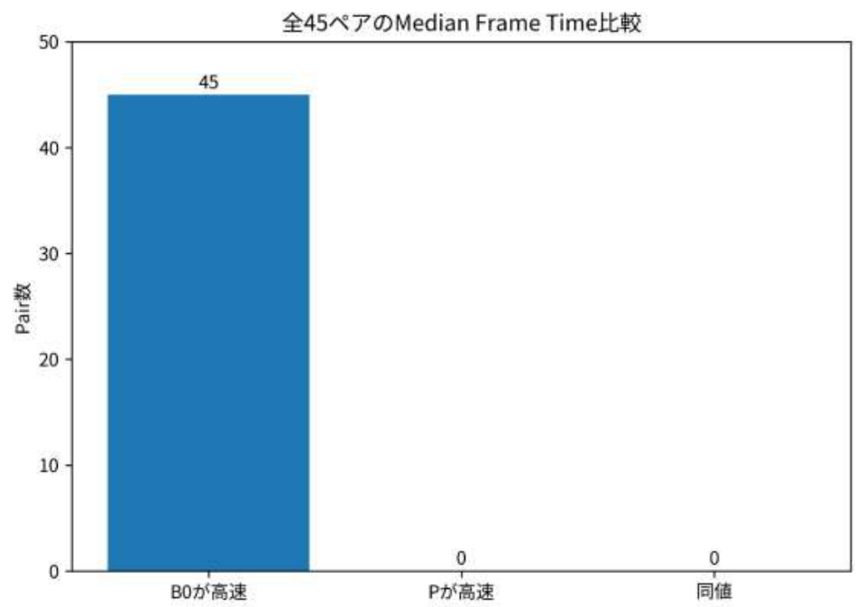

*図 7-8　全 45 ペアの Median Frame Time 比較。 B0 高速 45、P 高速 0、同値 0 であった。*

## 7.10 アブレーション結果

正式データの topLevelNoveltyMask を確認すると、Performance および Quality の P 条件では全測定フレームで 17 が記録されている。一方、B0 は提案機構を無効化した独立経路である。正式セッションの Comparison Methods は B0 と P の 2 種類のみであり、P から Microtype だけを除外した条件、GPU-Resident だけを除外した条件などの 1 要素ずつ異なる正式比較ケースは存在しなかった。また、P 条件そのものでも Physics Islands と Rod Repair は OFF であり、Microtype Decode、Mode 系カウンタ、GPU-Resident Task および Indirect Dispatch には実行を示すカウントがなかった。したがって、本正式実験では 5 要素それぞれの寄与を因果的に分離するアブレーション評価は成立しなかった。B0 と P の統合差は測定できるが、どの要素が何 ms の増減を生じさせたかを本データだけから決定することはできない。

<!-- 原PDF 39 / 47 ページ -->

**表 7-5　5 構成要素の正式測定成立状況**

| 要素 | P 設定 | 実行証拠 | 評価 |
| --- | --- | --- | --- |
| Microtype | ON | microtypeDecodedCount max=0 | 局所メモリ表現は50%だが Decode実行は確認できず |
| Mode Allocation | 関連状態管理ON | mode 系カウンタ max=0、Full Dynamic=100.0% | 処理削減経路を確認できず |
| Physics Islands | OFF | islandCandidateCount max=0 | 正式評価未成立 |
| Rod Repair | OFF | typedRepairRequestCount max=0 | Rod Repair 単体評価未成立 |
| GPU-Resident Runtime | ON | gpuResidentTaskCount max=0, dispatchIndirectCount max=0 | 専用実行経路を確認できず |

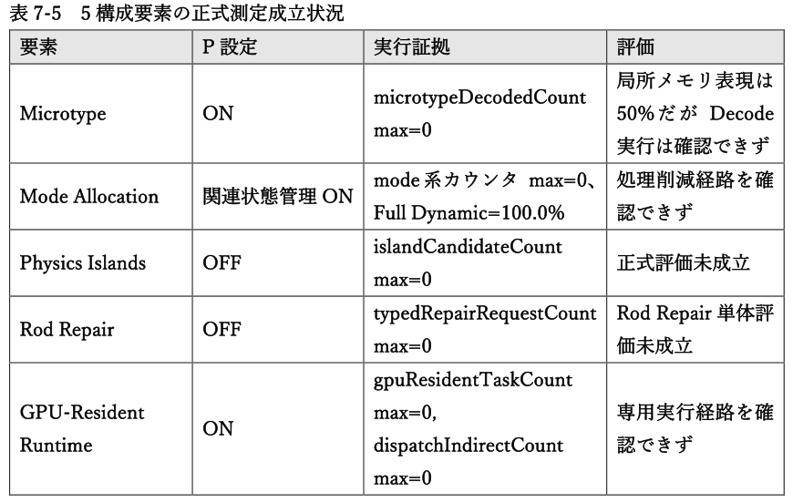

## 本章のデータ出典

本章の全図表は同フォルダの README.md およびルートの SOURCE_MANIFEST.csvから元 ZIP 内部ファイルへ追跡できる。

# 第8章 考察

## 8.1 結果の全体的な傾向

本実験で最も明確な傾向は、統合 P 条件が B0 より高速にならなかったことである。Performance Profile では Median Frame Time の 18 シナリオ平均が 6.9432 ms から 10.0587 ms へ増加し、p95 も 7.3659 ms から 26.0901 ms へ増加した。全 45 ペアの比較でも P が B0 より高速となったペアは 0 であった。メモリも同じ傾向を示し、Performance Profile では Peak Process Private Memory が約30.0%、Peak Working Set が約 69.1%、DXGI Local Usage が約 8.7%増加した。そのため、今回の P 実装では高速化とシステム全体の省メモリ化の双方を実証できなかった。ただし、NaN、Inf、Fatal Failure が 0 であり、Quality Profile の False Static Count も 0 であった。したがって、単純にシステムが破綻したのではなく、保守的な処理状態を維持しながら追加管理コストが発生したと解釈する方が実測結果に整合する。

## 8.2 Microtype による効果

Microtype では Direction Cache 7.751465 MB に対して Full Position 15.502930 MB であり、局所保存量を 50%にできている。この点は、保存形式を小さくするという設計上の目

<!-- 原PDF 40 / 47 ページ -->

的に対応した結果である。一方、microtypeDecodedCount は正式 P 条件 erformance 評価測定で 0 であり、Microtype Block Hierarchy も無効であった。さらに全 16,000 Block および全 508,000 Group が毎フレーム Dirty で、Static Reuse Attempt も 0 であった。この状態では、保存形式が小さくなっても、毎フレーム処理する対象数自体を減らせない。したがって、今回の結果は Microtype の局所データ表現が無意味であることを示すのではなく、その局所削減を実行時間削減へ変換する経路が正式測定で作動しなかったことを示している。

## 8.3 Mode Allocation による効果

Mode Allocation では、Performance Profile で mode 系カウンタがすべて 0 であり、used_full_dynamic は 100.0%であった。dynamicGroupCount も全 508,000 Group の約99.983%を占め、staticCachedGroupCount は 0 である。この結果から、P は状態分類や Certificate などの管理機構を追加しながら、最終的にはほぼ全 Group を Dynamic として処理していたと考えられる。特に S15 AllStatic でも B0 より P の Frame Time が長く、Static 化に伴う処理省略が性能へ反映されていない。Performance 低下の原因を 1 要素へ帰属することはできないが、少なくとも「管理コストを追加したのに Full Dynamic 処理量が減っていない」という状態は、P が B0 より遅い結果と整合する。

## 8.4 Physics Islands による効果

Physics Islands は正式 P 条件条件で無効であり、Island Candidate、Island Count、Commit、Reject はいずれも 0 であった。このため、Physics Islands について「効果がなかった」と結論することはできない。評価に必要な実行条件そのものが成立していないためである。5 要素の 1 つとして Physics Islands の有効性を論じる場合は、enablePhysicsIslands=true とし、Island Candidate および Island Commit が実際に発生するシナリオを用いた追加測定が必要である。したがって、本論文の正式結果で示せるのは Physics Islands の有効性ではなく、正式評価未成立という限界である。

## 8.5 Rod Repair による効果

Rod Repair も正式 P 条件条件では無効であったため、Rod Repair 固有の性能・品質効果は評価できない。Repair Storm シナリオで動作したのは Generic Repair 側の処理であり、Typed Repair Request や Rod Repair Commit は 0 であった。Generic Repair では Attempt と Success が記録され、Failure は 0 であった一方、Verified Count も 0 である。このため、実行パスが処理を完了したことと、物理的な修復品質が独立に検証されたことは分けて扱う必要がある。

<!-- 原PDF 41 / 47 ページ -->

## 8.6 GPU-Resident Runtime による効果

GPU-Resident Runtime は 設 定 上 ON で あ っ た が 、 gpuResidentTaskCount 、dispatchIndirectCount、drawIndirectCount が 0 であった。このため、GPU-Resident 専用経路が正式測定で実際に利用されたことを確認できない。GPU Hair Time は Median 平均で B0 6.8720 ms から P 11.2670 ms へ増加し、p95 も B0

## 7.3836 ms から P 22.2815 ms へ増加した。DXGI Local Usage も P で増加した。

したがって、少なくとも今回の正式測定では、GPU 側へ処理を常駐させることによる CPU-GPU 転送削減や GPU 処理時間削減を実証できなかった。設定の有効化と専用経路の実稼働を区別する必要がある。

## 8.7 5 つの構成要素の相互補完

本研究で想定した構成では、Mode Allocation が処理対象を分離し、Physics Islands が局所的な物理計算単位を形成し、 Rod Repair が異常部分を限定して修復し、その状態を Microtype と GPU-Resident Runtime が効率的に保持・実行することで相互補完することを期待した。しかし正式測定では、Physics Islands と Rod Repair が OFF であり、Mode 系カウンタは 0、Microtype Decode も 0、GPU-Resident Task も 0 であった。その一方で Full Dynamic 経路がほぼ常時使用された。したがって、今回測定された P は「5 要素がすべて連携した完成状態」の性能を表しているとは言えない。追加管理機構を含む統合経路の一部は存在するが、想定した相互補完関係を実測で確認するには至らなかった。

## 8.8 制作現場への影響

リアルタイムコンテンツ制作では、平均 FPS だけでなくフレーム時間の安定性が重要になる。P の Performance Profile では 60 FPS 以内に収まるフレーム割合が平均 65.17%であり、p95 Frame Time は平均 26.09 ms であった。B0 では 60 FPS 以内の割合が 99.96%、p95 が 7.37 ms であった。このため、現在の P 実装を「100,000 本の髪を B0 より安定して高速に処理する最適化」としてそのまま制作現場へ導入することは難しい。また Process Private Memory および Working Set も増加しており、メモリ制約のある実行環境では追加負担になる。一方、致命的な数値破綻が 0 で False Static も 0 であった点から、安全側に倒した状態管理の実装としては一定の安定性が確認された。現段階では、高速化済みの完成方式ではなく、安全性を優先した管理方式のオーバーヘッドが処理削減量を上回っている実装段階と位置付けるのが妥当である。

<!-- 原PDF 42 / 47 ページ -->

## 8.9 既存研究との差分

今回指定した情報源は正式実験 ZIP のみであり、この ZIP には外部の既存研究を同一ハードウェア、同一ストランド数、同一 18 シナリオで再測定した結果は含まれていない。そのため、本章の実測値だけから既存研究に対する速度やメモリの定量的優位性を主張することはできない。本章で実証できる比較範囲は、本研究内で定義した B0 と P の差である。設計上の差分と性能上の優位性は区別する必要がある。Microtype や状態管理、Certificate、Repair、GPU Compaction などの機構を導入したこと自体は実装上の差分であるが、その差分が B0 より高性能であることは今回の実測では支持されなかった。したがって、既存研究との概念的・方式的な比較は先行研究を扱う章で行い、本章では正式実験データ内で再現可能な B0/P 比較に限定して結論を述べる。

## 8.10 新規性の妥当性

本研究の新規性を評価する際には、「新しい構成を設計・実装したこと」と「その構成によって目的とした性能向上を実証したこと」を分けなければならない。正式データからは、P 条件に Microtype、Segment Group State、Static Certificate、Predictive Wake、Generic Repair、GPU Compaction、Static Cache などの設定が存在することを確認できる。また Microtype の局所保存量 50%、False Static 0、NaN・Inf・Fatal Failure 0 など、一部の設計上の特性は確認された。一方、Physics Islands と Rod Repair は OFF であり、Microtype Decode、Mode Allocationの Mode カウンタ、GPU-Resident Task と Indirect Dispatch には実稼働を示すカウントがなかった。さらに、正式 P 条件 erformance 評価測定では Full Dynamic が 100%使用され、全 Block・全 Group が Dirty、Static Reuse Attempt は 0 であった。アブレーション条件も存在しない。したがって、本正式実験から「5 要素を統合した提案方式によってリアルタイム髪シミュレーションを高速化できた」と結論することはできない。実測上は B0 より Frame Time とメモリ使用量が増加しており、性能上の有効性は実証できなかった。

# 第9章 限界と今後の課題

## 9.1 本研究の限界

本研究の最大の限界は、提案した統合方式 P が正式実験で B0 を上回る性能を示せなかったことである。Performance 18 シナリオの Median Frame Time 平均は B0 6.9432 ms に対し P 10.0587 ms であり、P は 44.87%増加した。p95 平均は B0 7.3659 ms に対し P 26.0901 ms で、254.20%増加した。また、全 45 組の B0/P ペアで P の Median Frame Time が B0 より短かったケースは 0 件であり、B0 が短かったケースは 45 件であった。したがって、「一部シナリオでは改善した」

<!-- 原PDF 43 / 47 ページ -->

という形でも性能向上を主張できない。一方、Fatal Integrity Issue は 0、Quality の False Static は 0 である。そのため本研究は動作不能ではなく、安全側へ寄りすぎた結果、最適化経路が使われず追加管理コストを負担した実装と捉えることができる。

## 9.2 Microtype の限界

Microtype では Direction Cache 7.751465 MB、Full Position 15.502930 MB であり、局所保存量 50%という結果は得られた。しかし、正式 P 条件 erformance 評価全フレームで`microtypeDecodedCount` の非 0 率は 0.0%であった。したがって、今回確認できたのは「小さい表現を用意したこと」と「そのメモリ量」であり、「Decode 経路を使って処理量や転送量を削減したこと」ではない。今後の評価では、Decode が実際に発火する条件を明示的に構成し、Microtype の ON/OFFのみを変更したペア測定によって寄与を分離する必要がある。さらに、Decode Error と Frame Time、Memory 削減の関係を同一 Run 内で追跡する必要がある。

## 9.3 Mode Allocation の限界

Performance では Full Dynamic 使用率が 100.0%であり、Dynamic Group 割合も 99.9832%であった。Static Reuse Attempt の非 0 率は 0.0%である。これは、Mode Allocation を導入しても処理対象を縮小できていないことを示す。また`stateTransitionCount` と `stateOscillationCount` は平均 507,925.83/frame であり、ほぼ全 Group 規模の状態変化が記録されている。今後は、Dirty 伝播、Version Mismatch、Wake 条件、Hysteresis の条件を個別に可視化し、「なぜ全 Group が Dynamic へ戻るのか」を Group 単位で追跡する必要がある。特に AllStatic条件で Static Cache が成立しない理由を最優先で調べるべきである。

## 9.4 Physics Islands の限界

正式 P 条件では `enablePhysicsIslands=false` であり、Island Candidate の非 0 率も 0.0%であった。一方、Physics Fallback は 100.0%であった。したがって、Physics Islands については「効果がなかった」のではなく、「正式評価条件に含まれていなかった」が正しい。今後は Physics Islands を ON にし、Candidate、Member、Commit が非 0 となる専用 Scenarioを用意する。その上で、Island を OFF にした条件とペア比較し、局所化による Solve 削減量と Island 生成コストを分離して測定する必要がある。

## 9.5 Rod Repair の限界

正式 P 条件では `enableRodRepair=false` である。Generic Repair は平均 85.56 task/frame

<!-- 原PDF 44 / 47 ページ -->

動作しているが、`repairVerifiedCount` 平均は 0.00 である。したがって、Repair Success Counter をそのまま Rod Repair の有効性や物理品質とみなすことはできない。今後は Rod Repair を有効化し、Typed Repair Request、Commit、Verified Success、Recurrence をすべて測定する必要がある。また S13 Repair Storm だけでなく、軽度な局所破綻、Collider 境界、Edit 後の復帰など複数の Repair 原因を分けるべきである。

## 9.6 GPU-Resident Runtime の限界

正式 P 条件では `enableGpuResident=true` であるが、`gpuResidentTaskCount` の非 0率は 0.0%、`dispatchIndirectCount` の非 0 率は 0.0%であった。この状態では、設定上 GPU-Resident であっても、意図した Task/Indirect 実行経路を利用できていない。さらに Median GPU Hair Time は B0 6.8720 ms から P 11.2670 ms へ 63.95%増加した。今後は、CPU Upload、GPU Task 生成、Compaction、Indirect Dispatch、Readback の各段階を独立 Timer で測定し、どこで GPU 常駐化が途切れているかを確認する必要がある。

## 9.7 評価上の限界

正式 P 条件 erformance 評価と Quality は 18 シナリオを網羅している一方、Seed は 1 種類で、通常 Profile は 1 repetition である。Determinism のみ S01 で 2 repetition、Soak は S01と S13 のみである。このため、Run 間分散や異なる Seed に対する一般性は十分に評価できていない。また、正式測定環境は RTX 4070 Ti SUPER の 1 台である。したがって、異なる GPU 世代、VRAM 容量、CPU、ドライバで同じ傾向になるかは未検証である。さらに最も大きい評価上の限界は、5 要素を 1 つずつ除外するアブレーション Run が正式セッションに存在しないことである。B0 と P の差は測定できても、Microtype、Mode Allocation、Physics Islands、Rod Repair、GPU-Resident Runtime の個別寄与を因果的に分離できない。

## 9.8 今後の課題

今後の再評価では、実装を追加する前に「意図した経路が本当に使われているか」を成立条件として確認する必要がある。第一段階では、Microtype Decode、Static Reuse、Island Candidate、GPU Resident Task などの主要 Counter が非 0 になることを小規模 Case で確認する。第二段階では 5 要素を個別に有効化し、実行 Counter と品質を確認する。第三段階では P から 1 要素ずつ除外した Ablation を同一入力で測定する。第四段階で 18 シナリオ、Determinism、Soak を再実行する。

<!-- 原PDF 45 / 47 ページ -->

最終的な目標は、False Static 0 や Integrity を維持したまま、𝑃 𝐵0𝑇𝑓𝑟𝑎𝑚𝑒 < 𝑇𝑓𝑟𝑎𝑚𝑒 かつ𝑀𝑃 ≤ 𝑀𝐵0を達成し、さらに各要素の寄与を Ablation で説明できる状態にすることである。以上の限界と課題を踏まえ、第 10 章では本研究で得られた知見と意義を総括する。

# 第10章 結論

## 10.1 本研究のまとめ

本研究では、Guide/Follower 型の 100,000 表示ストランド髪 Runtime を対象として、Microtype、Mode Allocation、Physics Islands、Rod Repair、GPU-Resident Runtime の 5 要素を統合した処理方式を設計・実装し、同一バイナリ・同一コミット・同一入力条件で B0と P を比較した。正式セッションは全 90 ランで構成し、Quality、Performance、Determinism、Soak を含む測定を行った。実験データには Case 設定、フレーム単位 Telemetry、Process Memory、Visual Metrics、入力 Hash、Final Gate が保存されている。

## 10.2 得られた成果

第一の成果は、100,000 表示ストランドを対象とする正式評価環境と再現可能なペア比較手順を構築したことである。B0/P は同一 Viewer、同一 Commit、同一 Asset、同一 Scenario Input Hash で実行されており、Input Parity Issue は 0 であった。第二の成果は、性能結果だけでなく内部実行経路まで記録したことである。これにより、Microtype の Direction Cache が Full Position の 50%の局所保存量であること、Performanceで Full Dynamic が 100%使用されたこと、Physics Islands と Rod Repair が正式 P 条件で OFF であること、Microtype Decode と GPU-Resident Task の主要 Counter が 0 であることを確認できた。第三の成果は、提案方式の性能改善が成立しなかったことを定量的に示したことである。Performance の Median Frame Time 平均は B0 6.9432 ms、P 10.0587 ms であり、P は44.87%増加した。p95 平均は 7.3659 ms から 26.0901 ms へ 254.20%増加した。Peak Process Private Memory 平均は B0 8171.34 MiB、P 10626.38 MiB で、P は 30.04%増加した。Median GPU Hair Time も 63.95%増加した。したがって、今回の正式実装に対して「5 要素によって高速化・省メモリ化を達成した」と結論づけることはできない。

## 10.3 本研究の意義

本研究の意義は、性能改善が得られなかった場合でも、失敗を再現可能な実験結果として分解できた点にある。単純に P が遅かったという結果だけでは、提案概念の問題なのか、実装経路が使われなか

<!-- 原PDF 46 / 47 ページ -->

ったのかを区別できない。本研究ではランタイムカウンタを記録したことで、Performance中の Full Dynamic 100%、Static Reuse 0%、Island Candidate 0%、GPU-Resident Task 0%などの実行状態を確認できた。さらに Quality では False Static 0、Fatal Integrity Issue 0 であり、P が完全に不安定化したわけではない。すなわち、今回の失敗は「安全性を失ったため」ではなく、「安全側 Fallbackと追加管理コストが、処理削減効果を上回った」可能性が高いという形で考察できる。このように、負の結果も含めて設計、実装、Formal Measurement、内部 Telemetry を一貫して残したことは、次の実装改善を具体化するための基盤となる。

## 10.4 今後の展望

今後は、新機能を増やすことよりも、今回の正式測定で発火しなかった経路を成立させることが優先される。具体的には、Microtype Decode を実行経路へ接続し、AllStatic 条件で Static Reuse が成立することを確認する。Physics Islands と Rod Repair を正式 P 条件で有効化し、それぞれの Candidate/Commit/Verified Counter が増加する条件を作る。GPU-Resident Runtime では Full CPU Upload を削減し、Indirect Dispatch が実際に利用される状態を確認する。その後、各要素を 1 つずつ除外した Ablation を実行し、Δ𝑇𝑘 = 𝑇(𝑃 − 𝑘) − 𝑇(𝑃)によって要素𝑘のフレーム時間寄与を測定する。同様にメモリについてΔ𝑀𝑘 = 𝑀(𝑃 − 𝑘) − 𝑀(𝑃)を求める。最終的には、Integrity と False Static 0 を維持しつつ、p95 16.6667 ms 以下、60 FPS 以内フレーム割合 95%以上を達成し、各構成要素の寄与を定量的に説明できる状態を目指す。今回の正式結果は当初の性能目標を達成しなかった。しかし、その未達を内部実行経路まで含めて定量的に明示したことで、次段階で修正すべき箇所を具体化することができた。本研究は、提案方式の完成を示すものというより、リアルタイム髪 Runtime の最適化を検証可能な形で設計・測定し、失敗原因を定量化した研究として位置づける。

## 参考文献

[1] M. Müller, B. Heidelberger, M. Hennix, and J. Ratcliff, “Position Based Dynamics,”Journal of Visual Communication and Image Representation, 2007.

[2] M. Macklin, M. Müller, and N. Chentanez, “XPBD: Position-Based Simulation of Compliant Constrained Dynamics,” Motion in Games, 2016.

[3] M. Bergou, M. Wardetzky, S. Robinson, B. Audoly, and E. Grinspun, “Discrete Elastic Rods,” ACM Transactions on Graphics, 2008.

[4] “Stable Cosserat Rods,” SIGGRAPH, 2025.

[5] H. Nguyen and W. Donnelly, “Hair Animation and Rendering in the Nalu Demo,” GPU Gems 2, 2005.

<!-- 原PDF 47 / 47 ページ -->

[6] AMD GPUOpen, “TressFX.”

[7] Epic Games, “Hair Rendering and Simulation in Unreal Engine.”

[8] “Interactive Hair Simulation on the GPU using ADMM,” 2023.

[9] “Augmented Mass-Spring Model for Real-Time Dense Hair Simulation,” 2024; ICCV,2025.

[10] M. Li et al., “Incremental Potential Contact: Intersection- and Inversion-free, Large-Deformation Dynamics,” ACM Transactions on Graphics, 2020.

[11] M. Li et al., “Codimensional Incremental Potential Contact,” ACM Transactions on Graphics, 2021.

[12] “Neural Strands: Learning Hair Geometry and Appearance from Multi-View Images,”ECCV, 2022.

[13] Z. Wang et al., “NeuWigs: A Neural Dynamic Model for Volumetric Hair Capture and Animation,” CVPR, 2023.

[14] “Quaffure: Real-Time Quasi-Static Neural Hair Simulation,” 2024.

[15] “Neuralocks: Real-Time Dynamic Neural Hair Simulation,” 2025.

[16] “HairFormer: Transformer-Based Dynamic Neural Hair Simulation,” 2025.

[17] “AGIPC: Adaptive In-Solve Algebraic Coarsening for GPU IPC,” SIGGRAPH, 2026.

[18] D. Guo et al., “Heterogeneous Subspace Corrections for GPU Deformable Multibody Dynamics,” ACM Transactions on Graphics, 2026.

[19] J. E. Zhang, D. James, and D. Kaufman, “Progressing Level-of-Detail Animation for Volumetric Elastodynamics,” ACM Transactions on Graphics, 2026.

[20] A. Shi, F. Bertails-Descoubes, A. M. Darke, and T. Kim, “Curvature Space Editing of Highly-Coiled Hair,” SIGGRAPH, 2026.

[21] “HairGPT: A Unified Autoregressive Framework for 3D Realistic Hairstyle Synthesis,”SIGGRAPH, 2026.

[22] Y. Shen et al., “HairLRM: Strand-based Hair Modeling via Large Reconstruction Models,”SIGGRAPH, 2026.

