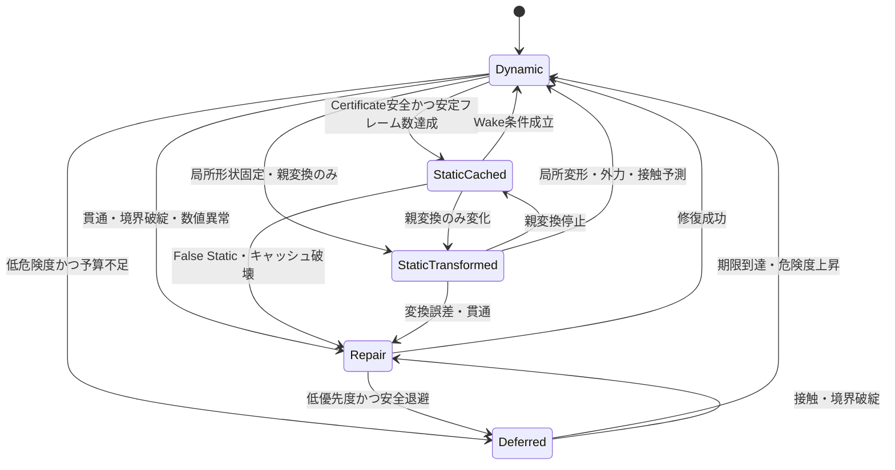
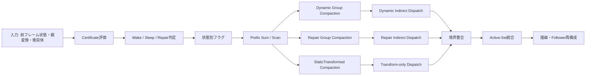

# 01 安全版・企画書兼設計書  
## 状態適応型 Segment Group データ表現による高密度線状構造の局所更新  
### ― 共有点責任分割・静止証明・予測 Wake・Repair を備えた 10 万本リアルタイム髪ランタイム ―

---

## 文書情報

| 項目 | 内容 |
|---|---|
| 文書名 | 01 安全版・企画書兼設計書 |
| 文書バージョン | 01-Safe v1.0 |
| 対象リポジトリ | `MKyosei2/HairSystem` |
| 対象ブランチ | `Novelty` |
| 基準スナップショット | 2026年7月14日確認時点 |
| 対象実装 | `SegmentGroupTopologyInfo`、`SegmentGroupRuntimeSnapshot`、`ActiveSetRuntimeInput`、`ActiveSetBudget` 周辺 |
| 研究対象 | 10万本の髪を表示するリアルタイム髪システム |
| 本文書の役割 | 新規性本体の研究企画、理論設計、実装設計、評価設計を一体化した基準文書 |
| 主張の強さ | 世界初を断定せず、既存手法との差を実験で検証する安全な主張を採用 |
| 発表用途 | 本文書を基に卒業研究発表用PowerPointを作成する |

> **注意**  
> 本文書は、既存のActive-Set型ハイブリッド髪ランタイム全体ではなく、設計書01の新規性本体を定義する。  
> Neural Prior、Dynamic Residual、Guide/Follower、LOD、局所補正物理は既存ランタイム側の構成要素であり、本研究の新規性本体そのものとは分けて扱う。

---

# 0. 研究の要約

本研究では、髪、ロープ、草、ケーブル、パーティクルトレイルなどの線状構造を、単純な点列または線分列として一様に処理するのではなく、**共有点を持つ「点―線―点」の重複 Segment Group** に分解し、各Groupが実行時状態に応じて保存形式と計算方式を切り替える**状態適応型データ表現**を提案する。

各Segment Groupは、次の5状態を持つ。

1. `StaticCached`：最後に確定した局所形状を再利用し、物理再計算を行わない  
2. `StaticTransformed`：局所形状は再計算せず、親変換のみを反映する  
3. `Dynamic`：積分、拘束、衝突、速度更新を行う  
4. `Deferred`：時間予算超過時に更新を延期する  
5. `Repair`：誤静止、貫通、境界不整合、速度欠落を修復する  

単純なSleepingとの差は、各Groupが次を持つ点にある。

- 共有点に対する責任分割
- 局所形状キャッシュ
- 状態別の保存形式
- 静止が安全であることを確認するStatic Certificate
- 衝突や親運動を事前に検知するPredictive Wake
- 静的状態から動的状態へ戻す速度復元
- 誤った静止判定を回復するRepair状態
- GPU上で状態別に処理対象を圧縮するCompaction
- 固定60 FPS予算に応じたDeferred制御

本研究の中心的問いは次である。

> **線状構造をSegment Group単位で状態適応化することで、全要素を毎フレーム計算する方式や、髪一本単位・ブロック単位のSleeping方式よりも、見た目と接触安全性を維持しながら、10万本表示条件における最悪フレーム時間を削減できるか。**

---

# 1. 研究背景

## 1.1 高密度髪シミュレーションの負荷

リアルタイムCGにおける髪は、数万本から10万本規模の表示要素を持つ。髪一本を複数点で表現し、各点に対して積分、長さ拘束、曲げ拘束、衝突、自己衝突、描画用頂点生成を行うと、処理量は急速に増加する。

特に問題となるのは平均処理時間ではなく、次の状況で発生する最悪フレーム時間である。

- キャラクターが急回転する
- 髪が肩、手、椅子、アクセサリへ一斉に接触する
- 強風や急停止によって広い範囲が動く
- 編集直後に多数の髪が再構成される
- 自己衝突候補が局所的に集中する
- 静的と判定した部分が誤って動き始める

60 FPSでは1フレームを16.67 ms以内に処理する必要がある。髪以外の描画やゲーム処理も含まれるため、髪ランタイムが使用できる時間は一般に16.67 msより小さい。

## 1.2 全要素を同じ方法で計算する非効率

髪全体が常に同程度に動いているわけではない。根元付近が頭部変換に追従するだけの部分、空間内でほぼ静止している部分、接触によって激しく変形する毛先が同時に存在する。

従来の一様更新では、ほぼ静止している線分にも動的線分と同じ処理を適用するため、時間と電力を消費する。一方、髪一本全体をSleepingさせる方式では、毛先だけが動く状況や、一本の途中だけが接触する状況を細かく扱えない。

## 1.3 既存ランタイムとの関係

HairSystemのNoveltyブランチには、Guide/Follower、Active-Set、Simulation Tier、フレーム予算、Segment Group用の状態スナップショットが存在する。

本研究はこれらを置き換えるものではなく、次の位置に挿入する。

```text
髪アセット
  ↓
Segment Groupトポロジー構築
  ↓
状態適応型Segment Group判定  ← 本研究の新規性本体
  ↓
Dynamic / Repair Groupの圧縮
  ↓
Active-Set・予算制御
  ↓
局所物理・Follower再構成・描画
```

---

# 2. 研究目的

本研究の目的は、10万本の髪を表示するリアルタイム髪システムにおいて、線状構造内部をSegment Group単位で静的・動的・延期・修復へ分類し、必要な部分だけを計算することで、次を両立することである。

1. 平均フレーム時間の削減  
2. 95、99、99.9パーセンタイルフレーム時間の削減  
3. 16.67 ms超過率の削減  
4. 接触・貫通・曲げ・長さ保持の品質維持  
5. 誤った静止判定の抑制  
6. 静的状態から動的状態への自然な復帰  
7. 共有点境界における位置・速度・曲率の連続性維持  
8. GPU上で静的Groupを実際のDispatch対象から除外すること  
9. 32 GB以下のシステムRAM条件への適合  
10. HairSystemの既存Active-Setランタイムとの統合  

---

# 3. 研究課題

本研究で解決すべき課題を次に示す。

## 3.1 表現上の課題

- 点―線―点を一つのGroupとしてどのように定義するか
- 隣接Groupが共有する点をどちらが更新するか
- 中間点を前後の半球に分ける考えを数式化する方法
- 同一ストランド内でGroup長を一定に保つ方法
- 最終Groupの余り長を扱う方法
- 静的状態と動的状態で保存データをどう切り替えるか

## 3.2 状態判定の課題

- 一時的に速度が小さいだけのGroupをStaticにしないこと
- 接触直前のGroupを事前にWakeすること
- 親Groupや隣接Groupの動きを伝播すること
- 強風、編集、急回転に反応すること
- Static判定の誤りを検出すること

## 3.3 復帰の課題

- StaticからDynamicへ戻す際に速度を失わないこと
- 親変換に由来する線速度・角速度を復元すること
- 隣接するStatic Groupとの境界を破綻させないこと
- 貫通状態から安全に復帰すること

## 3.4 GPU実装の課題

- シェーダー内の早期returnだけに頼らないこと
- Dynamic GroupとRepair GroupをGPU上で圧縮すること
- Indirect Dispatchを利用すること
- CPUとGPU間の状態読み戻しを最小化すること
- 状態別バッファをSoAで構成すること
- 10万本条件でメモリ帯域を抑えること

---

# 4. 研究仮説

## 仮説H1：局所状態適応の有効性

Segment Group単位の状態適応は、全要素更新および髪一本単位Sleepingよりも、同等の形状品質のもとでDynamic計算対象数を削減できる。

## 仮説H2：Static Certificateの有効性

速度閾値のみを用いたSleepingよりも、速度、加速度、拘束残差、親運動、隣接運動、衝突予測、編集影響を統合したStatic Certificateの方がFalse Static率を低減できる。

## 仮説H3：Predictive Wakeの有効性

現在の接触だけでなく、予測距離と相対速度を利用して事前Wakeすることで、貫通発生後にWakeする方式よりも最大貫通量とRepair回数を低減できる。

## 仮説H4：Repair状態の有効性

Staticから直接Dynamicへ遷移する方式よりも、速度復元、境界整合、貫通解消を行うRepair状態を挟む方が、復帰直後の位置誤差、速度誤差、振動を低減できる。

## 仮説H5：GPU Compactionの有効性

全GroupをDispatchしシェーダー内でStaticを除外する方式よりも、GPU CompactionとIndirect Dispatchを用いてDynamic／Repair Groupだけを起動する方式の方が、状態判定による削減を実フレーム時間へ反映できる。

## 仮説H6：10万本条件での成立性

10万本を表示し、数千本のGuideを動的計算するGuide/Follower構成において、通常シーンのDynamic Group率を5～15％、高負荷シーンを25～35％程度へ抑えられれば、旧世代寄りのPCでも固定60 FPSへ近づける。

---

# 5. 新規性の定義

## 5.1 新規性の中心

本研究の新規性候補は、次の統合表現にある。

> **共有点を持つ重複した点―線―点Segment Groupを基本単位とし、各Groupが局所形状キャッシュ、動的状態、方向責任領域、Static Certificate、Predictive Wake、Repair情報を保持し、状態に応じて保存形式とGPU実行方式を切り替える線状構造向け状態適応型データ表現。**

## 5.2 新規性ではないもの

次の要素単独は新規性として主張しない。

- 動いていないものを計算しない
- Sleeping／Wake
- Dirty Flag
- Active-Set
- LOD
- Guide/Follower
- 前回結果のキャッシュ
- GPU並列化
- Indirect Dispatch
- XPBD
- 質点ばね
- Cosserat Rod
- 衝突予測

これらは既存概念である。本研究では、これらをSegment Groupデータ型の状態、責任分割、復帰保証、予算制御へ統合した点を検証対象とする。

## 5.3 安全な主張文

論文・発表では次の表現を使用する。

> 本研究では、共有点を持つ点―線―点の重複Segment Groupを基本単位とし、局所形状キャッシュ、静止証明、予測Wake、修復状態、GPU状態別実行を統合した状態適応型線状構造表現を提案する。主要なSleeping、Dirty Flag、ストランド単位更新、ブロック単位更新、Active-Set方式との比較を通じて、その性能と品質上の差を検証する。

次のような断定は、十分な文献調査と比較実験が終わるまで使用しない。

- 世界初のデータ型である
- 既存研究には存在しない
- 必ず60 FPSを達成する
- どのPCでも高速である
- 品質を一切落とさない

---

# 6. 提案データ表現

## 6.1 基本点列

一本のストランドを次の点列として表す。

\[
\mathcal{P}=\{P_0,P_1,\ldots,P_n\}
\]

隣接点を結ぶ線分を、

\[
E_i=(P_i,P_{i+1})
\]

とする。

## 6.2 Segment Group

Segment Groupを次で定義する。

\[
G_i=(P_i,E_i,P_{i+1})
\]

隣接Groupは共有点を持つ。

\[
G_i=(P_i,E_i,P_{i+1})
\]

\[
G_{i+1}=(P_{i+1},E_{i+1},P_{i+2})
\]

したがって、一本の髪は次の重複構造になる。

```text
[P0 — E0 — P1]
             [P1 — E1 — P2]
                          [P2 — E2 — P3]
```

## 6.3 Group長

同一ストランド内では、基本Group長を一定値 \(\ell\) とする。

\[
\|P_{i+1}-P_i\|=\ell
\]

髪ごとに基本長が異なることは許可する。

\[
\ell^{(a)} \neq \ell^{(b)}
\]

最終Groupのみ余り長を持てる。

\[
\ell_{last}=\alpha\ell,\quad 0<\alpha\leq1
\]

このとき、最終Groupに`validLengthRatio`を保存する。

## 6.4 Groupの論理データ

各Groupの論理状態を次で表す。

\[
G_i =
(
I_i,
T_i,
S_i,
C_i,
V_i,
H_i,
Q_i,
B_i
)
\]

| 記号 | 内容 |
|---|---|
| \(I_i\) | トポロジー情報 |
| \(T_i\) | 親に対する局所変換 |
| \(S_i\) | 実行時状態 |
| \(C_i\) | 局所形状キャッシュ |
| \(V_i\) | 速度・角速度情報 |
| \(H_i\) | 共有点の方向責任領域 |
| \(Q_i\) | Static Certificate |
| \(B_i\) | 予算・優先度・Repair情報 |

---

# 7. 共有点の責任分割

## 7.1 二重更新問題

共有点 \(P_i\) を前後のGroupが同時に書き換えると、次が起こり得る。

- 書き込み競合
- 位置の二重補正
- 速度の不一致
- 曲率の不連続
- エネルギー増加
- GPU上の非決定性

したがって、位置の最終書き込み権限と、変形・衝突応答の責任領域を分けて定義する。

## 7.2 位置所有規則

共有点 \(P_i\) の最終位置は、前Group \(G_{i-1}\) の終点出力として一意に決定する。

\[
P_i = \operatorname{End}(G_{i-1})
\]

後Group \(G_i\) は、\(P_i\) を固定された始点入力として参照する。

\[
\operatorname{Start}(G_i)=P_i
\]

これにより、同一フレームで一つの共有点に対して複数Groupが最終書き込みを行わない。

## 7.3 半球責任領域

半球分割は位置所有ではなく、共有点周辺の変形要求や衝突応答をどちらのGroupが優先処理するかを決める。

前方向接線を、

\[
t_i^-=
\frac{P_i-P_{i-1}}
{\|P_i-P_{i-1}\|}
\]

後方向接線を、

\[
t_i^+=
\frac{P_{i+1}-P_i}
{\|P_{i+1}-P_i\|}
\]

とする。

共有点に加わる変位要求 \(\Delta p\) について、

\[
w^-=
\max(0,-\Delta p\cdot t_i^-)
\]

\[
w^+=
\max(0,\Delta p\cdot t_i^+)
\]

を計算する。

- \(w^- > w^+\)：前Group側の責任を優先
- \(w^+ > w^-\)：後Group側の責任を優先
- 差が小さい：境界協調処理へ送る

## 7.4 局所フレーム

半球だけでは曲げ方向を十分表現できないため、実装では接線 \(t\)、法線 \(n\)、従法線 \(b\) の局所フレームを用いる。

\[
F_i=[t_i,n_i,b_i]
\]

衝突法線や変形要求を局所フレームへ射影し、軸ごとの責任重みを求める。

## 7.5 境界協調

共有点の境界誤差を、

\[
e_p=\|P_i^{left}-P_i^{right}\|
\]

速度誤差を、

\[
e_v=\|V_i^{left}-V_i^{right}\|
\]

接線誤差を、

\[
e_t=1-t_i^{left}\cdot t_i^{right}
\]

とする。

いずれかが閾値を超えた場合、隣接Groupを`Repair`へ昇格する。

---

# 8. 状態定義

## 8.1 状態一覧

```cpp
enum class SegmentGroupRuntimeStateValue : uint32_t
{
    StaticCached = 0u,
    StaticTransformed = 1u,
    Dynamic = 2u,
    Deferred = 3u,
    Repair = 4u
};
```

## 8.2 StaticCached

### 条件

- 局所形状が安定している
- 親変換が変化していない、または描画時に一括適用できる
- 衝突予測が安全
- 編集影響がない
- Certificateが閾値以下
- 一定フレーム以上安定

### 処理

- 物理積分を行わない
- 長さ拘束・曲げ拘束を行わない
- 衝突の詳細解決を行わない
- 最後に確定した局所形状を再利用
- 必要最小限の安全監視だけを行う

### 保存

- 局所始点
- 局所方向
- 長さ
- 局所回転
- キャッシュID
- Certificate
- 最終Dynamicフレーム
- 親変換履歴

## 8.3 StaticTransformed

### 条件

- Group内部の相対形状は変わらない
- 頭部や親Groupの剛体的移動のみが存在する
- 近傍衝突がない

### 処理

\[
T_i^{world}=T_{parent}^{world}T_i^{local}
\]

- 局所形状の再計算は行わない
- 親変換だけを適用
- 衝突Broadphase用AABBだけ更新

### 重要点

単純なXYZ加算の等差数列ではなく、Quaternionまたは行列による階層変換を使用する。平行移動だけでなく、頭部回転に対応するためである。

## 8.4 Dynamic

### 条件

- 外力・慣性が存在する
- 接触または接触予測がある
- 編集された
- 親または隣接Groupが大きく動いた
- Certificateが破壊された
- Repair終了後に通常計算へ戻る

### 処理

- 予測位置計算
- 長さ拘束
- 曲げ拘束
- 根元拘束
- 衝突拘束
- 必要に応じて自己衝突
- 速度更新
- Certificate更新
- キャッシュ候補更新

## 8.5 Deferred

### 条件

- フレーム予算を超過する
- 危険度が低い
- 可視性が低い
- 前フレーム結果を短時間再利用しても品質影響が小さい

### 処理

- 1フレームまたは指定フレームだけ更新を延期
- 状態監視は継続
- 衝突予測が危険になったら即時DynamicまたはRepairへ昇格

### 制限

連続Deferred回数に上限を設ける。

\[
N_{deferred}\leq N_{max}
\]

## 8.6 Repair

### 発生条件

- False Static検出
- キャッシュ無効
- 共有点境界誤差
- 貫通
- Wake時の速度欠落
- トポロジー変更
- 予測と実測の大きな不一致

### 処理

1. 親変換からワールド位置を再構成  
2. 線速度・角速度を復元  
3. 共有点位置を整合  
4. 長さ拘束を強制適用  
5. 低反復回数で貫通を解消  
6. 隣接GroupへWakeを伝播  
7. 安全確認後にDynamicへ移行  

---

# 9. 状態遷移



## 9.1 ヒステリシス

状態の頻繁な往復を防ぐため、Sleep閾値とWake閾値を分ける。

\[
\theta_{sleep}<\theta_{wake}
\]

Staticへの移行には複数フレームの連続安定を要求する。

\[
N_{stable}\geq N_{sleep}
\]

Dynamicへの復帰は危険検出時に即時実行する。

---

# 10. Static Certificate

## 10.1 目的

速度が一時的に小さいだけのGroupをStaticにしないため、複数の危険要素を統合したStatic Certificateを定義する。

## 10.2 構成要素

\[
Q_i =
w_v q_v+
w_a q_a+
w_s q_s+
w_b q_b+
w_p q_p+
w_n q_n+
w_c q_c+
w_e q_e+
w_u q_u
\]

| 項 | 意味 |
|---|---|
| \(q_v\) | 速度リスク |
| \(q_a\) | 加速度リスク |
| \(q_s\) | 伸長残差 |
| \(q_b\) | 曲げ残差 |
| \(q_p\) | 親Group運動 |
| \(q_n\) | 隣接Group運動 |
| \(q_c\) | 衝突予測 |
| \(q_e\) | 編集影響 |
| \(q_u\) | モデル不確実性または予測誤差 |

すべて0～1へ正規化する。

## 10.3 Static条件

\[
Q_i < \theta_{sleep}
\]

かつ、

\[
N_{stable}\geq N_{sleep}
\]

かつ、

\[
q_c<\theta_c
\]

かつ、

\[
q_e<\theta_e
\]

を満たす場合のみStatic候補とする。

## 10.4 Certificate Risk

ランタイムでは、

\[
R_i^{cert}=\operatorname{clamp}\left(
\frac{Q_i-\theta_{sleep}}
{\theta_{wake}-\theta_{sleep}},0,1
\right)
\]

をActive-Setへ渡す。

---

# 11. Predictive Wake

## 11.1 衝突予測

Groupと衝突体の現在距離を \(d\)、相対速度を \(v_{rel}\)、予測時間を \(\Delta t_p\) とする。

\[
d_{pred}=d+\Delta t_p(v_{rel}\cdot n)
\]

\[
d_{pred}<r+\delta
\]

なら接触前にWakeする。

## 11.2 親運動Wake

\[
\|\Delta x_{parent}\|>\theta_x
\]

または、

\[
\Delta\phi_{parent}>\theta_\phi
\]

ならWakeする。

## 11.3 隣接伝播

Group \(G_i\) がDynamicになった場合、隣接Groupへ減衰付きWakeスコアを伝える。

\[
W_{i\pm k}=W_i\lambda^k
\]

\[
0<\lambda<1
\]

一定閾値以上の隣接GroupをDynamicへ移す。

## 11.4 外力Wake

- 風強度変化
- 重力方向変化
- キャラクター加速度
- 編集操作
- テレポート
- アニメーションの大きな姿勢変化

をWake要因とする。

---

# 12. StaticからDynamicへの速度復元

## 12.1 問題

Static中に速度を完全にゼロとして破棄すると、Wake直後に髪が一瞬遅れるか、不自然に跳ねる。

## 12.2 復元式

親の線速度を \(v_p\)、角速度を \(\omega_p\)、Group中心の親からの相対位置を \(r_i\) とする。

\[
v_i=
v_p+
\omega_p\times r_i+
v_i^{residual}
\]

角速度は、

\[
\omega_i=
\omega_p+
\omega_i^{local}
\]

とする。

`StaticCached`中も、次だけは保持する。

- 親変換の前回値
- 親変換の現在値
- 最終Dynamic時の残差速度
- 最終Dynamic時の局所角速度
- 最終Dynamicフレーム番号

## 12.3 Repair時の制限

復元速度が過大な場合は上限を設定する。

\[
\|v_i\|\leq v_{max}
\]

\[
\|\omega_i\|\leq\omega_{max}
\]

---

# 13. 衝突処理

## 13.1 Broadphase

すべてのStatic Groupへ詳細衝突を行わない。代わりに次を使用する。

- Group AABB
- Capsule近似
- Spatial HashまたはUniform Grid
- 衝突体のSwept AABB
- 近接距離閾値

## 13.2 Narrowphase対象

Narrowphaseは次だけに限定する。

- Dynamic
- Repair
- Predictive Wake候補
- Active-Set上位
- 編集直後
- 可視近距離

## 13.3 Self Collision

10万本すべての組合せは扱わない。次を採用する。

- Guide間のみ
- Cluster間近似
- 局所密度が高い部分のみ
- Dynamic／Repair Groupのみ
- 1セル当たり候補数上限
- 予算超過時の反復回数削減

## 13.4 安全Fallback

衝突処理が予算内に収まらない場合、次の順で品質を落とす。

1. 遠距離Follower自己衝突を停止  
2. Reduced Tierの反復回数を削減  
3. 不可視GroupをDeferred  
4. 低危険度接触を次フレームへ延期  
5. 高危険度Repairは必ず残す  

---

# 14. GPU実行設計

## 14.1 全体パイプライン



## 14.2 シェーダー内return方式を主方式にしない

次の方式だけでは、Static Group分のスレッド起動が残る。

```hlsl
if (state == STATIC_CACHED)
{
    return;
}
```

本研究では、状態判定後にDynamic／Repair Groupのインデックス列を生成し、`DispatchIndirect`で必要数だけ起動する。

## 14.3 推奨SoA

```cpp
struct SegmentGroupRuntimeBuffers
{
    Buffer<uint> state;
    Buffer<uint> previousState;
    Buffer<uint> strandIndex;
    Buffer<uint> startPointIndex;
    Buffer<uint> endPointIndex;
    Buffer<uint> parentGroupIndex;
    Buffer<uint> nextGroupIndex;

    Buffer<float3> localStart;
    Buffer<float3> localDirection;
    Buffer<float> length;
    Buffer<float> validLengthRatio;
    Buffer<float4> localRotation;

    Buffer<float3> cachedWorldStart;
    Buffer<float3> cachedWorldEnd;

    Buffer<float3> linearVelocity;
    Buffer<float3> angularVelocity;

    Buffer<float> certificate;
    Buffer<float> collisionRisk;
    Buffer<float> boundaryRisk;
    Buffer<float> repairUrgency;

    Buffer<uint> stableFrameCount;
    Buffer<uint> lastDynamicFrame;
    Buffer<uint> lastRepairFrame;

    Buffer<uint> flags;
};
```

## 14.4 Flags

```cpp
enum SegmentGroupFlags : uint32_t
{
    CacheValid        = 1u << 0,
    WakeRequested     = 1u << 1,
    RepairRequested   = 1u << 2,
    FalseStatic       = 1u << 3,
    MandatoryRepair   = 1u << 4,
    Visible           = 1u << 5,
    Edited            = 1u << 6,
    PredictiveContact = 1u << 7
};
```

## 14.5 メモリ二重化

フレーム中の読み書き競合を避けるため、位置、速度、状態は必要に応じてPing-Pongバッファを用いる。

## 14.6 決定性

共有点最終書き込みは一つのGroupに限定し、並列処理順によって結果が変わらないようにする。

---

# 15. Active-Setとの統合

## 15.1 役割分担

| 機構 | 役割 |
|---|---|
| Segment Group状態 | 計算形式を決める |
| Static Certificate | 静止が安全かを判定する |
| Predictive Wake | 将来の危険を検出する |
| Repair | 誤静止・境界・貫通を修復する |
| Active-Set | 限られた予算で優先対象を決める |
| Simulation Tier | Full／Reduced／Frozen／Cachedを決める |
| Guide/Follower | 物理本数と表示本数を分離する |

## 15.2 Active-Set入力

各Guideへ、所属Segment Groupから次を集約する。

- 最大Segment Group Risk
- Repair Urgency
- False Static Risk
- Certificate Risk
- Dynamic Group率
- Repair Group率
- 編集Group率
- 接触予測Group率

## 15.3 必須Repair

`mandatoryRepair`が立ったGroupを含むクラスタは、通常のTop-Kより優先する。ただし、無制限に必須化すると予算を破るため、次の二段階にする。

1. 安全上必須：貫通、NaN、共有点断裂  
2. 品質上推奨：軽い曲率誤差、低優先度境界誤差  

---

# 16. 予算制御

## 16.1 フレーム時間モデル

総処理時間を、

\[
T =
C_{fixed}
+
c_D N_D
+
c_R N_R
+
c_T N_T
+
c_C N_C
\]

とする。

| 記号 | 内容 |
|---|---|
| \(C_{fixed}\) | 状態判定、描画準備などの固定費 |
| \(N_D\) | Dynamic Group数 |
| \(N_R\) | Repair Group数 |
| \(N_T\) | StaticTransformed Group数 |
| \(N_C\) | 詳細衝突候補数 |
| \(c_*\) | 実測した単位コスト |

60 FPS条件は、

\[
T\leq16.67\text{ ms}
\]

である。

ただし髪に割り当てる予算を \(B_{hair}\) とする場合、

\[
T_{hair}\leq B_{hair}
\]

を満たすように制御する。

## 16.2 実測値を使う

`estimatedSegmentGroupCostMilliseconds`のような値は固定仮定ではなく、実行中の移動平均から更新する。

\[
\hat{c}_D(t)=
(1-\eta)\hat{c}_D(t-1)+
\eta\frac{T_D(t)}{N_D(t)}
\]

## 16.3 優先順位

1. NaN・断裂・深い貫通  
2. Mandatory Repair  
3. 接触予測  
4. 編集直後  
5. シルエット上重要  
6. 高速度・高加速度  
7. 通常Dynamic  
8. 遠距離・不可視  
9. StaticCached  

---

# 17. 10万本条件

## 17.1 基本条件

本研究の評価では、**表示本数を10万本**とする。

ただし、10万本すべてを独立した高精度物理対象にすることは前提としない。Guide/Follower構成を用いる。

### 推奨初期条件

| 項目 | 初期値 |
|---|---:|
| 表示髪本数 | 100,000本 |
| Guide本数 | 2,000～5,000本 |
| Follower本数 | 残り |
| 1 Guide当たり点数 | 16～24点 |
| Group長 | 同一ストランド内で一定 |
| Group数 | 1本当たり15～23 |
| 通常Dynamic Group率 | 5～15％を目標 |
| 高負荷Dynamic Group率 | 25～35％以内を目標 |
| Solver反復 | 3～8回の予算適応 |
| フレームレート | 60 FPS |
| 1フレーム上限 | 16.67 ms |
| システムRAM | 32 GB以下 |

## 17.2 10万本すべてを独立物理にしない理由

10万本×16～24点では160万～240万点になる。これに複数反復の拘束と自己衝突を適用すると、旧世代寄りのPCでは安定60 FPSが難しい。

本研究は「10万本を表示しつつ、GuideとSegment Group状態適応によって物理対象を限定する」構成を評価する。

## 17.3 旧世代寄りPCの評価例

最低でも次の2～3段階で測定する。

- Low：GTX 1660級、6 GB VRAM、旧世代6コアCPU
- Mid：RTX 2060／RTX 3060級
- Reference：研究室で利用可能な主力PC

ハードウェア名、ドライバ、解像度、ビルド設定を明記する。

---

# 18. アルゴリズム

## 18.1 フレーム処理

```text
入力:
  前フレームのSegment Group状態
  親変換
  外力
  衝突体
  編集情報
  フレーム予算

1. 各GroupのCertificate要素を計算する
2. Predictive Contactを計算する
3. 親・隣接GroupからWakeを伝播する
4. 状態遷移候補を決める
5. False StaticとRepair条件を検出する
6. 予算に応じてDeferred候補を決める
7. 状態別フラグ列を作る
8. Prefix Sumで状態別インデックス列を圧縮する
9. StaticTransformedを変換する
10. Repairを実行する
11. Dynamic物理を実行する
12. 共有点境界を整合する
13. Certificateとキャッシュを更新する
14. Guide単位リスクをActive-Setへ集約する
15. Followerを再構成して描画する
16. 実測コストを更新する
```

## 18.2 状態判定疑似コード

```cpp
State DecideState(const GroupMetrics& m, const BudgetState& budget)
{
    if (m.hasNaN || m.deepPenetration || m.boundaryBroken)
        return State::Repair;

    if (m.falseStatic || !m.cacheValid)
        return State::Repair;

    if (m.edited || m.predictiveContact)
        return State::Dynamic;

    if (m.parentMotion > wakeThreshold ||
        m.neighborWake > wakeThreshold ||
        m.certificate > wakeThreshold)
        return State::Dynamic;

    if (m.certificate < sleepThreshold &&
        m.stableFrameCount >= requiredStableFrames)
    {
        if (m.parentTransformChanged)
            return State::StaticTransformed;

        return State::StaticCached;
    }

    if (budget.overloaded && m.lowRisk && m.deferCount < maxDeferCount)
        return State::Deferred;

    return State::Dynamic;
}
```

---

# 19. データ不変条件

実装では次を常に満たす。

## 19.1 トポロジー不変条件

\[
G_i.endPointIndex=G_{i+1}.startPointIndex
\]

## 19.2 長さ不変条件

\[
\left|
\|P_{i+1}-P_i\|-\ell_i
\right|
\leq\epsilon_\ell
\]

## 19.3 共有点一意書き込み

一つのフレームで共有点の最終位置を書き込むGroupは一つだけとする。

## 19.4 キャッシュ不変条件

`StaticCached`または`StaticTransformed`では、

```text
cacheValid == true
```

でなければならない。無効ならRepairへ移行する。

## 19.5 状態安全条件

深い貫通、NaN、断裂、トポロジー不一致を持つGroupはStaticへ移行できない。

## 19.6 Deferred上限

\[
deferCount\leq maxDeferCount
\]

---

# 20. 実装設計

## 20.1 現行コードとの対応

| 現行要素 | 本設計での役割 |
|---|---|
| `SegmentGroupRange` | ストランドごとのGroup範囲 |
| `SegmentGroupBlockRange` | Groupブロック範囲 |
| `SegmentGroupTopologyInfo` | トポロジー、Group数、平均長、ハッシュ |
| `SegmentGroupRuntimeSnapshot` | 評価・Active-Set入力用の状態要約 |
| `ActiveSetRuntimeInput.segmentGroupSnapshots` | Segment Group状態の受け渡し |
| `guideSegmentGroupRisk` | Guide単位の最大・平均Group危険度 |
| `guideRepairUrgency` | Repair優先度 |
| `guideFalseStaticRisk` | 誤静止リスク |
| `guideCertificateRisk` | Certificate違反リスク |
| `ActiveSetDispatchPack` | 状態別GPU Dispatchの基礎 |

## 20.2 追加する主要ファイル案

```text
include/hairgpu/SegmentGroupRuntime.h
src/hairgpu_core/SegmentGroupRuntime.cpp

include/hairgpu/SegmentGroupCertificate.h
src/hairgpu_core/SegmentGroupCertificate.cpp

include/hairgpu/SegmentGroupGpuDispatch.h
src/hairgpu_core/SegmentGroupGpuDispatch.cpp

apps/dx11_viewer/shaders/SegmentGroupClassify.hlsl
apps/dx11_viewer/shaders/SegmentGroupCompact.hlsl
apps/dx11_viewer/shaders/SegmentGroupTransform.hlsl
apps/dx11_viewer/shaders/SegmentGroupDynamic.hlsl
apps/dx11_viewer/shaders/SegmentGroupRepair.hlsl
apps/dx11_viewer/shaders/SegmentGroupBoundary.hlsl

tools/research/segment_group_eval.py
docs/01_STATE_ADAPTIVE_SEGMENT_GROUP_SAFE_DESIGN.md
```

## 20.3 責務分離

### `SegmentGroupRuntime`

- 状態遷移
- Groupデータ
- フレーム履歴
- キャッシュ管理

### `SegmentGroupCertificate`

- Certificate計算
- False Static検出
- Predictive Wake
- 隣接伝播

### `SegmentGroupGpuDispatch`

- Compaction
- Indirect Args
- 状態別Dispatch Pack

### `ActiveSet`

- Guide／Cluster単位の予算優先順位
- Repair強制選択
- Simulation Tier決定

## 20.4 現行重複定義の整理

`ActiveSetBudget`内の01関連設定は専用構造へ分離する。

```cpp
struct SegmentGroupBudgetSettings
{
    uint32_t maxDynamicGroups = 0u;
    uint32_t maxRepairGroups = 0u;
    uint32_t maxDeferredFrames = 2u;

    float targetMilliseconds = 3.0f;
    float measuredDynamicGroupCostMs = 0.0f;
    float measuredRepairGroupCostMs = 0.0f;

    bool enforceMandatoryRepair = true;
};
```

これにより、同名メンバの重複、Active-Set責務の肥大化、仮定コストと実測コストの混在を避ける。

---

# 21. 実装段階

## Phase 0：整合性修正

- 重複定義を削除
- Noveltyブランチをビルド可能にする
- 状態名と設計書用語を統一
- 10万本テスト設定を固定

## Phase 1：トポロジー

- 点―線―点Group生成
- Group長検証
- 最終Group有効長
- トポロジーハッシュ
- 共有点所有テーブル

## Phase 2：CPU参照実装

- 状態遷移
- Certificate
- Predictive Wake
- Repair
- 共有点境界整合
- 単体テスト

## Phase 3：GPU状態判定

- Certificate Kernel
- State Classify Kernel
- Wake伝播
- フラグ列生成

## Phase 4：GPU Compaction

- Scan
- Dynamic Index Buffer
- Repair Index Buffer
- Transform Index Buffer
- Indirect Args

## Phase 5：状態別Solver

- StaticTransformed
- Dynamic
- Repair
- Boundary
- Cache Update

## Phase 6：Active-Set統合

- Guideリスク集約
- Repair必須選択
- 予算適応
- Simulation Tier

## Phase 7：評価

- Baseline
- Ablation
- 10万本
- 旧世代PC
- 品質・性能・メモリ

---

# 22. 比較対象

## 22.1 Baseline A：全Group Dynamic

すべてのGroupへ毎フレーム同じ物理計算を行う。

## 22.2 Baseline B：Strand Sleep

髪一本全体が静止した場合だけ更新を止める。

## 22.3 Baseline C：Block Sleep

8Groupなど固定ブロック単位で静止させる。

## 22.4 Baseline D：単純Segment Sleep

速度閾値だけで各線分を静止させる。

## 22.5 Baseline E：Active-Setのみ

Segment Group状態を使わず、Guide ClusterのTop-Kだけを計算する。

## 22.6 Proposed

- 重複Segment Group
- 共有点責任分割
- 状態別保存形式
- Static Certificate
- Predictive Wake
- Repair
- GPU Compaction
- Active-Set統合
- 予算制御

---

# 23. アブレーション

| ID | 構成 |
|---|---|
| P0 | Segment Group状態のみ |
| P1 | P0 + Static Certificate |
| P2 | P1 + Predictive Wake |
| P3 | P2 + Repair |
| P4 | P3 + 共有点半球責任 |
| P5 | P4 + GPU Compaction |
| P6 | P5 + Active-Set予算制御 |
| Full | すべて |

追加比較：

- AoS vs SoA
- CPU分類 vs GPU分類
- return方式 vs Compaction方式
- 固定閾値 vs 実測適応閾値
- Wake伝播距離0／1／2／3 Group
- Stable Frame数4／8／16
- Repair反復1／2／4
- Guide数2,000／3,000／5,000

---

# 24. 評価シーン

## S1：静止主体

キャラクターがほぼ静止し、呼吸と微小頭部運動だけが存在する。

## S2：歩行

周期的な頭部移動と軽い髪揺れ。

## S3：急停止

高速移動後に急停止し、毛先が大きく動く。

## S4：急回転

頭部が大きく回転し、StaticTransformedからDynamicへの移行が発生する。

## S5：外部接触

肩、手、椅子、アクセサリ、外部物体と接触する。

## S6：強風

広範囲のWakeが必要な場面。

## S7：局所編集

一本または局所領域の髪を編集する。

## S8：False Static誘発

速度が一時的にゼロになるが、拘束残差や接触予測が残る状況。

## S9：予算超過

多数のGroupが同時にDynamic／Repair候補になる状況。

## S10：10万本表示

近距離で100,000本を表示し、Guide 2,000～5,000本を使用する。

---

# 25. 評価指標

## 25.1 性能

- 平均フレーム時間
- 中央値
- 95パーセンタイル
- 99パーセンタイル
- 99.9パーセンタイル
- 最大フレーム時間
- 16.67 ms超過率
- 髪処理時間
- 状態判定時間
- Compaction時間
- Dynamic Solver時間
- Repair時間
- Follower再構成時間
- 描画準備時間

## 25.2 状態効率

- Dynamic Group率
- StaticCached率
- StaticTransformed率
- Deferred率
- Repair率
- キャッシュ再利用率
- Wake回数
- 状態遷移回数
- 状態振動回数
- 平均Static継続フレーム数

## 25.3 品質

- 平均位置誤差
- 最大位置誤差
- 接線誤差
- 曲率誤差
- 長さ誤差
- 速度誤差
- 最大貫通深度
- 1秒当たり貫通回数
- 自己衝突見逃し率
- シルエット誤差
- 束感保持

## 25.4 新規性本体に固有の指標

- False Static率
- Static→Dynamic復元位置誤差
- Static→Dynamic復元速度誤差
- Wake遅延フレーム数
- Predictive Wake適中率
- Repair成功率
- 共有点位置不一致
- 共有点速度不一致
- 共有点接線不一致
- 半球責任競合回数
- Certificate違反率
- Compaction削減率
- return方式に対する起動スレッド削減率

## 25.5 メモリ

- システムRAM
- VRAM
- 1Group当たりバイト数
- キャッシュメモリ
- Compaction用一時バッファ
- Peak Memory
- CPU-GPU転送量

---

# 26. False Staticの定義

Ground Truthとして全Group Dynamicの結果を使用する。

Static Group \(G_i\) の誤差を、

\[
E_i=
w_pE_i^{pos}+
w_vE_i^{vel}+
w_cE_i^{collision}+
w_bE_i^{boundary}
\]

とする。

\[
F_i=
\begin{cases}
1 & S_i\in\{StaticCached,StaticTransformed\}
\land E_i>\theta_E \\
0 & \text{otherwise}
\end{cases}
\]

False Static率は、

\[
R_{FS}=
\frac{\sum_i F_i}
{\#\{i\mid S_i\in Static\}}
\]

とする。

---

# 27. 成功条件

## 27.1 最低成功条件

- 全Group Dynamicより平均髪処理時間を20％以上削減
- 99パーセンタイル髪処理時間を15％以上削減
- 16.67 ms超過率を低減
- False Static率5％未満
- 共有点位置誤差が許容閾値以内
- 最大貫通量が全Dynamicの1.2倍以内
- Repair成功率90％以上
- 10万本表示で60 FPS達成率95％以上を少なくともReference PCで達成

## 27.2 強い成功条件

- 平均髪処理時間35％以上削減
- 99パーセンタイル25％以上削減
- Static Cache再利用率60％以上
- False Static率2％未満
- Repair成功率95％以上
- 16.67 ms超過率1％未満
- Low PCでも60 FPS達成率90％以上
- 主観評価で基準方式との品質差が小さい

## 27.3 失敗として扱う条件

- FPSだけ上がり貫通が大きく増える
- False Staticが頻発する
- Static／Dynamicが毎フレーム振動する
- GPU Compactionコストが削減量を上回る
- 共有点に断裂や速度不一致が生じる
- 10万本条件を下げないと比較できない
- Baselineとの差が統計的・実用的に小さい

---

# 28. 理論上の計算量

全Group数を \(N\)、Dynamic Group数を \(N_D\)、Repair Group数を \(N_R\) とする。

全更新方式は概ね、

\[
O(NI+K_{collision})
\]

である。ここで \(I\) はSolver反復数。

提案法は、

\[
O(N)+O(N_D I)+O(N_R I_R)+O(K_{active})
\]

である。

最初の \(O(N)\) は状態判定・軽量Certificate評価である。ただし、GPU上で単純な連続アクセスとして処理し、重い拘束と衝突は \(N_D\) と \(N_R\) に限定する。

提案法が有効となる条件は、

\[
N_D I + N_R I_R + C_{compact}
<
N I
\]

である。

したがって、Dynamic率が高い場面では利益が小さくなる。強風など全体が動く場面では全Dynamicへ安全にフォールバックし、状態適応のオーバーヘッドだけが増えないようにする。

---

# 29. リスクと対策

| リスク | 対策 |
|---|---|
| Sleepingの言い換えに見える | 共有点責任、状態別保存、Certificate、Repair、GPU実行の統合を明示 |
| 半球分割が曖昧 | 位置所有と方向責任を分離し、局所フレームで定義 |
| 頻繁な状態振動 | ヒステリシスとStable Frame数 |
| Wakeが遅い | Predictive Wakeと隣接伝播 |
| Wake時に髪が跳ねる | 親速度・角速度から復元しRepairを挟む |
| Staticでも衝突する | Swept AABBと低コスト安全監視 |
| Compactionが高コスト | GroupをBlock化し、状態変化が少ない場合は前回リスト再利用 |
| 10万本でメモリ超過 | Guide/Follower、SoA、圧縮状態、16-bit量子化の検討 |
| すべてDynamicになる | 全Dynamicフォールバックと判定コスト上限 |
| Repairが集中する | Mandatory Repair優先、品質Repairを延期 |
| 旧PCで60 FPS未達 | Guide数、反復、自己衝突、Follower更新頻度を段階評価 |
| 世界初主張が危険 | 「提案し比較検証する」と表現し、絶対断定を避ける |

---

# 30. 期待される成果

1. 線状構造を点―線―点の重複Groupとして扱う状態適応型データ表現  
2. 共有点の最終書き込みと方向責任を分けた境界処理  
3. False Staticを抑えるStatic Certificate  
4. 衝突前に動的化するPredictive Wake  
5. 静的状態から自然に復帰するRepair方式  
6. 状態別CompactionとIndirect DispatchによるGPU実行  
7. HairSystemのActive-SetとSegment Groupを統合した予算制御  
8. 10万本表示条件での性能・品質・メモリ評価  
9. Strand Sleep、Block Sleep、単純Segment Sleep、Active-Setとの比較  
10. 髪以外の線状構造へ応用できる一般化可能性の提示  

---

# 31. 卒業研究としての最終貢献候補

本研究の貢献は、次の3点へ整理する。

## 貢献1：状態適応型Segment Group表現

共有点を持つ点―線―点Groupが、局所形状キャッシュと動的状態を保持し、状態に応じて計算・保存形式を切り替える。

## 貢献2：安全な状態遷移

Static Certificate、Predictive Wake、速度復元、Repairにより、単純Sleepingで起きる誤静止、接触遅れ、復帰破綻を抑える。

## 貢献3：固定予算GPU実行

状態別Compaction、Indirect Dispatch、Active-Set統合により、静的Groupを実際の重いGPU計算から除外し、固定60 FPSに向けて処理量を制御する。

---

# 32. 発表用の一文

> 本研究は、髪を一本単位で止めるのではなく、一本の内部を点―線―点の小さなGroupへ分け、それぞれが「再利用」「変換のみ」「物理計算」「延期」「修復」を切り替えるデータ表現を提案する。動かない部分は最後の正しい形を再利用し、接触や急な運動が近づいた部分だけを事前に起こすことで、10万本の髪を表示しながら60 FPSの安定化を目指す。

---

# 33. PowerPoint化の推奨構成

## 1枚目：タイトル

- 状態適応型Segment Groupデータ表現
- 10万本リアルタイム髪
- Noveltyブランチ

## 2枚目：問題

- 全髪を毎フレーム計算すると重い
- 髪一本単位Sleepでは粗い
- 接触直前・毛先だけ動くケースに弱い

## 3枚目：着想

- 点―線―点を一つのGroup
- 髪一本の中でGroupごとに状態が違う
- 静的部分は最後の結果を再利用

## 4枚目：新しいデータ表現

- 重複Segment Group
- 共有点
- 同一ストランド内の等長Group
- 局所キャッシュ

## 5枚目：5状態

- StaticCached
- StaticTransformed
- Dynamic
- Deferred
- Repair

## 6枚目：安全性

- Static Certificate
- Predictive Wake
- False Static
- Repair
- 速度復元

## 7枚目：共有点処理

- 一意の位置所有
- 半球・局所フレーム責任
- 境界誤差でRepair

## 8枚目：GPU処理

- 状態判定
- Compaction
- Indirect Dispatch
- Staticを本当にDispatchから外す

## 9枚目：10万本構成

- 100,000本表示
- 2,000～5,000 Guide
- 通常Dynamic率5～15％目標
- 32 GB以下

## 10枚目：比較実験

- 全更新
- Strand Sleep
- Block Sleep
- 単純Segment Sleep
- Active-Set
- Proposed

## 11枚目：評価指標

- 99 percentile
- 16.67 ms超過率
- False Static
- 貫通
- 共有点誤差
- Repair成功率

## 12枚目：貢献

- 状態適応型データ表現
- 安全な状態遷移
- 固定予算GPU実行

---

# 34. 参考文献・関連領域

以下は本文を構成する主要な関連領域である。最終論文では、各論文の正式な書誌情報、発行年、会議名、DOIまたはURLを確認して記載する。

## 髪・線状構造

1. Bertails et al., *Super-Helices for Predicting the Dynamics of Natural Hair*, ACM Transactions on Graphics, 2006.  
2. Selle et al., *A Mass Spring Model for Hair Simulation*, ACM Transactions on Graphics, 2008.  
3. Stuyck et al., *Quaffure: Real-Time Quasi-Static Neural Hair Simulation*, CVPR 2025.  
   - https://openaccess.thecvf.com/content/CVPR2025/papers/Stuyck_Quaffure_Real-Time_Quasi-Static_Neural_Hair_Simulation_CVPR_2025_paper.pdf  
   - https://arxiv.org/abs/2412.10061  
4. *Augmented Mass-Spring Model for Real-Time Dense Hair Simulation*, 2025.  
   - https://arxiv.org/abs/2412.17144  
5. *Stable Cosserat Rods*, 2025.  
   - https://dl.acm.org/doi/10.1145/3721238.3730618  
   - https://jerryhsu.io/projects/StableCosseratRods/  
6. *Neuralocks*, 2025 preprint.  
   - https://arxiv.org/abs/2507.05191  
7. *HairFormer*, 2025 preprint.  
   - https://arxiv.org/abs/2507.12600  

## 拘束・変形体

8. Müller et al., *Position Based Dynamics*, Journal of Visual Communication and Image Representation, 2007.  
9. Macklin et al., *XPBD: Position-Based Simulation of Compliant Constrained Dynamics*, Motion in Games, 2016.  
10. Cosserat Rod、Discrete Elastic Rod、Mass-Spring、FEMに関する基礎研究。

## 局所更新・実行制御

11. Rigid Body Sleeping / Island Sleeping  
12. Particle Sleep / Wake  
13. Dirty Flag / Incremental Computation  
14. Adaptive Simulation / Local Time Stepping  
15. Temporal Coherence / Cached Simulation  
16. Sparse Update / Active-Set Optimization  
17. GPU Stream Compaction / Prefix Sum / Indirect Dispatch  
18. Budget-Aware Scheduling / Bounded-Latency Runtime  

---

# 35. 最終まとめ

本研究は、単に動いていない髪を停止する研究ではない。

提案の中心は、一本の線状構造を、共有点を持つ点―線―点の重複Segment Groupへ分解し、各Groupが次を持つことである。

- 局所形状キャッシュ
- 静的・動的・延期・修復状態
- 共有点の一意な位置所有
- 半球および局所フレームによる方向責任
- Static Certificate
- Predictive Wake
- StaticからDynamicへの速度復元
- Repair
- GPU状態別Compaction
- Active-Setとフレーム予算の統合

これらを、全更新、髪一本単位Sleep、Block Sleep、単純Segment Sleep、Active-Setのみと比較し、10万本表示条件で性能、品質、False Static、共有点誤差、貫通、メモリを評価する。

この形であれば、新規性を「動かないものを計算しない」という既存概念に依存させず、**状態・保存形式・責任分割・復帰保証・GPU実行を統合した線状構造用データ表現**として、卒業研究の中心へ据えることができる。