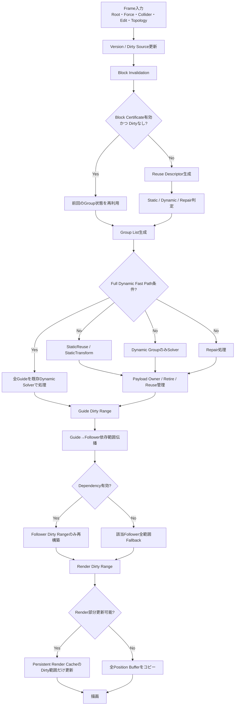

# 第4章　提案手法

## 4.1 提案手法の概要

本研究では，高密度な髪のリアルタイムシミュレーションにおいて，ガイドストランドの状態変化が局所的であるにもかかわらず，Guide，Follower，描画用データを広い範囲で更新し続けることで生じる処理負荷を抑えるため，**GPU-Resident Segment-Group Adaptive Payload Type（SG-APT）**を提案する。

Guide / Follower方式では，少数のGuideを物理シミュレーションし，多数のFollowerをGuideの変形から再構築することで，表示本数を増やしながら物理計算量を抑える。しかし，Guide側で一部の領域しか変化していない場合でもFollowerの広い範囲を再構築し，さらに描画用データまで更新すると，Guide物理を局所化した効果がEnd-to-Endのフレーム時間へ十分に反映されない。

そこで本研究では，Guideの隣接点間を**Segment Group**として管理し，Segment Groupごとに「再利用可能な状態」と「動的計算が必要な状態」を区別する。各Segment Groupは，常に保持する固定情報と，動的計算時にのみ必要となる追加情報へ分離する。前者を**Fixed Core**，後者を**Dynamic Payload**とする。これにより，静的なSegment Groupに対して速度，制約計算用の一時値，前フレームの動的状態などを常時保持・更新する必要を減らす。

さらに，本研究ではSG-APTをGuide側の部分更新だけで終わらせない。Guideの更新範囲を`Guide Dirty Range`として表現し，Followerへ伝播させて`Follower Dirty Range`を生成し，最後に描画側の`Render Dirty Range`へ変換する。これにより，

> Guideの局所更新  
> → Followerの局所再構築  
> → 描画用データの局所更新

というEnd-to-Endの更新連鎖を構成する。

一方，部分更新には状態判定，Dirty Range生成，Payload管理，Compactionなどの管理コストが追加される。動的領域が大きい場合には，この管理コストが部分更新による削減量を上回る可能性がある。そこで，動的領域が一定以上に増加した場合や，部分更新経路の実測時間が全動的経路に近づいた場合には，SG-APTの細かな管理を継続せず，従来の全動的処理へ切り替える**Full Dynamic Fast Path**を導入する。

本手法の中心は，すべてのフレームで常に部分更新を行うことではない。**更新しなくてよい範囲を安全に判定し，局所更新が有利なときだけ局所化し，不利または不確実なときには全動的処理へ戻す**ことにある。

---

## 4.2 従来のFollower再構築処理

本研究で用いるHairSystemはGuide / Follower方式を採用している。Guideは物理シミュレーションの対象であり，FollowerはGuideの変形を参照して表示本数を増やすために用いられる。Followerは親Guideとの対応関係，Follow Weight，Clump Weight，Noise Weightなどを用いて位置を生成する。

従来経路では，Follower更新を行う際，Guide側のどの**セグメント範囲**が変化したかをFollower側の依存範囲まで細分化して伝える仕組みが十分ではなかった。そのため，更新対象が限定されている場合でも，Follower単位，あるいは設定によってはFollower全体に対して更新処理を行う必要があった。

表示髪本数を \(N\)，Guide本数を \(G\)，1本のGuideに対応するFollower本数を \(F\)，1本当たりの点数を \(P\) とすると，

\[
N = G(1+F)
\]

である。本研究の固定構成では，

\[
G = 4000,\quad F = 24,\quad P = 128
\]

であるため，

\[
N = 4000 \times 25 = 100000
\]

となる。このうちFollowerは96,000本であり，Follower全体の点数は，

\[
96000 \times 128 = 12,288,000
\]

点となる。

Guideの一部だけが変化した場合でも，Follower側を広い範囲で更新すると，Guide側で削減した処理量に対してFollower側の計算量が支配的になりやすい。さらにFollower更新後に描画用の位置や頂点を全体更新すると，局所化の効果が描画段階で失われる。

したがって本研究では，Followerを「更新するか，更新しないか」だけでなく，**どのFollowerの，どのセグメント範囲を更新するか**まで依存関係として扱う。

---

## 4.3 Follower全再構築の抑制

Follower全再構築を抑制するため，本研究ではGuide側の変更範囲を段階的にFollowerへ伝播する。

まず，Guideごとに更新が必要となった最小のセグメント区間を

\[
R_g = [s_g, e_g]
\]

として表す。ここで \(s_g\) は更新開始セグメント，\(e_g\) は更新終了セグメントである。

Follower \(f\) がGuide \(g\) に依存しているとき，Follower側の更新範囲を，

\[
R_f =
[\max(0, s_g-b),\;
 \min(P-2, e_g+b)]
\]

として生成する。\(b\) は境界付近の不連続を避けるためのGuard Bandであり，本実装では1セグメントを基本値とする。

この処理により，Guideの一部だけが変化した場合，Follower全128点を無条件に更新するのではなく，変化の影響を受ける点だけを対象にできる。

Followerの局所再構築では，親Guideの現在位置とRest Positionとの差を用いてFollowerの局所形状を更新する。また，Follow Weight，Clump Weight，Noise Weightを適用し，Follower固有の形状差を維持する。したがって，単純にGuide位置をコピーするのではなく，Guideの変化をFollowerのRest形状へ反映する形で更新する。

ただし，依存関係そのものが不正である場合や，Follower MappingのVersionが一致しない場合に局所範囲を使用すると更新漏れが生じる可能性がある。このため，依存関係を検証できない場合には局所更新を行わず，当該Followerの全範囲をDirtyとして扱う。

この方針により，

- 正常な依存関係が確認できる場合：局所再構築
- 依存関係が不明または不正な場合：Follower全範囲再構築

というFail-safeな更新方式を採用する。

---

## 4.4 Block Certificateによる更新判定

Segment Groupをすべて毎フレーム詳細判定すると，判定処理そのものが大きなコストになる。そこで本研究では，複数のSegment Groupをまとめた**Block**を用い，Block単位で「前回の判定結果を再利用できるか」を判定する。

本論文では，この再利用可否を表す情報を**Block Certificate**と呼ぶ。実装上は単一の`BlockCertificate`構造体に限定せず，Blockの記述情報，Groupの再利用記述子，Version，Dirty Flagを組み合わせてCertificateを構成する。

1つのBlockには複数のSegment Groupを含める。本研究の固定条件では1 Block当たり32 Groupを基本とする。Blockは少なくとも次の情報を保持する。

- Blockに属する先頭GroupとGroup数
- Dirty Flag
- 有効状態
- 空間Bounds
- Block内の最大移動量
- Colliderまでの最小余裕
- 最大制約残差
- 最大境界誤差
- Descriptor Version
- 最終更新Frame

Blockに新たな変更要因がなく，Versionが一致し，Certificateが有効である場合には，Block内部のGroupについて詳細な状態判定を再実行せず，前回の状態を利用する。

Blockを \(B_i\)，そのDirty状態を \(D_i\)，Certificateの有効性を \(C_i\) とすると，簡略化した更新条件は，

\[
\mathrm{Evaluate}(B_i)=
\begin{cases}
0 & (C_i=1 \land D_i=0)\\
1 & \text{otherwise}
\end{cases}
\]

と表せる。

Dirtyとなる要因には，Root Transform，外力，Collider，Topology，編集，Follower依存関係，Descriptorの有効期限，境界誤差などがある。Colliderについては，単にCollider Versionが変化しただけで全BlockをDirtyとするのではなく，Colliderの移動範囲とBlockのBoundsが交差するかを用いて影響範囲を絞る。

Block Certificateの目的は，静的なBlockを永久に静的とみなすことではない。一定期間ごとのDescriptor再検証，Version不一致，Collider接近，編集などによってCertificateを無効化できるようにすることで，更新省略と安全性を両立する。

---

## 4.5 Payload移行処理の非毎フレーム化

Static状態とDynamic状態を別Bufferへ分離する方式では，状態が変化するたびにデータを別領域へコピーする必要がある。またStatic/Dynamicの並びを毎フレーム詰め直す設計では，Group本体の移行量が増え，局所更新の効果を相殺する可能性がある。

本研究では，Segment Groupの**Fixed CoreのGPU IndexをTopologyが変化しない限り固定**する。StaticからDynamic，DynamicからStaticへ状態が変わってもFixed Core自体を別Bufferへ移動しない。

動的計算に追加で必要な値だけを`Dynamic Payload`として分離し，Dynamic，Repair，ForcedDynamicなど，動的情報を必要とするGroupのみがPayloadを参照する。静的Groupは有効なDynamic Payloadを持たない。

したがって本研究でいう「Payload移行処理の非毎フレーム化」とは，**全Groupの本体データを毎フレームStatic/Dynamic Buffer間で移行する処理を行わず，状態遷移に伴って必要になる追加Payloadの所有関係だけを管理する**ことを意味する。

PayloadにはOwner，Version，Generationを持たせる。Payload \(p\) をGroup \(g\) が有効に使用できる条件を，

\[
owner(p)=g
\]

\[
version(p)=version(g)
\]

\[
generation(p)=generation(g)
\]

とする。

GPUが以前のPayloadを参照している可能性を考慮し，RetireしたPayloadを即座に再利用しない。Payloadを解放候補に移したFrameを \(E_r\)，安全に再利用可能なEpochを \(E_s\) とすると，

\[
E_{\mathrm{current}} \ge E_s
\]

となるまで再割当を禁止する。

これにより，固定Coreの全体コピーを避けつつ，Payloadの割当，継続使用，Retire，再利用を独立して管理する。

---

## 4.6 動的Fast Path

部分更新は動的領域が小さい場合に効果を得やすい。一方，髪全体が風，急激な頭部運動，衝突などによって動的になった場合には，Block判定，Compaction，Payload管理，Dirty Range生成などの追加処理が，全動的処理より高いコストになる可能性がある。

そこで本研究では部分更新を常に強制せず，条件に応じて**Full Dynamic Fast Path**へ切り替える。

動的Group率を，

\[
r_d=\frac{N_d}{N_g}
\]

とする。ここで \(N_d\) はDynamic Group数，\(N_g\) は全Group数である。

実装では動的Group率のほか，次の条件をFast Path選択へ利用する。

- Dynamic Group率が高い
- Payload PoolがOverflowした
- Repair Failureが発生した
- False Staticが検出された
- Topology / Edit / Dependencyが大きく変更された
- Proposal経路の実測時間がFull Dynamic経路とほぼ同等以上になった

Proposal経路のGPU時間を \(T_p\)，Full Dynamic経路のGPU時間を \(T_f\) とすると，管理処理を継続する価値が小さい場合，

\[
T_p \ge 0.98T_f
\]

をFast Path選択の一条件とする。

一度Fast Pathへ入った直後に毎フレーム経路が往復すると，かえって不安定になる。このため動的率についてはEnter側とExit側で異なる閾値を持たせる。固定値としてFull DynamicへのEnterを0.70，Exitを0.55とし，Hysteresisを設ける。

Full Dynamic Fast Pathは提案手法の失敗経路ではない。局所更新が不利な状態においてSG-APTの管理処理を省略し，既存の全動的Solverを利用するための**提案手法内の選択経路**である。

---

## 4.7 描画処理との連携

Guide側だけを局所更新しても，Followerおよび描画用位置を全更新するとEnd-to-Endの処理量は削減されない。そこで本研究ではGuideのDirty Rangeを描画まで伝播させる。

\[
GuideDirty
\rightarrow FollowerDirty
\rightarrow RenderDirty
\]

Guideが更新された場合，まずGuideごとのDirty Segment Rangeを生成する。その後Guide-Follower依存関係を用いてFollower Dirty Rangeへ変換し，さらにFollowerの更新点範囲をRender Dirty Rangeへ変換する。

描画側ではPersistent Render Cacheを用いる。Proposal経路では，

- Guide点：現在Frameの値をRender Cacheへ反映
- DirtyなFollower点：更新された範囲だけRender Cacheへ反映
- DirtyでないFollower点：前FrameまでのRender Cacheを維持

とする。

ただしRender Dirty Rangeが利用できない場合，Dependency Fallbackが発生した場合，Full Dynamic Fast Pathを使用した場合，Render Cache初期化直後などは局所更新を継続せず，全Position BufferをRender Cacheへコピーする。

したがって描画連携でも，「更新範囲が確実に分かる場合のみ部分更新する」という方針を維持する。

---

## 4.8 更新条件とFallback処理

本研究では，誤ったStatic判定によって髪の形状が破綻することを避けるため，更新省略よりもFallbackを優先する。

各Segment Groupは，概念的に以下の状態を持つ。

| 状態 | 内容 |
|---|---|
| StaticReuse | 前回のCacheをそのまま再利用可能 |
| StaticTransform | Root変換のみを反映してCacheを利用 |
| Dynamic | 通常の動的Solverを実行 |
| Deferred | 動的処理を保留して管理 |
| Repair | 境界誤差や不正状態を修復 |
| ForcedDynamic | 安全上の理由で強制的に動的化 |
| Invalid | 正常利用できない状態 |

Static化を許可するには，位置変化，速度，予測変位，Root移動量，Root回転，外力，Colliderまでの余裕，長さ誤差，境界誤差，Version，Cache有効性などが条件を満たす必要がある。

一方，次の条件はStatic維持より優先してDynamic / Repair / Fallbackへ移行する。

- NaN / Infなどの非有限値
- Segment長の異常
- Boundary Error超過
- Topology / Edit / Dependency Version不一致
- Force / Colliderの影響
- Payload Index不正
- Payload Owner / Version / Generation不一致
- Payload Pool不足
- Dependency情報不正
- Render Dirty情報不正

Fallbackは範囲に応じて段階的に行う。

1. **Group単位Fallback**：Cacheを信用できないGroupをDynamicまたはRepairへ戻す。
2. **Follower単位Fallback**：Dependencyを検証できないFollowerは全範囲を再構築する。
3. **Render単位Fallback**：Dirty Rangeを保証できない場合は全PositionをRender Cacheへコピーする。
4. **Frame単位Fallback**：動的率上昇，Payload Overflow，重大な状態変更などではFull Dynamic Fast Pathを選択する。
5. **Safe Stop**：非有限値や証拠整合性破壊など，結果の正当性を保証できない場合は処理継続より停止を優先する。

このように，提案手法は可能な限りStaticにする方式ではなく，**安全に省略できることを確認できた場合だけ省略する方式**として設計する。

---

## 4.9 提案手法の処理フロー

本手法の1Frameの処理概要を以下に示す。

処理を文章で整理すると，以下の順になる。

1. Root Transform，外力，Collider，編集，Topologyなどの変更をVersionおよびDirty Sourceへ反映する。
2. Dirty Sourceから影響を受けるBlockを無効化する。
3. 有効なBlock Certificateを持つBlockは詳細判定を省略する。
4. 再判定が必要なGroupではReuse Descriptorを生成し，Static，Dynamic，Repair等の候補状態を決定する。
5. Groupを状態別ListへCompactionする。
6. 動的率，Payload状態，計測時間等からFull Dynamic Fast Pathの使用可否を判定する。
7. Partial経路ではStatic再利用，Dynamic Solver，Repairを必要なListだけに実行する。
8. PayloadのOwner，Version，Generation，Retire / Reuseを検証する。
9. Guide Dirty Rangeを生成する。
10. Guide-Follower依存関係からFollower Dirty Rangeを生成する。
11. DirtyなFollowerの対象範囲のみ再構築する。
12. Render Dirty RangeをPersistent Render Cacheへ反映する。
13. DependencyやRender Rangeを保証できない場合は局所更新を中止し，全範囲Fallbackへ移る。
14. 更新済みRender Cacheを用いて描画する。

以上により，本手法はGuide物理だけでなく，Follower再構築と描画データ更新までを一つの依存更新系として扱う。
