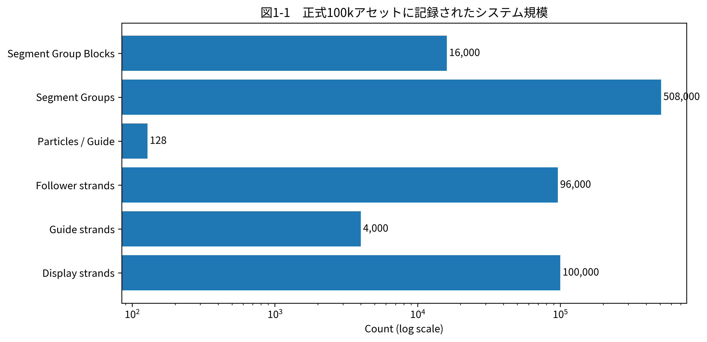
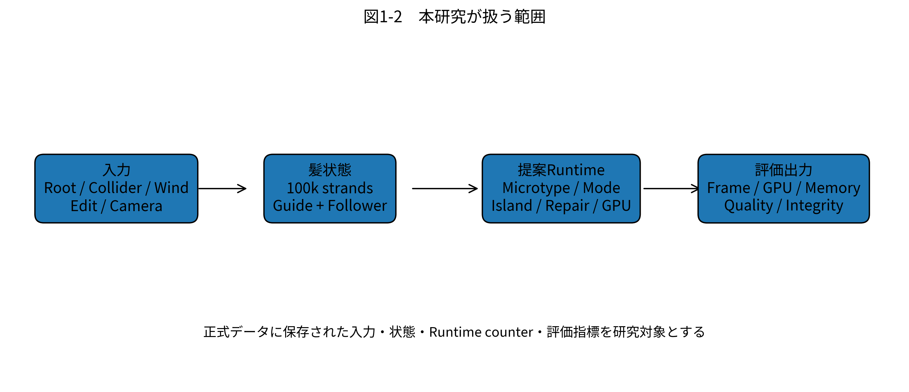

# 第1章　はじめに

## 1.1 研究背景

リアルタイム3Dコンテンツにおける髪は、キャラクタの外観だけでなく、運動時の印象、接触表現、編集自由度を左右する重要な要素である。本研究の対象システムでは、正式評価用アセットとして表示ストランド数100,000本、Guide 4,000本、Follower 96,000本、Guide当たり128粒子を使用している。表示上の本数を増やすだけでなく、Guide上の粒子状態、Follower再構成、衝突、編集、描画までを毎フレーム整合させる必要があるため、髪処理は単一の物理計算ではなく、複数段階からなるRuntime問題として扱う必要がある。

本研究では、Guide/Follower構成を前提として、物理計算の対象を必要な範囲に限定し、静的な部分の再利用、局所的なRepair、GPU側での処理継続、内部状態表現の縮小を組み合わせることで、リアルタイム髪処理の負荷を抑えることを目標とした。正式実験では、1920×1080、VSync OFF、固定時間刻み1/60秒、Solver 6 iterationsという条件で100,000本を描画し、フレーム時間、GPU Hair Time、Process Memory、DXGI Local Usage、Ground Truthに対する誤判定、NaN/Inf/Fatal Failureなどを記録している。

**図1-1　正式100kアセットに記録されたシステム規模。** カウント差が大きいため横軸は対数表示としている。

## 1.2 髪シミュレーションにおける問題

髪シミュレーションの難しさは、表示本数と物理自由度が同一ではない点にある。本研究の正式アセットでは4,000本のGuideに24本ずつFollowerを割り当て、合計100,000表示ストランドを構成している。Guideだけでも512,000粒子を持ち、隣接粒子間に対応するSegment Group数は正式Telemetryで508,000と記録されている。これは

$$
N_{\mathrm{seg}}
=
N_{\mathrm{guide}}\left(N_{\mathrm{particle}}-1\right)
=
4000\times(128-1)
=
508000
$$

と一致する。

したがって、すべてのSegment Groupを毎フレーム同一の重い経路で処理すると、状態分類や再利用を導入した意味が失われる。一方、処理を省略しすぎると、動いている髪をStaticと誤判定するFalse Static、衝突見逃し、編集反映遅延、位置誤差などの品質問題が生じる。このため、性能最適化は単純な処理削除ではなく、どの部分を安全に省略できるかを判定する問題となる。

さらに、髪の状態はRoot移動、Root回転、Teleport、Collider、Wind、Local Edit、Repair要求、Static/Dynamic切替、Camera距離などによって変化する。正式評価ではこれらを18シナリオに分けて入力しており、通常状態だけでなく、状態遷移が頻発する条件やRepair負荷も含めている。

## 1.3 制作現場における要求

リアルタイム制作では、平均FPSだけを満たしても十分ではない。Formal Performance条件では、平均60 FPS以上に加えて、60 FPS以内に収まるフレーム割合0.95以上、Frame Budget Overrun Rate 0.05以下、p95 Frame Time 16.6667 ms以下、p99 20 ms以下、単一フレーム50 ms以下が設定されている。つまり、平均的に高速であるだけでなく、上位パーセンタイルまで安定していることが要求される。

また、性能を上げるために状態を省略した結果、NaN、Inf、異常終了、入力不一致、誤ったStatic化が発生してはならない。本研究では性能指標とは別に、IntegrityとQualityを独立して記録する。特にFinal GateのPASSは性能目標達成を意味せず、正式データが壊れていないことを示すものとして扱う。

制作現場を想定した要求をまとめると、(1) 60 FPSに対応するフレーム時間、(2) 長時間動作時の安定性、(3) 状態変化や編集への追従、(4) GPU/CPU間の不要な往復削減、(5) メモリ使用量の抑制、(6) 品質を損なわない安全側のFallback、を同時に扱う必要がある。

## 1.4 本研究の目的

本研究の目的は、100,000表示ストランドを対象とするGuide/Follower型髪Runtimeに対し、以下の5要素を統合した処理方式を設計・実装し、その性能と限界を正式なB0/Pペア実験によって検証することである。

1. **Microtype**：位置情報全体を保持する場合より小さい内部表現を利用する。
2. **Mode Allocation**：状態に応じてSkip、Dynamic、Repair等の処理経路を振り分ける。
3. **Physics Islands**：動的な領域を局所集合として扱い、物理計算範囲を限定する。
4. **Rod Repair**：破綻や拘束違反が疑われる部分だけを局所的に修復する。
5. **GPU-Resident Runtime**：状態管理とタスク実行をGPU側へ寄せ、CPUとの同期や転送を減らす。

本研究では、これらの要素が期待通りに動作しなかった場合も含めて評価する。すなわち、「提案方式が高速であること」を結論として先に置くのではなく、実装した方式がどの実行経路を通り、その結果どの指標が改善または悪化したかを測定することを目的とする。

**図1-2　本研究が扱う範囲。** 正式ZIPに記録された入力、髪状態、Runtime機構、評価出力の関係を示す。

## 1.5 本研究の貢献

本研究の貢献は、性能向上の成否だけではなく、設計・実装・評価を一体として検証可能な形にした点にある。

第一に、Guide/Follower型髪Runtimeに対し、表現縮小、状態依存処理、局所物理、局所修復、GPU常駐化を5要素として整理し、統合可能なRuntime構成として実装した。第二に、同一バイナリ、同一コミット、同一アセット、同一Scenario Input Hashを用いたB0/Pのペア比較を行い、90 Runを正式セッションとして記録した。第三に、単なるフレーム時間だけでなく、内部Runtime Counterを保存することで、性能が改善しなかった場合に「どの機構が実際には発火していなかったか」を追跡可能にした。

実際の正式結果では、PはB0より高速にならなかった。この負の結果も本研究の重要な成果である。PerformanceではFull Dynamic使用率が100%であり、Microtype Decode、Physics Island Candidate、GPU-Resident Taskなどの主要Counterは0であった。これにより、単に「遅かった」で終わらず、設計した最適化経路の一部が正式測定では利用されていないことを示せた。

## 1.6 本論文の構成

第2章では髪シミュレーションに関連する技術領域を整理し、本研究の位置づけを示す。第3章では対象問題、入出力、要求条件、現行プロジェクトの課題、および5構成要素の役割を定義する。第4章では提案手法を数学的に定式化し、第5章では正式Telemetryから確認できる実装構造を、ソースコードではなく数式とデータ構造で記述する。

第6章では評価計画、第7章では実験結果、第8章では結果の考察を示す。第9章では正式実験で明らかになった限界と再評価に必要な課題を整理し、第10章で本研究を総括する。
