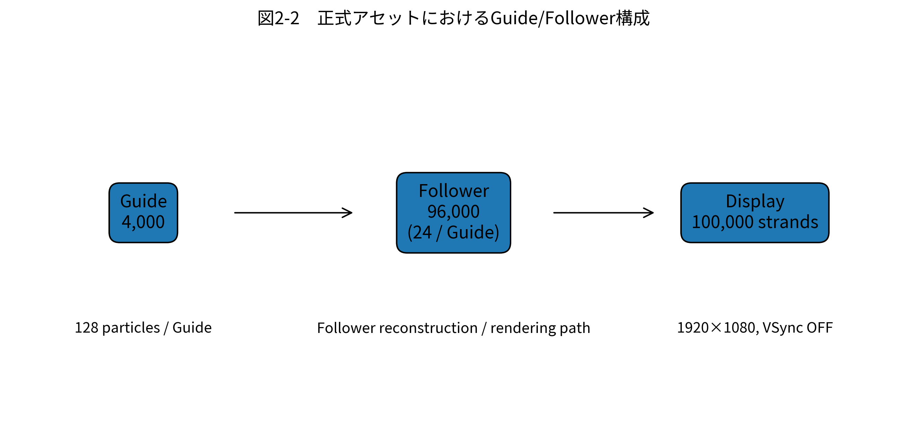
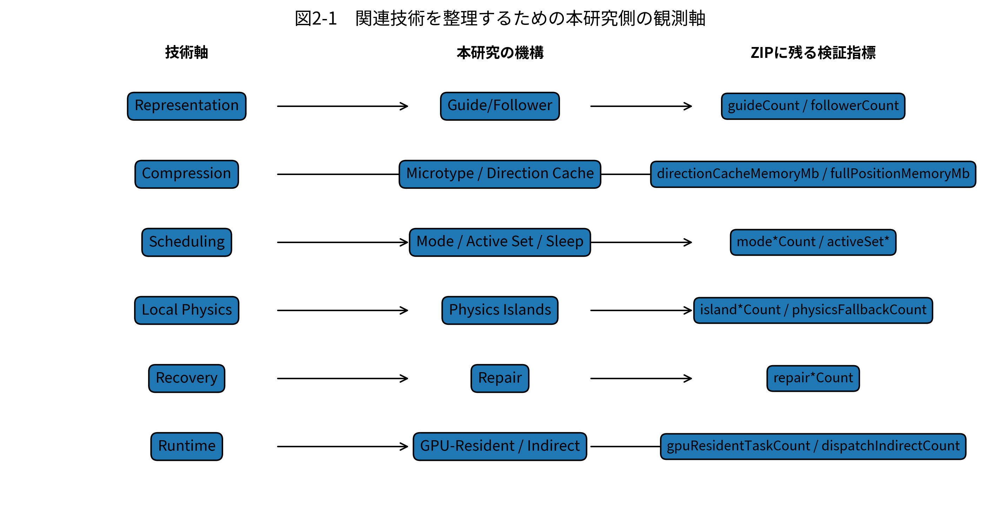

# 第2章　関連研究

> **注意**  
> 提供された正式実験ZIPには、外部論文のPDF、BibTeX、著者名、論文名、出版年などの書誌情報が含まれていない。本章では、指定された関連研究の分類と、本研究で実際に扱う技術要素との関係を整理する。存在しない参考文献を生成しないため、提出版では別途、一次文献に基づく引用番号を追加する必要がある。

## 2.1 髪シミュレーションの概要

髪のリアルタイム処理は、幾何表現、物理状態、衝突、再構成、描画、編集を連続して処理する問題として整理できる。すべての表示ストランドを完全に独立した物理自由度として扱う方式は表現力を高められる一方、表示本数が増えるほど計算量とメモリ量が増える。そのため、実時間用途では、少数の代表ストランドを物理計算し、残りを代表状態から再構成する方式、局所領域だけを更新する方式、圧縮状態を保持する方式、GPUで並列実行する方式などが組み合わされる。

本研究の正式アセットは、Guide 4,000本とFollower 96,000本から合計100,000本を表示する。したがって、本研究は「表示本数をそのまま物理自由度にする」のではなく、Guide側の状態を中心にRuntimeを構成する問題に属する。

## 2.2 Guide/Follower型の髪シミュレーション

Guide/Follower型では、代表となるGuideを物理計算し、その近傍に複数のFollowerを生成する。Guide $g$ の粒子位置を

$$
\mathbf{x}_{g,j}^{t}\in\mathbb{R}^{3}
$$

とし、Follower $f$ がGuideに対する局所Offset $\mathbf{o}_{g,f,j}$ を持つとする。Followerの位置は、本論文では一般化して

$$
\tilde{\mathbf{x}}_{g,f,j}^{t}
=
\mathbf{x}_{g,j}^{t}
+
\mathbf{R}_{g,j}^{t}\mathbf{o}_{g,f,j}
$$

と表す。ここで $\mathbf{R}_{g,j}^{t}$ はGuide上の局所座標系を表す。

この構成では、Followerの完全な物理状態を独立に解く必要がないため、表示本数と物理自由度を分離できる。本研究の正式設定ではFollowerはGuide当たり24本であり、Follower再構成に関するGPU時間も `followerReconstructionGpuMilliseconds` としてTelemetryに用意されている。

**図2-2　正式アセットにおけるGuide/Follower構成。** 数値はFrozen Asset Manifestと正式Runtime設定に記録された値を使用した。

## 2.3 Neural Hair Simulation

Neural Hair Simulationは、物理状態遷移や変形を学習モデルで近似する考え方として整理できる。入力状態 $\mathbf{s}^{t}$ から次状態を

$$
\hat{\mathbf{s}}^{t+1}=F_{\theta}(\mathbf{s}^{t},\mathbf{u}^{t})
$$

のように推定する。$F_{\theta}$ は学習済み関数、$\mathbf{u}^{t}$ は外力、Root運動、Collider情報などの条件である。

本研究の正式ZIPにはNeural Networkの学習データ、モデル、推論時間、学習誤差は存在しない。本研究は学習モデルによる近似ではなく、Runtime状態の分類、局所化、圧縮、GPU実行経路の組合せを対象とする。そのためNeural Hair Simulationは技術カテゴリとして整理するが、今回のB0/P実験に直接含まれる方式ではない。

## 2.4 Dense Physics Hair Simulation

Dense Physics Hair Simulationは、多数のストランドまたは粒子を直接物理計算する方向の方式として整理できる。単純化すれば、粒子集合 $\mathcal{X}^{t}$ に対し、

$$
\mathcal{X}^{t+1}
=
\Psi(\mathcal{X}^{t},\mathbf{f}_{ext}^{t},\mathcal{C}^{t})
$$

を毎フレーム評価する。$\mathcal{C}^{t}$ は長さ、曲げ、衝突などの拘束集合である。

本研究のPは、DenseなFull Dynamic経路を常時使うことを避けるためにMode AllocationやStatic Cacheを導入する設計である。しかし正式Performanceでは `used_full_dynamic=1` が100%となった。この結果は第7章で示すように、本研究の実装が実際にはDenseに近い処理量へ戻っていたことを意味する。

## 2.5 Rod-based Hair / Cosserat Rod

Rod-basedな表現では、髪を位置だけでなく接線、向き、曲げ、ねじれ等を持つ1次元構造として扱う。離散化したセグメント $j$ の長さ誤差は

$$
r_{\ell,j}
=
\lVert\mathbf{x}_{j+1}-\mathbf{x}_{j}\rVert
-
\ell_{j}^{0}
$$

と表せる。曲げに相当する量は、隣接セグメント方向

$$
\mathbf{d}_{j}
=
\frac{\mathbf{x}_{j+1}-\mathbf{x}_{j}}
{\lVert\mathbf{x}_{j+1}-\mathbf{x}_{j}\rVert}
$$

の変化によって表現できる。

本研究ではRod Repairという局所修復経路を5要素の一つとして定義している。ただし正式P条件では `enableRodRepair=false` であり、Rod Repair固有の性能は今回の正式実験では測定できていない。

## 2.6 Hair Compression / Neural Hair Representation

多数の3次元位置をそのまま保持する場合、状態メモリは概念的に

$$
M_{pos}\propto3Nb
$$

となる。$N$ は保持要素数、$b$ は1成分の保存量である。これに対して方向、長さ、局所座標、量子化された符号などを用いると、完全位置を直接保持するより小さい表現へ変換できる可能性がある。

本研究のMicrotypeはこの方向に位置づけられる。正式PerformanceのTelemetryではDirection Cache Memoryが平均7.751465 MB、Full Position Memoryが15.502930 MBであり、局所的な保存量は50%となった。ただしDecode Counterは0であったため、圧縮表現の存在と、Runtimeでその表現が実際に利用されたことは分けて評価する。

## 2.7 GPU-based Hair Runtime

髪処理は多数の独立または局所依存タスクを持つため、GPU並列実行との親和性が高い。本研究の正式Telemetryにも、Block Classification、Group Classification、Compaction、Dynamic Solve、Boundary Repair、Watchdog、Follower Reconstruction、Render Preparation、Hair DrawなどのGPU時間フィールドが存在する。

GPU-Resident Runtimeの理想形は、時刻 $t$ のGPU状態 $\mathbf{S}_{GPU}^{t}$ をCPUへ戻さず、

$$
\mathbf{S}_{GPU}^{t+1}
=
F_{GPU}(\mathbf{S}_{GPU}^{t},\mathbf{U}^{t})
$$

として次フレームへ引き継ぐことである。Active数 $N_{active}$ に応じてIndirect Dispatchを行う場合、Thread Group Sizeを$T$とすると、

$$
N_{dispatch}
=
\left\lceil \frac{N_{active}}{T}\right\rceil
$$

のように実行量を決定できる。

本研究では `gpuResidentTaskCount`、`dispatchIndirectCount`、`drawIndirectCount`、`delayedTelemetryReadCount`、`fullCpuGroupUploadCount` 等を記録し、設定ONだけでなく実際にGPU常駐経路が使用されたかを確認する。

## 2.8 既存研究の限界と本研究の位置づけ

本研究は、単一の物理モデルそのものを置き換えることよりも、既存のGuide/Follower Runtimeにおいて「どの状態を、どの表現で、どの範囲だけ、どの実行場所で処理するか」を同時に制御することに焦点を置く。

**図2-1　関連技術を整理するための本研究側の観測軸。** 外部論文の性能値ではなく、本研究の正式Telemetryに存在する観測項目だけで構成している。

本研究の5要素は、表現（Microtype）、処理選択（Mode Allocation）、局所物理領域（Physics Islands）、局所修復（Rod Repair）、実行配置（GPU-Resident Runtime）という異なる層に分かれる。したがって、新規性の中心は単一要素の存在そのものではなく、これらを同一Runtimeで連携させ、同一入力のB0/P比較によって実行状態まで検証する点に置く。

ただし、今回の正式結果では5要素すべての動作を実証できていない。よって、第8章では「既存研究より高性能である」といった外部優位性を主張せず、本研究内のB0/P差と、各Runtime Counterが示す事実に限定して位置づけを行う。
