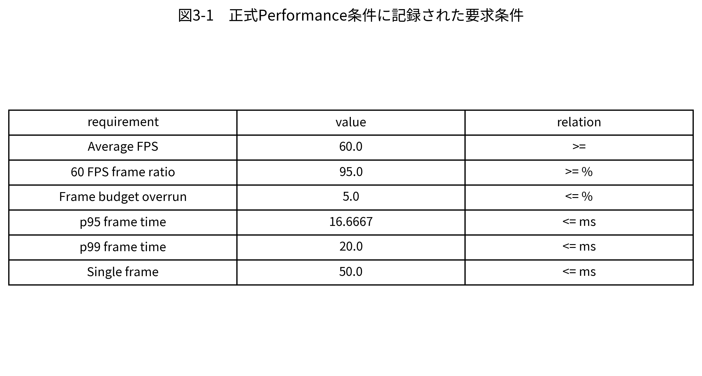
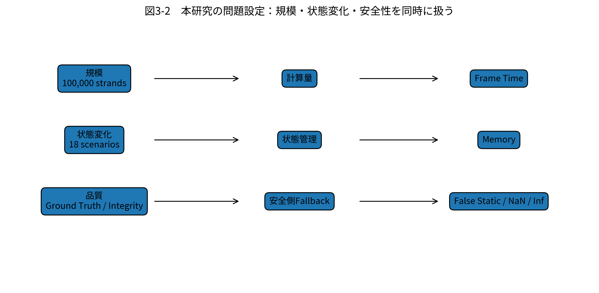

# 第3章　問題設定と設計方針

## 3.1 対象とする問題

本研究では、100,000表示ストランドを持つGuide/Follower型髪Runtimeにおいて、品質を損なわずに不要な物理計算、状態転送、再構成を削減する問題を扱う。

Guide集合を $\mathcal{G}$、各Guide上の粒子集合を $\mathcal{P}_g$ とし、時刻$t$における状態を

$$
\mathbf{S}^{t}
=
\left\{
\mathbf{x}_{g,j}^{t},
\mathbf{v}_{g,j}^{t},
q_{g}^{t},
c_{g}^{t},
d_{g}^{t}
\right\}
$$

と表す。$\mathbf{x}$ は位置、$\mathbf{v}$ は速度、$q_g^t$ は処理Mode、$c_g^t$ はCertificate状態、$d_g^t$ はDirty状態などのRuntimeメタデータを抽象化したものである。

目的は、品質制約を満たしながら1フレームの処理時間

$$
T_{frame}
=
T_{classify}
+
T_{schedule}
+
T_{physics}
+
T_{repair}
+
T_{reconstruct}
+
T_{render}
+
T_{sync}
$$

を小さくすることである。

## 3.2 想定する入力と出力

正式シナリオに記録された入力は、Root Translation、Root Rotation、Teleport、Collider Transform、Wind、Local Edit、Repair Storm、Force All Dynamic / Static、Camera Distanceなどである。これらを時刻$t$の入力$\mathbf{u}^{t}$としてまとめ、

$$
\mathbf{S}^{t+1}
=
F(\mathbf{S}^{t},\mathbf{u}^{t})
$$

と表す。

出力は、(1) 次フレームの髪状態、(2) 表示用Follower/Render情報、(3) Frame/GPU/Memory指標、(4) Quality/Integrity指標、(5) 各提案要素のRuntime Counterである。

## 3.3 要求条件

Performance Pの正式Caseには、以下の条件が明示的に記録されている。

- Average FPS $\ge 60$
- 60 FPS以内のフレーム割合 $\ge 0.95$
- Frame Budget Overrun Rate $\le 0.05$
- p95 Frame Time $\le 16.6667$ ms
- p99 Frame Time $\le 20.0$ ms
- Single Frame $\le 50.0$ ms
- GPU Timing Coverage $\ge 0.99$
- Process Memory Sample Coverage $\ge 0.95$
- NaN / Inf / Fatal Failureを致命的問題として扱う

**図3-1　正式Performance条件に記録された要求条件。**

ここで特に重要なのは、平均値だけでなくp95やOverrun Rateが明示されている点である。したがって、平均フレーム時間が16.6667 ms未満であっても、p95が超過していれば「安定60 FPS」とは判定しない。

## 3.4 現行プロジェクトの課題

正式Telemetryに用意されている指標から、現行Runtimeでは少なくとも次の課題を管理対象としていることが分かる。

第一に、Segment Group単位のStatic/Dynamic状態管理である。`staticCachedGroupCount`、`dynamicGroupCount`、`stateTransitionCount`、`stateOscillationCount` が記録されている。第二に、Dirty伝播とCertificateであり、`dirtyBlockCount`、`dirtyGroupCount`、`certificateValidGroupCount`、各種Version Mismatchが記録される。第三に、局所RepairとFallbackであり、Repair Request、Commit、Reject、Defer、Verified、Recurrenceを区別している。第四に、GPU/CPU間の同期であり、Readback、Indirect Dispatch、Full CPU Group Upload等を個別に記録する。

これらの課題は独立ではない。安全性を高めるためにすべてをDynamicへFallbackすれば品質は守りやすいが、処理量は減らない。逆にStatic Cacheを積極利用しすぎればFalse Staticの危険が増える。したがって本研究は、性能と安全性のトレードオフをRuntime状態選択の問題として扱う。

**図3-2　本研究の問題設定。** 規模、状態変化、品質の入力条件が、計算量・状態管理・Fallbackを通じて性能と品質へ影響する。

## 3.5 設計方針

設計方針は、**安全側のFallbackを残しながら、通常時の処理対象を縮小する**ことである。

各Segment Group $g$ について、Runtime特徴量を

$$
\mathbf{z}_{g}^{t}
=
[
D_g^t,
C_g^t,
E_g^t,
W_g^t,
R_g^t,
V_g^t
]
$$

とする。ここで$D$はDirty、$C$はCollision関連、$E$はEdit、$W$はWake、$R$はRepair要求、$V$はCertificate/Version状態を抽象化したものである。処理Modeは

$$
m_g^t=\phi(\mathbf{z}_g^t)
$$

によって決定する。ZIPには$\phi$の具体的な閾値や係数は保存されていないため、本論文ではソースコードを推定せず、Mode集合と観測Counterを用いて実装を記述する。

また、Certificateが成立しない、Dirtyが伝播した、Collider/Edit/Topology Versionが一致しない等の場合は、Static再利用を行わずDynamicまたはRepair側へFallbackする。これによりFalse Staticを避ける。

## 3.6 本研究で扱う5つの構成要素

本研究では以下の5要素を主要構成とする。

**Microtype**は内部状態を小さい表現で保持し、必要時に再構成する機構である。  
**Mode Allocation**は各Segment Groupに実行Modeを割り当てる機構である。  
**Physics Islands**は相互依存するDynamic Groupを局所集合としてまとめる機構である。  
**Rod Repair**は拘束違反や異常が疑われる局所部分を修復する機構である。  
**GPU-Resident Runtime**は状態分類からCompaction、Solve、再構成までの処理をGPU側で継続する機構である。

これらは独立機能ではなく、Microtypeで状態量を減らし、Mode Allocationで処理対象を選び、Physics IslandsでDynamic範囲を局所化し、Rod Repairで例外だけを処理し、GPU-Resident Runtimeで同期を減らす、という連携を想定する。

## 3.7 本研究の新規性の整理

本研究の新規性は、5要素それぞれを単独で「世界初」と主張することではない。正式ZIPに外部先行研究の網羅的比較情報がないため、そのような主張は行わない。

本研究が実験的に示そうとする新規性は、**Guide/Follower型100k髪Runtimeにおいて、表現・Mode・局所物理・局所Repair・GPU実行配置を同一のSegment Group状態管理へ統合し、その内部実行状態をCounterとして記録しながらB0/Pを同一入力で比較する構成**にある。

したがって、新規性の妥当性は「機構が存在すること」だけではなく、(1) 正式実行時にCounterが増加しているか、(2) Full Dynamicへの過剰Fallbackが起きていないか、(3) Frame/Memory/Qualityの結果に反映されているか、という3段階で検証する。
