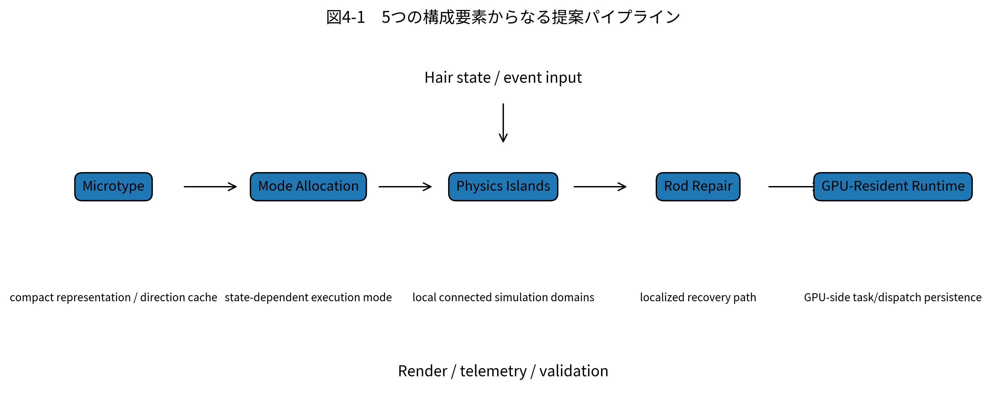
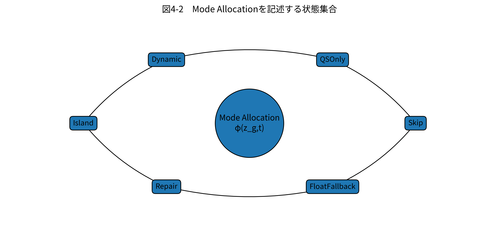

# 第4章　提案手法

## 4.1 提案手法の概要

本研究では、髪Runtimeの負荷を単一のアルゴリズムで削減するのではなく、状態表現、処理選択、局所物理、局所修復、実行配置の5層に分解する。提案手法を

$$
\mathcal{P}
=
\{
\mathcal{M}_{micro},
\mathcal{M}_{mode},
\mathcal{M}_{island},
\mathcal{M}_{repair},
\mathcal{M}_{gpu}
\}
$$

と表す。

**図4-1　5つの構成要素からなる提案パイプライン。** 各要素は正式Telemetryに対応するCounterを持つ。

## 4.2 数学的表記

Guide数を $G$、Guide当たり粒子数を $P$、Follower数を $F$ とする。正式設定では

$$
G=4000,\quad
P=128,\quad
F=96000
$$

である。

Guide $g$ の粒子$j$の位置を$\mathbf{x}_{g,j}^{t}$、速度を$\mathbf{v}_{g,j}^{t}$とする。隣接粒子間セグメントを

$$
e_{g,j}
=
(\mathbf{x}_{g,j}^{t},\mathbf{x}_{g,j+1}^{t}),
\quad
j=0,\ldots,P-2
$$

とする。このときSegment Group数は

$$
|\mathcal{E}|
=
G(P-1)
=
508000
$$

となり、正式Telemetryの `totalSegmentGroupCount` と一致する。

## 4.3 Microtype

Microtypeでは、完全な3次元位置列を毎要素保持する代わりに、局所方向と必要最小限の補助情報を保持する考え方を採る。本論文ではセグメント方向を

$$
\mathbf{d}_{g,j}^{t}
=
\frac{
\mathbf{x}_{g,j+1}^{t}
-
\mathbf{x}_{g,j}^{t}
}{
\left\|
\mathbf{x}_{g,j+1}^{t}
-
\mathbf{x}_{g,j}^{t}
\right\|
}
$$

と定義する。量子化・圧縮表現を$Q(\cdot)$とすると、保存状態は

$$
\mathbf{q}_{g,j}^{t}=Q(\mathbf{d}_{g,j}^{t})
$$

と表せる。Decode後の方向を$Q^{-1}(\mathbf{q})$とし、既知の基準位置とセグメント長$\ell_{g,j}$から、

$$
\hat{\mathbf{x}}_{g,j+1}^{t}
=
\hat{\mathbf{x}}_{g,j}^{t}
+
\ell_{g,j}
Q^{-1}(\mathbf{q}_{g,j}^{t})
$$

として再構成する。

Decode誤差は

$$
e_{g,j}
=
\left\|
\hat{\mathbf{x}}_{g,j}^{t}
-
\mathbf{x}_{g,j}^{t}
\right\|
$$

とし、Telemetryの `meanDecodeErrorMm` 等で観測する。

Microtypeの目的は、完全位置を常時保持する場合のメモリ$M_{full}$に対し、

$$
\rho_{micro}
=
1-
\frac{M_{dir}}{M_{full}}
$$

を大きくすることである。正式値では$M_{dir}\approx7.751465$ MB、$M_{full}\approx15.502930$ MBであり、局所的には$\rho_{micro}=0.5$であった。

## 4.4 Mode Allocation

各Segment Group $g$ に対し、時刻$t$の処理Modeを

$$
m_g^t
\in
\{
\mathrm{Skip},
\mathrm{QSOnly},
\mathrm{Dynamic},
\mathrm{Island},
\mathrm{Repair},
\mathrm{FloatFallback}
\}
$$

とする。

**図4-2　Mode Allocationを記述する状態集合。** 図中のMode名は正式 `frames.csv` の `mode*Count` に対応する。

Mode決定に用いる状態を

$$
\mathbf{z}_g^t
=
[
\delta_g^t,
\kappa_g^t,
\eta_g^t,
\omega_g^t,
\rho_g^t,
\chi_g^t
]
$$

とする。$\delta$はDirty、$\kappa$は衝突、$\eta$はEdit、$\omega$はWake、$\rho$はRepair、$\chi$はCertificate/Version整合性を表す抽象変数である。具体的な係数はZIPに保存されていないため、Mode関数を

$$
m_g^t
=
\phi(\mathbf{z}_g^t)
$$

とだけ定義する。

Mode Allocationが成功するためには、

$$
N_{Dynamic}<N_{Total}
$$

となり、かつFalse Staticを増やさないことが必要である。

## 4.5 Physics Islands

Segment Group間の依存関係をグラフ

$$
\mathcal{H}^{t}
=
(\mathcal{V}^{t},\mathcal{E}^{t})
$$

として表す。$\mathcal{V}^{t}$はDynamic候補Group、$\mathcal{E}^{t}$は隣接、共有点、衝突、状態依存等による結合を表す。

Candidate集合を

$$
\mathcal{A}^{t}
=
\{
g\in\mathcal{V}^{t}
\mid
a_g^t=1
\}
$$

とすると、Physics Islandは誘導部分グラフ$\mathcal{H}^{t}[\mathcal{A}^{t}]$の連結成分として

$$
\mathcal{I}^{t}
=
CC(\mathcal{H}^{t}[\mathcal{A}^{t}])
$$

と定義できる。

目的は、全Groupを1つのSolve対象とするのではなく、

$$
T_{physics}
\approx
\sum_{I\in\mathcal{I}^{t}}
T_{solve}(I)
$$

として必要な局所領域だけを処理することである。

## 4.6 Rod Repair

Rod Repairでは、局所セグメントの拘束違反を検出し、Full Dynamic全体へ戻す前に局所修復を試みる。

長さ残差を

$$
r_{\ell,g,j}
=
\left\|
\mathbf{x}_{g,j+1}
-
\mathbf{x}_{g,j}
\right\|
-
\ell_{g,j}^{0}
$$

とし、衝突・貫通残差を$r_{c,g,j}$とする。Repair対象集合は、具体閾値を推定せず、

$$
\mathcal{R}^{t}
=
\{
(g,j)
\mid
Q(r_{\ell,g,j},r_{c,g,j},\mathbf{z}_{g}^{t})=1
\}
$$

と定義する。

局所修復は概念的に、

$$
\min_{\Delta\mathbf{x}}
\sum_{(g,j)\in\mathcal{R}^{t}}
\left\|
\Delta\mathbf{x}_{g,j}
\right\|^{2}
$$

subject to

$$
r_{\ell,g,j}(\mathbf{x}+\Delta\mathbf{x})\approx0,
\qquad
r_{c,g,j}(\mathbf{x}+\Delta\mathbf{x})\le0
$$

として、必要最小限の位置修正を求める問題として表せる。

正式RuntimeではRepairをAttempt、Success、Failure、Verified、Recurrenceに分けて記録し、単なる関数呼び出しではなく修復結果まで追跡する設計とした。

## 4.7 GPU-Resident Runtime

GPU-Resident Runtimeでは、Segment Group状態をGPU側に保持し、

$$
\mathbf{S}_{GPU}^{t+1}
=
F_{GPU}
(
\mathbf{S}_{GPU}^{t},
\mathbf{U}^{t}
)
$$

として、分類、Compaction、Solve、Repair、Follower Reconstruction、Render Preparationへ受け渡すことを目標とする。

Active Group数を$N_a^t$、1 Dispatch Groupが処理する要素数を$T$とすると、

$$
D^t
=
\left\lceil\frac{N_a^t}{T}\right\rceil
$$

によってIndirect Dispatch数を決められる。

GPU-Residentが成立しているかは、単に `enableGpuResident=true` で判断しない。`gpuResidentTaskCount`、`dispatchIndirectCount`、`drawIndirectCount`、`delayedTelemetryReadCount`、`fullCpuGroupUploadCount` を併用して確認する。

## 4.8 統合制御と安全側Fallback

提案方式では、最適化が不確実な場合に品質破綻を避けるためFull DynamicへのFallbackを許容する。Group $g$ のCertificateを$C_g^t\in\{0,1\}$とし、

$$
C_g^t=1
$$

となる条件を、Dirtyなし、Parent/Collider/Edit/Topology Versionの不一致なし、という整合条件の積として扱う。

$C_g^t=0$の場合はStatic再利用を行わず、DynamicまたはRepair側へ遷移する。これによりFalse Staticを抑える一方、Certificateが過度に無効化されるとFull Dynamicが増え、性能改善が消える。

したがって、提案方式の成否は

$$
N_{FalseStatic}\rightarrow0,
\qquad
T_{frame}^{P}<T_{frame}^{B0},
\qquad
M^{P}\le M^{B0},
\qquad
\Pr(m_g^t=\mathrm{FullDynamic})<1
$$

を同時に満たせるかで評価する。
