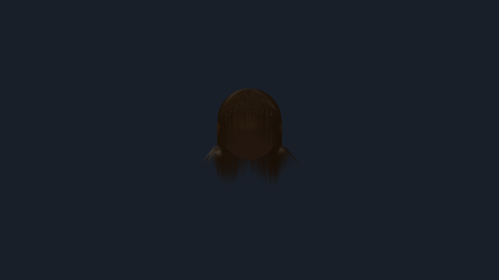
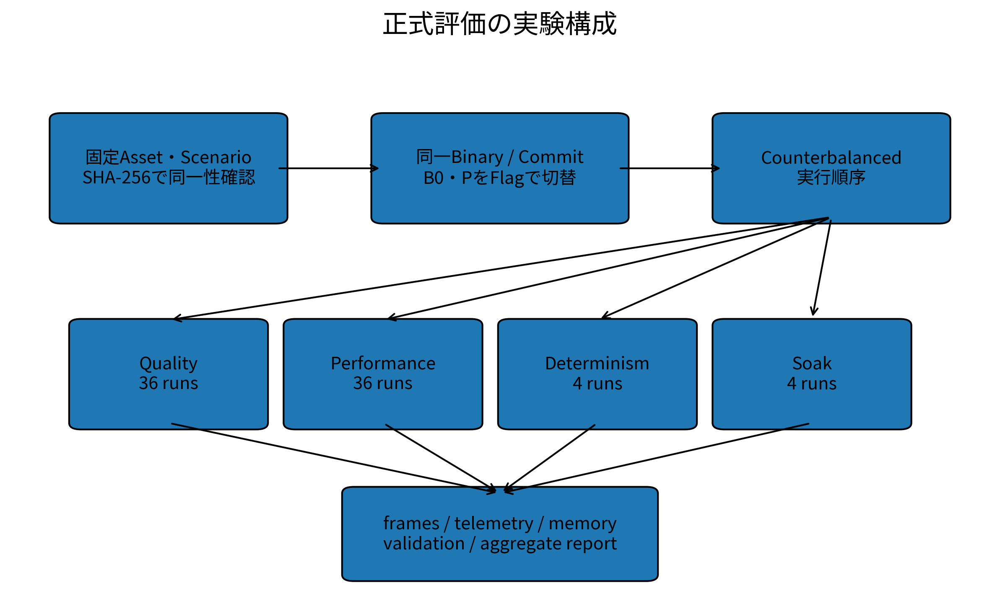
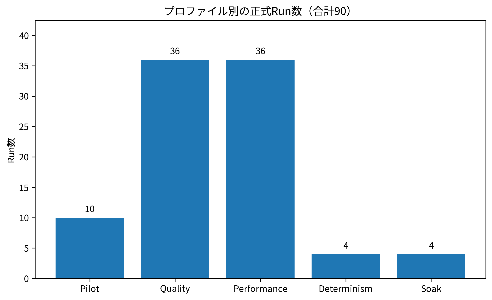

# 第6章　評価計画

## 6.1 評価目的

本研究では、リアルタイム髪シミュレーションに導入した提案方式が、ベースライン方式と比較してフレーム時間、GPU処理時間、メモリ使用量、品質および長時間安定性にどのような影響を与えるかを評価する。提案方式を構成する対象は、Microtype、Mode Allocation、Physics Islands、Rod Repair、GPU-Resident Runtimeの5要素である。

評価では平均FPSのみを用いず、Frame Timeの中央値、p95、p99、60 FPS以内に収まるフレーム割合、Frame Budget Overrun Rate、GPU Hair Time、プロセスメモリ、DXGI Local Usage、品質テレメトリ、および内部実行カウンタを併用する。これにより、性能向上が確認できた場合だけでなく、期待した実行経路が使用されなかった場合や、オーバーヘッドによって性能が悪化した場合も結果として記録する。

また、B0とPの比較では、同一バイナリ、同一コミット、同一シナリオ入力を用いる。正式セッションはStatus=FORMAL_COMPLETE_VALID、Final Gate=PASSであり、実験データの完全性と入力一致を確認した上で比較を行う。

## 6.2 評価環境

正式測定は、表6-1に示す環境で実施した。GPUはNVIDIA GeForce RTX 4070 Ti SUPER、CPUはIntel(R) Core(TM) i7-14700であり、表示解像度は1920x1080とした。Hair SystemはRelease/x64で実行し、VSyncを無効化した。

評価対象は表示ストランド100,000本、Guide Strand 4,000本、Follower 96,000本とした。各Guideには24本のFollowerを割り当て、Particles / Guideは128、Solver Iterationsは6とした。固定タイムステップは1/60秒である。

**表6-1　正式測定環境**

| 項目                   | 値                                   |
|:-----------------------|:-------------------------------------|
| CPU                    | Intel(R) Core(TM) i7-14700           |
| CPUコア/論理プロセッサ | 20 / 28                              |
| GPU                    | NVIDIA GeForce RTX 4070 Ti SUPER     |
| GPU VRAM               | 16376 MiB                            |
| RAM                    | 65303 MiB                            |
| OS                     | Microsoft Windows 11 Home 10.0.26200 |
| GPU Driver             | 32.0.15.6603                         |
| Visual Studio          | 18.5.2                               |
| MSVC                   | 14.50.35717                          |
| Windows SDK            | 10.0.26100.0                         |
| 解像度                 | 1920x1080                            |
| 電源プラン             | High Performance                     |
| 表示ストランド         | 100000                               |
| Guide                  | 4000                                 |
| Followers / Guide      | 24                                   |
| Follower               | 96000                                |
| Particles / Guide      | 128                                  |
| Solver Iterations      | 6                                    |
| Fixed Timestep         | 0.016666667 s                        |
| VSync                  | OFF                                  |

**図6-1　正式評価時のViewer出力。** Performance P・S01の正式Runに保存されたViewer画像をPNG化した。

## 6.3 評価シナリオ

通常の静止状態だけでなく、Root移動・回転、Collider、局所編集、Wind、Repair Storm、Dynamic/Static強制切替、Camera距離変更などの状態変化を含めるため、S01からS18までの18シナリオを使用する。各シナリオはCanonical Scenarioから生成されたMaterialized Timelineを用い、B0とPでScenario Input SHA-256およびPhysical Scenario Input SHA-256を一致させる。

表6-2に各シナリオと主要入力を示す。シナリオ名と実際に注入されたイベントの双方を記載することで、名称だけから実験内容を推測しないようにした。
**表6-2　評価シナリオと実際に注入された主要入力**

| ID   | Canonical Scenario               | Materialized Timelineの主入力                                                   |   イベント数 |   Payload容量[%] |
|:-----|:---------------------------------|:--------------------------------------------------------------------------------|-------------:|-----------------:|
| S01  | S01_Idle                         | 全GroupをStatic化                                                               |            1 |               50 |
| S02  | S02_Breathing                    | Root平行移動 → Root平行移動                                                     |            2 |               50 |
| S03  | S03_Walk                         | Root回転 → Root回転                                                             |            2 |               50 |
| S04  | S04_SuddenStop                   | Root平行移動 → Root平行移動                                                     |            2 |               50 |
| S05  | S05_HeadRotation                 | Root回転 → Root回転                                                             |            2 |               50 |
| S06  | S06_Teleport                     | Root瞬間移動                                                                    |            1 |               50 |
| S07  | S07_ColliderApproach             | Collider変換 → Collider変換                                                     |            2 |               50 |
| S08  | S08_StaticDynamicBoundaryContact | Collider変換 → 局所編集注入                                                     |            2 |               50 |
| S09  | S09_StrongWind                   | Wind変更                                                                        |            1 |               50 |
| S10  | S10_WindStop                     | Wind変更 → Wind変更                                                             |            2 |               50 |
| S11  | S11_LocalEdit                    | 局所編集注入 → 局所編集注入                                                     |            2 |               50 |
| S12  | S12_FalseStaticTrap              | Collider変換 → Wind変更 → Wind変更                                              |            3 |               50 |
| S13  | S13_RepairStorm                  | Repair Storm注入 → Repair Storm注入 → Repair Storm注入                          |            3 |               50 |
| S14  | S14_AllDynamic                   | 全GroupをDynamic化                                                              |            1 |               50 |
| S15  | S15_AllStatic                    | 全GroupをStatic化                                                               |            1 |               50 |
| S16  | S16_StateThrashing               | 全GroupをDynamic化 → 全GroupをStatic化 → 全GroupをDynamic化 → 全GroupをStatic化 |            4 |               50 |
| S17  | S17_CloseCamera100k              | Camera距離変更 → 全GroupをDynamic化                                             |            2 |                5 |
| S18  | S18_FarCamera100k                | Camera距離変更                                                                  |            1 |               50 |

## 6.4 比較対象

比較対象はB0（PRE-NOVELTY BASELINE）とP（POST-NOVELTY SG-APT）の2方式とする。両方式は別バイナリではなく、同一Commit 21e206250d902912fc429c0c024dcc992f522466、同一実行ファイルを用い、機能フラグによって経路を切り替える。正式セッションではsameBinary=true、sameCommit=trueが記録されている。

B0は提案機構を無効化した独立ベースライン経路である。PではMicrotype、GPU-Resident、Segment Group State、Static Certificate、Predictive Wake、Generic Repair、GPU Compaction、Static Cacheなどの機構を有効化している。一方、正式P条件ではenablePhysicsIslandsおよびenableRodRepairはfalseである。この設定差は後の結果解釈に直接関係するため、表6-3に明示する。
**表6-3　B0/Pの主要機能フラグ**

| 機構                              | B0   | P   |
|:----------------------------------|:-----|:----|
| enableMicrotype                   | OFF  | ON  |
| enableGpuResident                 | OFF  | ON  |
| enablePhysicsIslands              | OFF  | OFF |
| enableRodRepair                   | OFF  | OFF |
| enableSegmentGroupSleep           | OFF  | ON  |
| enableSegmentGroupIntegratedState | OFF  | ON  |
| enableSharedPointOwnership        | OFF  | ON  |
| enableDirectionalResponsibility   | OFF  | ON  |
| enableStaticCertificate           | OFF  | ON  |
| enablePredictiveWake              | OFF  | ON  |
| enableVelocityRecovery            | OFF  | ON  |
| enableRepair                      | OFF  | ON  |
| enableGpuCompaction               | OFF  | ON  |
| enableActiveSet                   | OFF  | ON  |
| enableSleepHysteresis             | OFF  | ON  |
| enableStaticCache                 | OFF  | ON  |

**図6-2　正式評価の実験構成。** 固定入力、B0/P切替、Counterbalanced Schedule、各Profile、最終集計の関係を示す。

## 6.5 評価指標

性能評価の主要指標にはframeMillisecondsを使用する。60 FPSのフレーム予算は16.666667 msであり、Performance ProfileではAverage FPS 60以上、60 FPS以内のフレーム割合95%以上、Frame Budget Overrun Rate 5%以下、p95 Frame Time 16.6667 ms以下、p99 Frame Time 20 ms以下を判定基準とする。

GPU側はgpuHairMillisecondsを使用する。メモリについては、フレームCSVのvramMegabytesが本正式データでは0として記録されているため、Process Private Memory、Working Set、およびDXGI Local Usageを主指標として扱う。

品質についてはFalse Static、False Dynamic、Position RMSE、Position Max Error、NaN State Count、Infinite State Count、Fatal Failureなどを確認する。提案要素の実行状況については、Microtype Decode、Mode、Island、Repair、GPU-Resident Task、Indirect Dispatch、Dirty Block、Static Reuseなどの内部カウンタを使用する。
**表6-4　主要評価指標**

| 評価対象          | 主指標                                                     | 集計                               | 目的                               |
|:------------------|:-----------------------------------------------------------|:-----------------------------------|:-----------------------------------|
| Frame Time        | frameMilliseconds                                          | Median / Average / p95 / p99 / Max | 60 FPS予算16.666667 msとの比較     |
| 60 FPS安定性      | sixtyFpsRatio / frameBudgetOverrunRate                     | 割合                               | 95%以上 / Overrun 5%以下を主要基準 |
| GPU               | gpuHairMilliseconds                                        | Median / p95                       | 髪処理のGPU時間                    |
| Memory            | Peak Process Private / Working Set / DXGI Local Usage      | MiB                                | 総メモリ使用量                     |
| Quality           | False Static / False Dynamic / Position RMSE / Max Error   | 件数・率・mm                       | Ground Truthに対する品質           |
| Integrity         | NaN / Inf / Fatal Failure                                  | 件数                               | 致命的破綻の有無                   |
| Component Runtime | Microtype / Mode / Island / Repair / GPU-Resident counters | Count/frame等                      | 設定ONと実稼働を区別               |

## 6.6 各提案要素の単体評価

MicrotypeではmicrotypeDecodedCount、safeDecodeCount、falseSafeCount、Direction Cache Memory、Full Position Memory、Memory Saving Rateを確認する。Mode AllocationではmodeSkipCount、modeQSOnlyCount、modeDynamicCount、modeIslandCount、modeRepairCount、staticCachedGroupCount、dynamicGroupCount、stateTransitionCount、stateOscillationCountを確認する。

Physics IslandsではislandCandidateCount、islandCount、islandCommitCount、islandRejectCount、physicsFallbackCountを使用する。Rod RepairではtypedRepairRequestCount、repairTaskCount、repairAttemptCount、repairSuccessCount、repairVerifiedCount、repairFailureCountを使用する。GPU-Resident RuntimeではgpuResidentTaskCount、dispatchIndirectCount、drawIndirectCount、delayedTelemetryReadCount、cpuReadbackCountおよびGPU Hair Timeを使用する。

単体評価では、機能フラグがONであることだけを動作の証拠とせず、対応する実行カウンタが増加していることを確認条件とする。これにより、実装済みであるが正式シナリオで経路が使用されなかった場合を区別する。

## 6.7 統合システム評価

統合評価ではB0とPをQuality、Performance、Determinism、Soakの各Profileで比較する。正式セッションはPilot 10 run、Quality 36 run、Performance 36 run、Determinism 4 run、Soak 4 runの合計90 runで構成され、B0とPを各45 run実行している。

Quality、Performance、Determinismでは600フレームのWarm-up後に6,000フレームを測定し、Soakでは600フレームのWarm-up後に108,000フレームを測定する。Pilotは300フレームのWarm-up後に1,800フレームを測定する。Soakの108,000 measured framesは60 FPS換算で30分に相当する。
**表6-5　Profile別の測定構成**

| Profile     |   Runs |   Warm-up Frames |   Measurement Frames/Run |   Total Measured Frames |
|:------------|-------:|-----------------:|-------------------------:|------------------------:|
| Pilot       |     10 |              300 |                     1800 |                   18000 |
| Quality     |     36 |              600 |                     6000 |                  216000 |
| Performance |     36 |              600 |                     6000 |                  216000 |
| Determinism |      4 |              600 |                     6000 |                   24000 |
| Soak        |      4 |              600 |                   108000 |                  432000 |

**図6-3　Profile別正式Run数。** Final Gateに記録された全90 Runの内訳を示す。

## 6.8 アブレーション評価

5つの提案要素の独立寄与を評価するためには、統合P条件から各要素を1つずつ除外した条件を用意し、同一シナリオで比較する必要がある。例えば、PからMicrotypeのみを無効化した条件とPを比較すれば、その他の条件を固定したままMicrotypeの寄与を推定できる。

正式テレメトリにはtopLevelNoveltyMaskおよびFeature Maskが記録されるため、アブレーション条件が実際に異なる構成として実行されたかを検証できる。第7章では、正式セッション内に必要なMaskの組合せが存在するかを確認し、アブレーション評価の成立可否そのものも結果として扱う。

## 6.9 評価結果の記録方法

各Caseではcase.json、settings.json、frames.csv、frames.jsonl、telemetry.jsonl、novelty01.csv、process_memory.jsonl、per_second.csv、summary.json、validation.json、visual_metrics.jsonなどを保存する。Profile単位ではnovelty01_matrix_summary.json、全実験終了後にはthesis_aggregate_table.csv、thesis_paired_b0_p.csv、thesis_statistical_report.jsonを生成する。

実行ファイル、Asset、Settings、Scenario Timelineおよび入力についてSHA-256を保存し、B0とPの入力一致を確認する。実行順はCounterbalanced Scheduleとする。正式セッションのFinal Gateでは90件のWindow Guard記録すべてがPASSし、Fatal Integrity Issueは0件であった。

ただしFinal GateのPASSはPの性能優位性を意味しない。これは正式測定条件とデータ完全性を満たしていることを示す検証結果であり、性能基準の未達はQuality Outcomeとしてそのまま記録する。

---

### 本章のデータ出典

本章の図表はすべて同フォルダの `README.md` に元ZIP内部パス、使用フィールド、集計方法を記載している。
