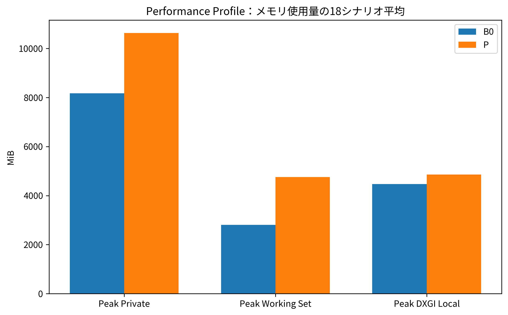
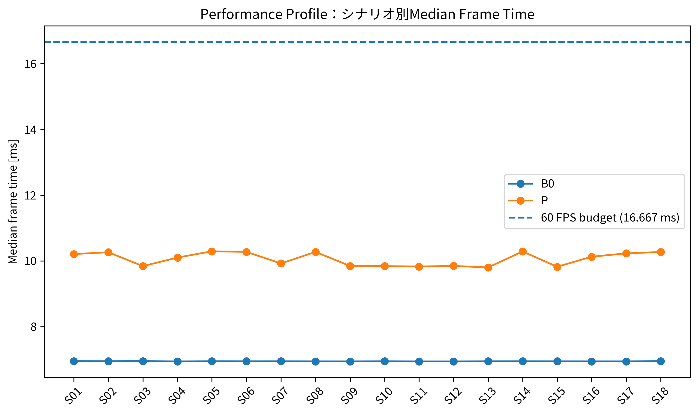
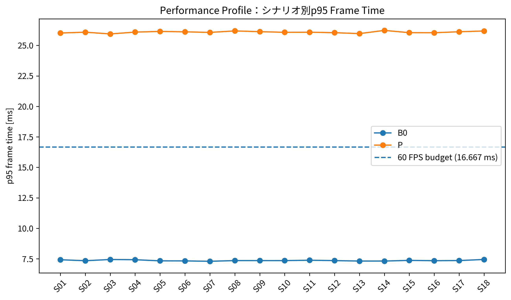
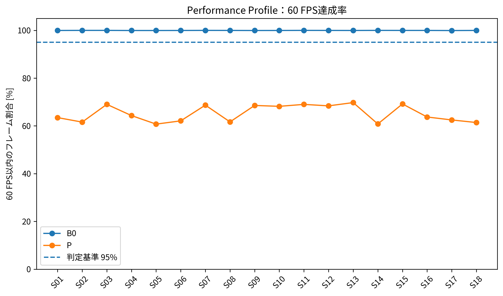
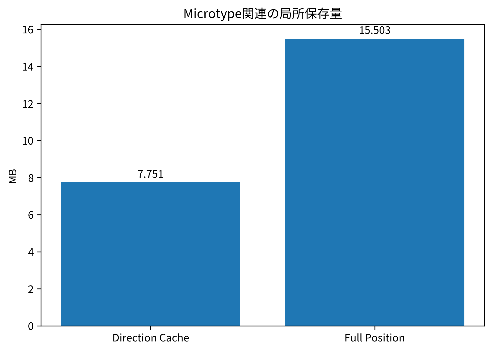
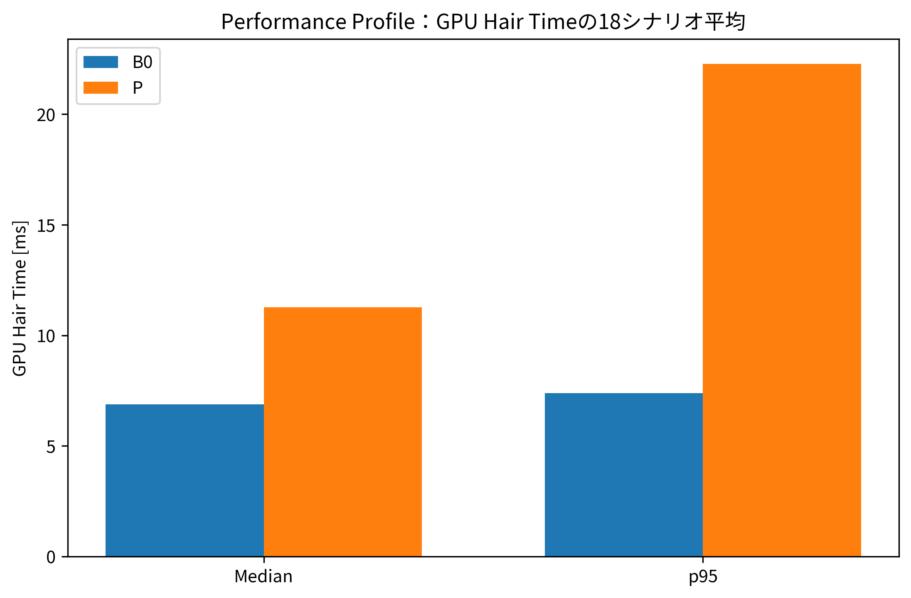
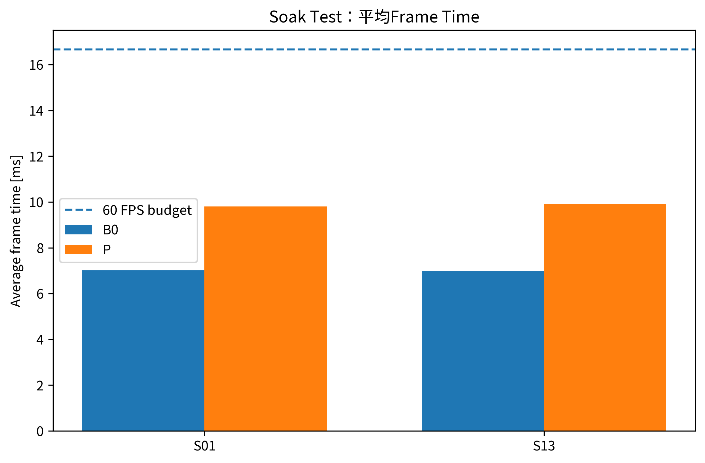
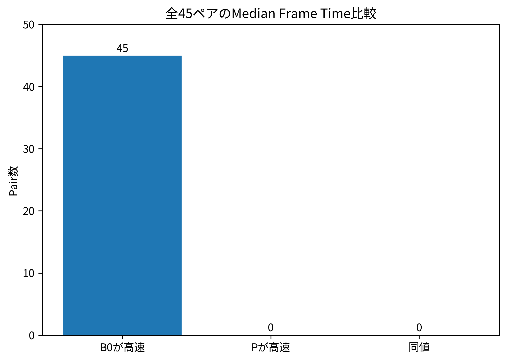

# 第7章　結果

## 7.1 実験条件

正式評価では合計90 runを実施し、B0とPをそれぞれ45 run測定した。内訳はPilot 10 run、Quality 36 run、Performance 36 run、Determinism 4 run、Soak 4 runである。PerformanceおよびQualityではS01からS18までの18シナリオを両方式で実行した。

すべての正式ProfileでScenario Input Parity Issueは0件であり、thesis_statistical_report.jsonに記録されたFatal Integrity Issueも0件であった。Determinism Outcome Issueも0件である。一方、性能基準やハードウェア変動などを含むQuality Outcome Issueは139件記録された。したがって、以下では「データ取得が正式に完了したこと」と「提案方式が性能目標を達成したこと」を分けて示す。
**表7-1　正式Profile別測定数**

| Profile     |   Runs |   Warm-up |   Measurement/Run |   Total measured |
|:------------|-------:|----------:|------------------:|-----------------:|
| Pilot       |     10 |       300 |              1800 |            18000 |
| Quality     |     36 |       600 |              6000 |           216000 |
| Performance |     36 |       600 |              6000 |           216000 |
| Determinism |      4 |       600 |              6000 |            24000 |
| Soak        |      4 |       600 |            108000 |           432000 |

## 7.2 メモリ使用量の結果

Performance Profileの18シナリオについてPeak Memoryを平均すると、Peak Process Private MemoryはB0が8171.34 MiB、Pが10626.38 MiBであり、Pは30.0%増加した。Peak Working SetはB0 2809.98 MiB、P 4751.31 MiBであり、69.1%増加した。Peak DXGI Local UsageもB0 4468.49 MiBに対してP 4856.46 MiBであり、8.7%増加した。

18シナリオの最大Peak Process Private MemoryはB0で8235.96 MiB、Pで11102.36 MiBであった。したがって、本正式Performance測定ではPによるシステム全体のメモリ削減は確認できなかった。

一方、P内部のMicrotype関連指標ではDirection Cache Memoryが7.751465 MB、Full Position Memoryが15.502930 MB、Memory Saving Rateが0.500であった。局所データ表現では50%の削減が記録されているが、この局所削減はプロセス全体の使用量削減には結び付かなかった。
**表7-2　Performance Profileのメモリ集計**

| 方式   |   Peak Private平均[MiB] |   Peak Working Set平均[MiB] |   Peak DXGI Local平均[MiB] |   Peak Private最大[MiB] |
|:-------|------------------------:|----------------------------:|---------------------------:|------------------------:|
| B0     |                 8171.34 |                     2809.98 |                    4468.49 |                 8235.96 |
| P      |                10626.4  |                     4751.31 |                    4856.46 |                11102.4  |

**図7-1　Performance Profileのメモリ使用量比較。** 18シナリオのPeak値を方式別に平均した。

## 7.3 フレーム時間の結果

Performance Profileの18シナリオでMedian Frame Timeを平均すると、B0は6.9432 ms、Pは10.0587 msであった。PはB0に対して44.9%増加した。Average Frame TimeはB0 6.9958 ms、P 13.2884 msであり、89.9%増加した。

p95 Frame Timeの18シナリオ平均はB0 7.3659 ms、P 26.0901 msであった。Pは約254.2%増加し、16.6667 msの60 FPS予算を全18シナリオで上回った。

60 FPS以内に収まったフレーム割合の18シナリオ平均はB0 99.959%、P 65.168%であった。Frame Budget Overrun RateはB0 0.041%、P 34.832%である。Pでは全18シナリオで60 FPS Ratio、Frame Budget Overrun Rate、p95、p99の主要4基準が未達となった。

以上より、Performance ProfileではPによる高速化は確認できず、すべてのシナリオでMedian Frame TimeがB0より長くなった。
**表7-3　18シナリオのフレーム時間と60 FPS達成率**

| Scenario   |   B0 Median[ms] |   P Median[ms] |   B0 p95[ms] |   P p95[ms] |   B0 ≤16.667ms[%] |   P ≤16.667ms[%] |
|:-----------|----------------:|---------------:|-------------:|------------:|------------------:|-----------------:|
| S01        |          6.9459 |        10.2064 |       7.4266 |     26.0191 |             99.95 |            63.47 |
| S02        |          6.9446 |        10.2629 |       7.3466 |     26.088  |             99.98 |            61.58 |
| S03        |          6.9467 |         9.8391 |       7.445  |     25.9433 |             99.98 |            69.02 |
| S04        |          6.9407 |        10.0999 |       7.428  |     26.0952 |             99.93 |            64.32 |
| S05        |          6.9443 |        10.2914 |       7.3363 |     26.1502 |             99.93 |            60.73 |
| S06        |          6.9432 |        10.2728 |       7.3302 |     26.1164 |             99.95 |            62.1  |
| S07        |          6.9434 |         9.9215 |       7.2999 |     26.0707 |             99.98 |            68.68 |
| S08        |          6.942  |        10.2723 |       7.357  |     26.1913 |             99.97 |            61.67 |
| S09        |          6.9413 |         9.8455 |       7.3551 |     26.1306 |             99.93 |            68.55 |
| S10        |          6.9436 |         9.8403 |       7.3543 |     26.0775 |             99.95 |            68.18 |
| S11        |          6.9408 |         9.8288 |       7.387  |     26.0869 |             99.98 |            69    |
| S12        |          6.9407 |         9.8462 |       7.3552 |     26.0475 |             99.97 |            68.38 |
| S13        |          6.9431 |         9.799  |       7.3183 |     25.9711 |             99.95 |            69.75 |
| S14        |          6.9437 |        10.2853 |       7.3194 |     26.2342 |             99.98 |            60.8  |
| S15        |          6.9428 |         9.8202 |       7.3723 |     26.0476 |             99.97 |            69.18 |
| S16        |          6.942  |        10.1261 |       7.3476 |     26.0436 |             99.97 |            63.72 |
| S17        |          6.9417 |        10.2289 |       7.3604 |     26.1235 |             99.92 |            62.48 |
| S18        |          6.9462 |        10.2701 |       7.4477 |     26.1849 |             99.97 |            61.4  |

**図7-2　18シナリオのMedian Frame Time。** 破線は60 FPSの16.6667 ms予算である。

**図7-3　18シナリオのp95 Frame Time。** Pは全18シナリオで16.6667 msを超過した。

**図7-4　60 FPS達成率。** 各フレームが16.6667 ms以内に収まった割合を示す。

## 7.4 Microtypeの結果

P条件ではenableMicrotypeがONであった。Direction Cache Memoryは7.751465 MB、Full Position Memoryは15.502930 MBであり、directionCacheMemorySavingRateは0.500であった。したがって、Microtypeが対象とする局所保存表現については50%の削減が記録された。

しかし、Performance ProfileのP条件108,000フレームにおいてmicrotypeDecodedCount、safeDecodeCount、falseSafeCountの最大値はいずれも0であった。またmicrotypeBlockHierarchyEnabledは0であった。さらに、dirtyBlockCountは毎フレーム16,000でTotal Block数と一致し、dirtyGroupCountも毎フレーム508,000でTotal Segment Group数と一致した。staticReuseAttemptCountは0であった。

Quality ProfileではFalse Static Countは全108,000 frameで0であった。Novelty telemetry上のPosition RMSEの非ゼロ値中央値は0.008015 mm、最大RMSEは0.105774 mm、Position Max Errorの最大値は7.93073 mmであった。ただし、これらは統合P条件の品質値であり、Microtypeだけを有効にした単体条件ではない。

以上から、局所保存量の削減は確認できた一方、正式測定中にMicrotype Decode経路が利用されたことを示すカウンタは得られなかった。

**図7-5　Microtypeの局所保存量。** Direction CacheとFull Positionの記録値を比較する。

## 7.5 Mode Allocationの結果

Performance ProfileではmodeSkipCount、modeQSOnlyCount、modeDynamicCount、modeIslandCount、modeRepairCount、modeFloatFallbackCountの最大値はいずれも0であった。一方、Novelty telemetryのused_full_dynamicは測定対象行で100.0%であり、Performance測定ではFull Dynamic経路が継続して使用された。

1フレーム当たりのtotalSegmentGroupCountは508,000であり、dynamicGroupCountの平均は507914.44であった。全Groupの約99.983%がDynamicとして記録されたことになる。staticCachedGroupCountおよびstaticTransformedGroupCountは全測定フレームで0であり、Static Cacheによる処理省略は確認できなかった。

stateTransitionCountは1フレーム当たり平均507925.83、stateOscillationCountも平均507925.83であった。S14 AllDynamicのMedian Frame TimeはB0 6.9437 ms、P 10.2853 ms、S15 AllStaticでもB0 6.9428 ms、P 9.8202 msであった。

したがって、正式Performance測定ではMode AllocationによってStatic側へ処理を逃がし計算量を削減する状態を確認できなかった。

## 7.6 Physics Islandsの結果

正式P条件ではenablePhysicsIslands=falseであった。Performance Profileの108,000フレームにおいてislandCount、islandMemberCount、islandCandidateCount、islandCommitCount、islandRejectCountの最大値はいずれも0であった。一方、physicsFallbackCountは平均1.000であり、各フレームでFallbackが記録された。

このため、本データからPhysics Islandsの性能向上または性能低下を判断することはできない。正確には、正式測定でPhysics Islandsを有効化した単体条件が存在せず、Physics Islandsの評価が成立していない。

## 7.7 Rod Repairの結果

正式P条件ではenableRodRepair=falseであった。typedRepairRequestCount、floatFallbackRequestCount、repairCommitCount、repairRejectCount、repairDeferCountの最大値はいずれも0である。

一方、P条件ではGeneric Repairに相当するenableRepairがONであり、Performance ProfileのrepairTaskCountは1フレーム当たり平均85.56、最小83、最大89であった。repairAttemptCountとrepairSuccessCountも同程度で、repairFailureCountの最大値は0であった。ただしrepairVerifiedCountも0であり、Success Countを独立検証済みの物理修復成功件数とは解釈できない。

Repair Stormを入力するS13では、Median Frame TimeがB0 6.9431 ms、P 9.7991 ms、p95がB0 7.3183 ms、P 25.9711 msであった。しかしRod Repair自体がOFFであるため、この差をRod Repair固有の性能結果として扱うことはできない。

## 7.8 GPU-Resident Runtimeの結果

P条件ではenableGpuResident=trueであった。しかしPerformance Profileの108,000フレームでgpuResidentTaskCount、riskyCompactionCount、dispatchIndirectCount、drawIndirectCount、delayedTelemetryReadCountの最大値はいずれも0であった。したがって、設定上GPU-Residentが有効であることは確認できるが、専用TaskやIndirect Dispatchが実際に使用された証拠は得られなかった。

GPU Hair TimeのMedianを18シナリオで平均するとB0 6.8720 ms、P 11.2670 msであり、Pは64.0%増加した。p95平均もB0 7.3836 ms、P 22.2815 msであり、201.8%増加した。

またDXGI Local UsageもPで増加したため、本正式測定ではGPU-Resident RuntimeによるGPU処理時間およびGPUメモリ使用量の削減を確認できなかった。

**図7-6　GPU Hair Timeの比較。** Performance 18シナリオのMedianおよびp95平均を示す。

## 7.9 統合システムの結果

P条件を含む全90 runでNaN State Count、Infinite State Count、Fatal Failureは0であり、Fatal Integrity Issueも0件であった。Determinism ProfileでもdeterminismIssuesは0件である。したがって、正式測定の範囲では致命的な数値破綻や異常終了を起こさず実行を完了した。

一方、thesis_paired_b0_p.csvに含まれる全45ペアのMedian Frame Timeを比較すると、B0が高速であったペアが45、Pが高速であったペアが0、同値が0であった。Pilot、Quality、Performance、Determinism、SoakのいずれのProfileでも、PがB0より高速となった対応ペアは存在しなかった。

Soak TestではS01のAverage Frame TimeがB0 7.0077 ms、P 9.7996 ms、S13ではB0 6.9864 ms、P 9.9097 msであった。Peak Process Private MemoryもS01でB0 8251.57 MiB、P 11973.68 MiB、S13でB0 8237.67 MiB、P 12063.28 MiBとなった。

Process Private Memoryの傾きはB0がS01 -0.73 MiB/min、S13 -0.63 MiB/minであったのに対し、PはS01 +4.91 MiB/min、S13 +4.65 MiB/minであった。長時間測定でもPの高速化やメモリ削減は確認されなかった。
**表7-4　Soak Test結果**

| 方式   | Scenario   |   Average Frame[ms] |   p95[ms] |   Max[ms] |   >100ms Frames |   Peak Private[MiB] |   Private Slope[MiB/min] |   Peak DXGI Local[MiB] |
|:-------|:-----------|--------------------:|----------:|----------:|----------------:|--------------------:|-------------------------:|-----------------------:|
| B0     | S01        |               7.008 |     7.541 |   153.518 |               3 |             8251.57 |                   -0.73  |                4468.51 |
| P      | S01        |               9.8   |    14.124 |   160.379 |               1 |            11973.7  |                    4.909 |                5647.16 |
| P      | S13        |               9.91  |    14.085 |   104.07  |               1 |            12063.3  |                    4.647 |                5647.14 |
| B0     | S13        |               6.986 |     7.555 |   161.319 |               2 |             8237.67 |                   -0.632 |                4468.5  |

**図7-7　Soak TestのAverage Frame Time。** S01とS13の長時間測定を比較する。

**図7-8　全45ペアのMedian Frame Time比較。** B0高速45、P高速0、同値0であった。

## 7.10 アブレーション結果

正式データのtopLevelNoveltyMaskを確認すると、PerformanceおよびQualityのP条件では全測定フレームで17が記録されている。一方、B0は提案機構を無効化した独立経路である。正式セッションのComparison MethodsはB0とPの2種類のみであり、PからMicrotypeだけを除外した条件、GPU-Residentだけを除外した条件などの1要素ずつ異なる正式比較ケースは存在しなかった。

また、P条件そのものでもPhysics IslandsとRod RepairはOFFであり、Microtype Decode、Mode系カウンタ、GPU-Resident TaskおよびIndirect Dispatchには実行を示すカウントがなかった。

したがって、本正式実験では5要素それぞれの寄与を因果的に分離するアブレーション評価は成立しなかった。B0とPの統合差は測定できるが、どの要素が何msの増減を生じさせたかを本データだけから決定することはできない。
**表7-5　5構成要素の正式測定成立状況**

| 要素                 | P設定          | 実行証拠                                                | 評価                                          |
|:---------------------|:---------------|:--------------------------------------------------------|:----------------------------------------------|
| Microtype            | ON             | microtypeDecodedCount max=0                             | 局所メモリ表現は50%だがDecode実行は確認できず |
| Mode Allocation      | 関連状態管理ON | mode系カウンタ max=0、Full Dynamic=100.0%               | 処理削減経路を確認できず                      |
| Physics Islands      | OFF            | islandCandidateCount max=0                              | 正式評価未成立                                |
| Rod Repair           | OFF            | typedRepairRequestCount max=0                           | Rod Repair単体評価未成立                      |
| GPU-Resident Runtime | ON             | gpuResidentTaskCount max=0, dispatchIndirectCount max=0 | 専用実行経路を確認できず                      |

---

### 本章のデータ出典

本章の全図表は同フォルダの `README.md` およびルートの `SOURCE_MANIFEST.csv` から元ZIP内部ファイルへ追跡できる。
